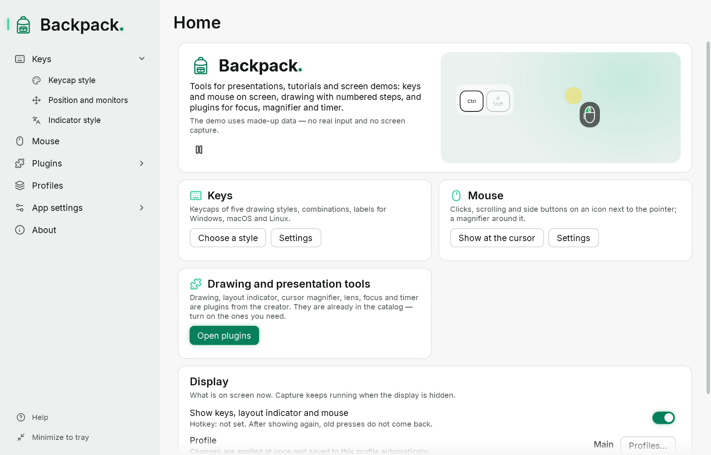
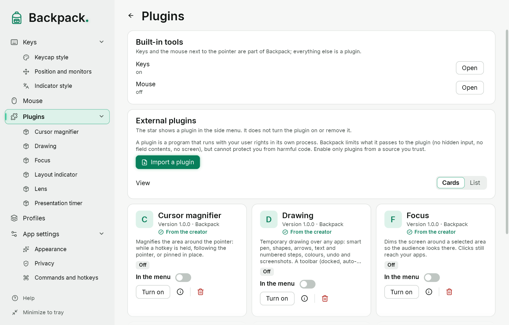

# Backpack

Backpack is a toolkit for clear presentations, tutorial videos and screen demos on Windows 10 and 11 (x64): it shows the
keys and mouse buttons you press, and its plugins add drawing, a magnifier, focus and a timer. It was called KeyOverlay
before.



## The core

- **Keys**: keycaps in six renderers (low profile, laptop, PBT, minimal, volumetric and the brand **Backpack Neon Emerald**
  preset), combinations, a second label for another keyboard layout, labels for Windows, macOS and Linux keyboards; on the
  primary monitor, a selected one, several, or the one under the pointer.
- **Mouse**: clicks, side buttons and scroll direction on an icon next to the pointer and in the keycap row.
- **Dynamic privacy**: input is hidden while the focus is in a field that reports itself as a password field (UI
  Automation `IsPassword`) or in apps you list. Windows has no universal way to recognize password fields — see the help.
- **Commands and hotkeys** for every action; **profiles and styles**; themes (Emerald, Classic, Sapphire, Amber; light,
  dark, Neon); built-in help.
- **Plugins**: `.bppkg` packages run in their own process and only after you confirm trust; Backpack draws their
  windows, so a plugin never receives screen images, drawings or text you type.

## The six plugins from the creator

They ship with Backpack turned off (Plugins → turn on) and are also the SDK samples (`lab/samples`).

| Plugin | What it does |
|---|---|
| **Drawing** | temporary drawing over any app: smart pen that recognizes lines, rectangles, ellipses, polygons, **arcs** and **angles** (with the angle in degrees while you draw), shapes with Shift/Alt, arrows, text, numbered steps, select / resize / rotate, undo and screenshots |
| **Layout indicator** | shows the keyboard layout when it changes |
| **Lens** | a live movable magnifier of a chosen area |
| **Focus** | dims everything except the area you choose |
| **Cursor magnifier** | magnifies the area around the pointer while a hotkey is held, following the pointer, or pinned |
| **Presentation timer** | a countdown panel for talks |

## Languages

The interface is available in English, Ukrainian, German, French, Spanish, Italian, Portuguese, Dutch, Polish, Czech,
Hungarian, Romanian, Swedish, Danish, Norwegian Bokmål, Finnish, Lithuanian, Greek and Russian. The built-in help is in
English, Ukrainian and Russian; in the other languages it shows the English text with a notice.

## Privacy

Key presses are shown on screen and kept only in memory. Settings, profiles and diagnostics contain no typed text, key
codes, key sequences, pointer positions or screen content. Backpack needs no administrator rights, does not inject input,
and never downloads or runs updates by itself. Plugins are programs: turn on only plugins you trust
([ADR-0001](docs/plugins/ADR-0001-plugin-trust.md)).

## Run

1. Download `Backpack-0.4.0-preview.6-win-x64.zip` from [the preview.6 release](https://github.com/soobshoob/Backpack/releases/tag/v0.4.0-preview.6) and check its SHA-256 against
   `SHA256SUMS.txt` attached to the same release. This is a **prerelease**, not a stable release.
2. Unpack it anywhere and run `Backpack.exe`. The .NET runtime is included; nothing else needs to be installed.
3. The package is **not digitally signed**, so Windows SmartScreen may show a warning.

Settings are kept in `%APPDATA%\Backpack`. For portable mode put an empty file `Backpack.portable` next to `Backpack.exe`.
Start without plugins: `Backpack.exe --no-plugins`.

## Build from source

Requirements: Windows 10/11 x64 and the .NET 10 SDK (tested with 10.0.401). PowerShell 7 for the packaging scripts.

```powershell
dotnet build lab/KeyOverlay.Lab.slnx -c Release
dotnet test  lab/KeyOverlay.Lab.slnx -c Release
dotnet run --project lab/src/KeyOverlay.Lab.App
```

Plugins build separately, for example
`dotnet build lab/samples/Drawing/Drawing.csproj -c Release`, and are packed by `tools/pack-plugin.ps1`.
`tools/package-release.ps1 -ReleaseDate <yyyy-mm-dd>` builds the portable package and `tools/verify-package.ps1 -Zip <zip>`
checks it. Future releases are built by GitHub Actions from a version tag; the first preview.6 release uses the owner's
verified local package ([RELEASING](docs/release/RELEASING.md)).
Internal project and namespace names still say `KeyOverlay`; only the product was renamed.

## Documentation



The illustrations show Backpack's own interface with demonstration data, without a capture of the author's desktop.

- Built-in help: [English](docs/help/en/README.md), [Ukrainian](docs/help/uk/README.md), [Russian](docs/help/ru/README.md)
- Plugin SDK and manifest: [docs/plugins/README.md](docs/plugins/README.md), [manifest schema](docs/plugins/backpack-plugin-manifest.schema.json)
- Plugin catalog (submit your plugin by pull request): [registry/README.md](registry/README.md)
- Settings formats: [docs/settings](docs/settings); release notes and licenses: [docs/release](docs/release)
- Phase reports: [lab/docs](lab/docs)

## Contributing and security

See [CONTRIBUTING.md](CONTRIBUTING.md). Report vulnerabilities privately as described in [SECURITY.md](SECURITY.md).

## License

The **Backpack core** is licensed under the [Mozilla Public License 2.0](https://www.mozilla.org/MPL/2.0/) from version
0.4.0-preview.6: [LICENSE](LICENSE), copyright notice in [NOTICE](NOTICE). Which files that covers is in
[LICENSING.md](LICENSING.md). Packages released earlier (up to 0.4.0-preview.5) were released under the PolyForm Strict
License 1.0.0 and keep those terms.

The **plugin SDK** (`lab/sdk`) and the **six plugins from the creator** (`lab/samples`) are not covered by the MPL: they
have their own `LICENSE` files and are under the PolyForm Strict License 1.0.0 until the owner decides on their terms
([proposal](docs/release/LICENSING-PROPOSAL.md)). Plugins by other authors have their own licenses. Third-party components
keep theirs: [THIRD-PARTY-NOTICES](docs/release/THIRD-PARTY-NOTICES.md).

Author: [soobshoob](https://github.com/soobshoob)
