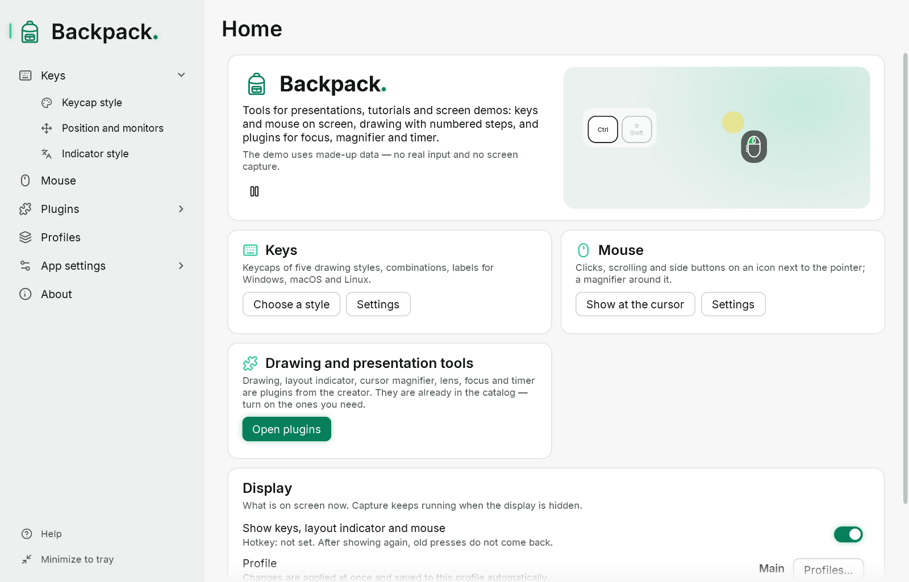

# Get started in a minute

You need Windows 10 or 11 (x64). Administrator rights are not needed. Unpack the Backpack folder anywhere you like and run `Backpack.exe`; nothing else has to be installed.

## What appears

- **The main window** — the “Home” page with the display switch, the active profile, quick switches and presentation tools.
- **The overlay** — a transparent strip at the bottom of the primary monitor. It never takes focus, lets clicks through to the windows below and is not shown on the taskbar or in Alt+Tab.
- **An icon in the notification area** of the taskbar. Windows may put it among the hidden icons (the ^ arrow).

## Five steps

1. Type a word quickly in any program: letters replace each other in the same place.
2. Press Ctrl+Shift+K: three keycaps appear — a combination.
3. Open “Keys” → “Keycap style” and click another style in the catalog: the preview and the overlay change at once. Settings are saved automatically.
4. Press Ctrl+Alt+Shift+O: the display hides; press again to show it. Capture keeps running.
5. Close the main window with ×: Backpack stays in the tray. Click the icon to open the main window again. To quit completely, choose “Exit Backpack” in the icon menu.

More about the windows and the icon: [Main window, tray, theme and language](02-interface.md). To keep a whole setup: [Profiles](07-profiles.md).

## Privacy in short

Backpack shows key presses on the screen and does not write them anywhere. If the overlay is visible on a stream, viewers also see what you type, including passwords. Before typing a password, hide the display with the hotkey or turn on “Combinations only”. More: [Diagnostics and privacy](09-diagnostics-and-privacy.md).
