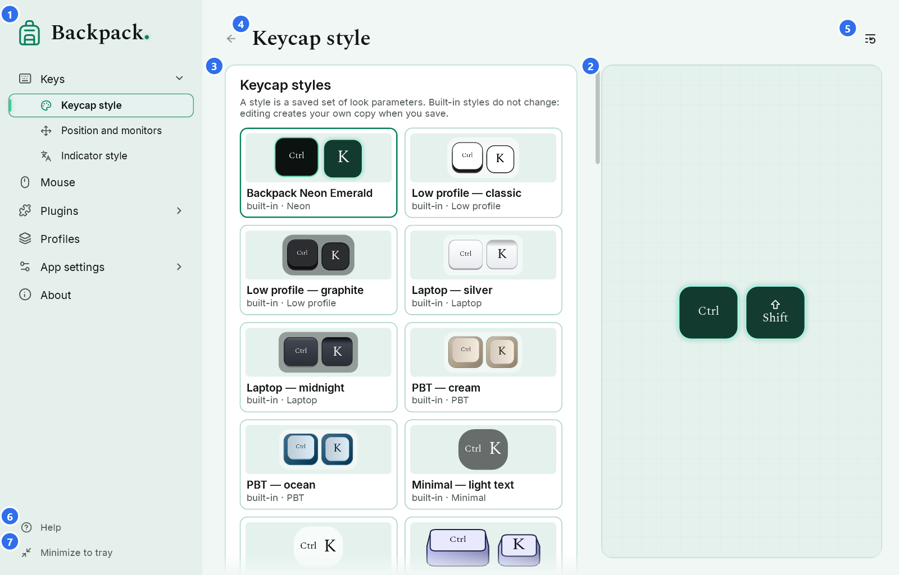
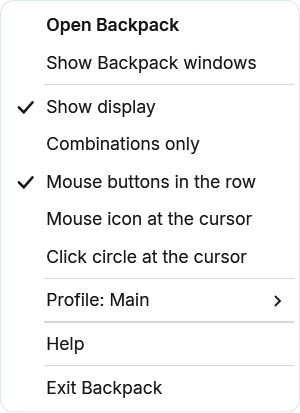
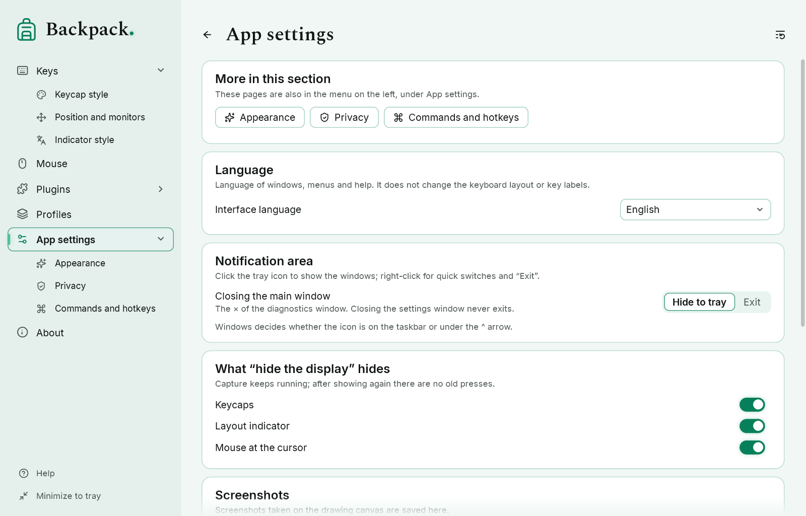

# Main window, tray, theme and language

## The main window

The navigation on the left: **Home**, **Keys** ▸ (Keycap style, Position and monitors), **Mouse** ▸ (Magnifier at the pointer), **Keyboard layout**, **Focus**, **Drawing**, favourite plugins, **Plugins** ▸, **Profiles**, **App settings** ▸ (Appearance, Privacy, Commands and hotkeys), **About**. **Help** is at the bottom of the menu. The arrow opens a group; the arrow left of the page title goes back. In a narrow window the menu shows only icons (hover for the name; the menu button at the top opens the full menu over the page). See [Appearance, navigation and fonts](17-appearance-navigation-fonts.md).

1. **Pages.** Opening a group or one of its pages expands it; the current page is highlighted.
2. **Preview.** An example of the selected page drawn by the same renderer as the overlay, on made-up data. In a wide window it is a column of fixed width on the right, as tall as the page area; in a narrow one it is a strip above the options. In both cases it stays in place: only the options scroll.
3. **Options.** Every change applies to the preview and the overlay at once; input capture is not restarted.
4. **Page title.** The name of the open page. Changes are saved to the current profile automatically; the profile is managed on the “Profiles” page.
5. **Reset section.** Restores the defaults of the open page only.
6. **Help.** The only way into the help from the menu: opens the help topic for the current page (F1 does the same). Inside the help — search and all topics.
7. **Minimize to tray.** Hides the Backpack windows; the overlay keeps working.

Number options have a slider and a box: type a number and press Enter. Decimals can be typed with a comma or a dot. Colors are typed as `#RRGGBB` or `#RRGGBBAA` (the last pair is opacity) or picked in the palette.

Settings are saved automatically half a second after a change and on exit.

## Home

“Home” opens when you click the Backpack logo above the menu (from the keyboard: Enter or Space while the logo has focus) and shows what is on screen now: the display switch (keycaps, layout indicator and mouse at the cursor), the active profile, quick switches, the drawing button, a link to the tool plugins and the most used pages. Technical counters and checks are on the “App settings” page.

## Three different actions: minimize, close, exit

| Action | What happens |
|---|---|
| Minimize to tray | Backpack windows are hidden; the overlay, mouse at the cursor, layout indicator and hotkeys keep working; the icon stays |
| × of the main window | by default the same as “Minimize to tray”; you can choose “Exit” on the “App settings” page |
| Exit | the program quits completely: overlay, icon, windows, hotkeys and input capture stop |

The first time windows go to the tray, Backpack explains where the icon is and how to exit. You can also choose “Exit instead” right there.

## The tray icon

- **Left click** — open the main window.
- **Right click** — the quick menu.

| Item | What it does |
|---|---|
| Open Backpack | brings hidden windows back and opens the main window |
| Show or hide the display | hides or shows the display (what exactly — “App settings” page); presses and releases are still tracked, so no keys get “stuck” when it comes back |
| Combinations only | the same switch as on “Keys” |
| Mouse buttons in the row | mouse buttons among the keycaps |
| Mouse icon, click circle and cursor highlight | parts of the “Mouse at the cursor” mode |
| Layout indicator | turns the indicator on and off |
| Plugins | commands of the plugins that are on (magnifier, lens, focus, timer) |
| Drawing | the same command as on the page and in hotkeys |
| Profile: … | switch profiles; changes of the current profile are already saved |
| Help | this help |
| Exit Backpack | quit completely |

Check marks in the menu always show the current state. If the main window is open, it shows a change made from the menu at once, and the other way round.

Windows decides whether the icon is on the taskbar or among the hidden icons. You can drag it to the taskbar or set it in the taskbar settings. To start Backpack when you sign in to Windows, turn on “App settings” → “Start with Windows”: Backpack then starts in the tray, without the main window. It needs no administrator rights and also works for the portable version (the entry points to where `Backpack.exe` is now). The switch shows the real state: if the entry belongs to another copy or was turned off in the Windows list of startup apps, a note under it says so. Starting Backpack again while it is running opens the window of the running copy instead of a second one.

## Interface theme

“App settings” → “Appearance”: colours (Backpack Emerald, Classic, Sapphire, Amber), **System**, **Light** or **Dark**, the window material and the accent glow. The theme applies at once to all open Backpack windows: main window, diagnostics, help, dialogs and the tray menu.

- The interface theme **does not change** the overlay: colors of keycaps, the layout indicator and the mouse at the cursor are set by their styles.
- “System” follows the Windows “app mode” setting and changes with it.
- File dialogs (import and export) are drawn by Windows: they follow the Windows theme and language, not the Backpack settings.

## Language

“App settings” → “Interface language”: **System** or one of 19 languages — English, Українська, Deutsch, Français, Español, Italiano, Português, Nederlands, Polski, Čeština, Magyar, Română, Svenska, Dansk, Norsk bokmål, Suomi, Lietuvių, Ελληνικά and Русский. “System” takes the Windows language; if Backpack does not have it, English is used.

- The language changes at once in all windows, menus and plugin pages, without a restart and without stopping capture.
- The help is written in English, Ukrainian and Russian. In the other languages the help window shows the English text and says so at the top.
- The interface language does not change the keyboard layout, keycap labels or profile contents.

Language, theme, tray behavior and hotkeys are settings of this computer: they are not part of profiles.

## Keys in Backpack windows

| Keys | Where | Action |
|---|---|---|
| F1 | any Backpack window | help about the current place |
| Tab / Shift+Tab | main window | move between controls; focus is shown with a frame |
| arrows | main window | choose an option, move a slider or palette marker |
| Enter | number box | apply the value |
| Esc | palette, help, dialogs | close |
| Alt+← / Alt+→ | help | back / forward |
| Alt+← | main window | back to the previous page |
| Ctrl+F | help | search |

These keys work only while a Backpack window is active. Global hotkeys (show/hide, Focus, drawing, radial menu) are described in [Commands, hotkeys and drawing](12-hotkeys-lens-drawing.md).
