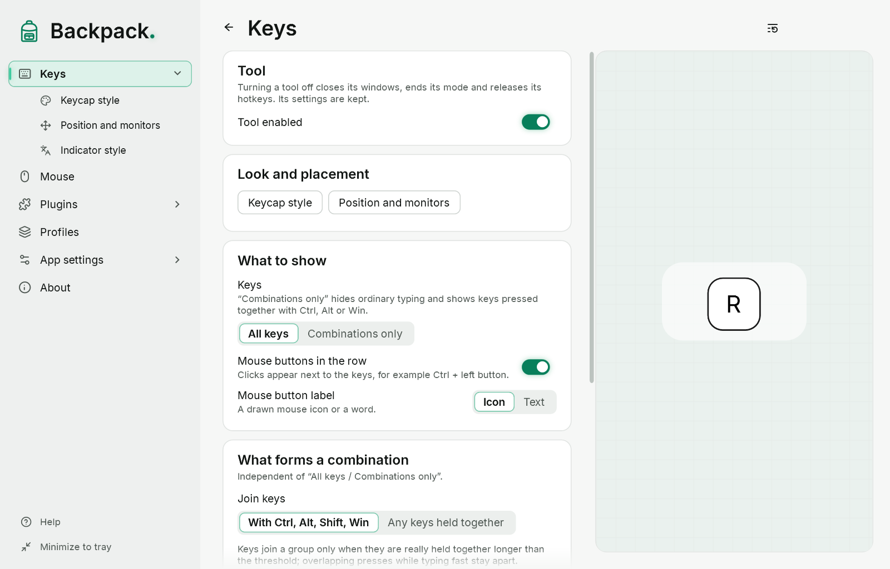
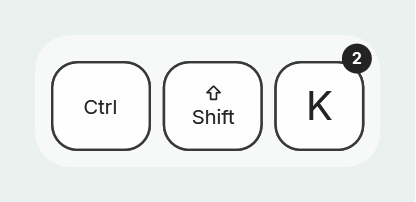
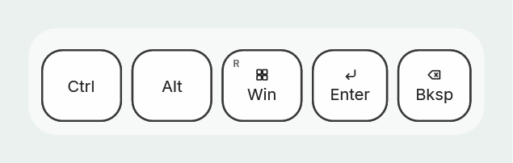
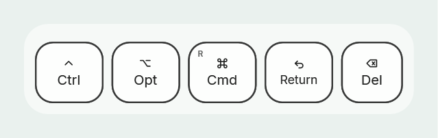
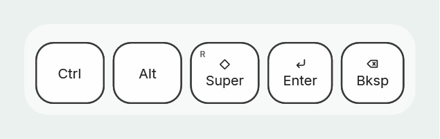

# Keys, combinations and labels

The “Keys” and “Keycap style” pages of settings.

## What the overlay shows

| Look | Meaning |
|---|---|
| top face pressed down | the key is held |
| dark strip visible at the bottom | the key was released; it disappears after the linger time (5 s by default) |
| dimmed label and “?” | the key state is unknown, for example after locking the computer |
| small “R” or “num” mark | a right-hand modifier or a numeric keypad key |
| circle with a number | the key was pressed several times while the combination was held |

## Calm typing or a trail

The “Trail” option on the “Keys” page.

- **Calm** (default): each new letter takes the place of the previous one; the row does not grow or jitter. While the group is on screen, its width does not shrink.
- **Fading trail**: released letters stay next to new ones for a moment and fade in place.

[Show example: calm](demo:trail-none) · [Show example: trail](demo:trail-fade)

**Linger after release** (5000 ms by default, 0 to 20,000) — how long the last keys stay on screen. The `--linger-ms` start option overrides it for one run.

## Combinations only

The “Keys” option: **All keys** or **Combinations only**. With “Combinations only”, ordinary typing and single modifiers are hidden, while combinations with Ctrl, Alt, Win or Shift are shown.

[Show example: combinations only](demo:combos)

- A held modifier counts: press Ctrl, then S — “Ctrl S” appears.
- Ctrl with a mouse button is a combination too, if mouse buttons are shown in the row.
- The filter changes only what is shown: presses and releases are still tracked.
- A key joins a combination only if a modifier is held when it is pressed; quick overlapping letters are not a combination.

## Key labels

“Keycap style” → “Key labels”.

| Option | Choices |
|---|---|
| Label set | Windows, macOS, Linux — names as on keyboards for these systems |
| Label style | Mixed (symbol and name), Symbols, Text |
| Left/right markers | “R” and “num” marks in the corner |
| Press counter | a number in the corner when a key repeats inside a combination |

[Show example: labels and counter](demo:labels)

The label set changes only the text on the keycaps. The keyboard layout and what programs receive stay the same. Labels follow the US English layout and do not depend on the interface language. Key symbols are drawn by the program itself; ⊞ is a neutral grid, not a logo.

## Keycap, colors and animation

| Option | Default |
|---|---|
| Size | 32 (8 to 128); keycap height is 2.5 × size |
| Rounding | 0.5 (0 to 1) |
| Colors | white face, side #1A1A1A, black label, outline 2 #1A1A1A, white row background at 60 % |
| Appear and disappear | smooth, 250 ms; or no animation |
| Press animation | on: the face moves down in 100 ms |

Mouse buttons in the row: the “Mouse buttons in the row” and “Mouse button label” (icon or text) options. Mouse at the cursor is a separate mode, see [Mouse](04-mouse.md).

## Any keys held together

“Keys” → “What forms a combination”: **With Ctrl, Alt, Shift, Win** (the default) or **Any keys held together**. It works together with “All keys / Combinations only”.

- With “Any keys held together”, A+B and other combinations without modifiers are shown as one group.
- Keys count as simultaneous only while they are really held down together. A released key that is still visible does not join; a key in the “?” state does not join either.
- Holding a key (auto-repeat) does not add a second keycap.
- The **simultaneity threshold** (150 ms by default) tells a combination from fast typing. Keys join only if the first one is held at least this long, or both are still held after it. When typing fast, the first key is released earlier — no group. 0 means no threshold (the old way: any overlap forms a group).
- Switching the option does not bring back old presses.

Backpack shows only what the keyboard and Windows report to programs. Some combinations are handled by Windows or other programs before Backpack sees them, and some keyboards cannot report certain combinations at all. See [What to do if…](08-troubleshooting.md).
