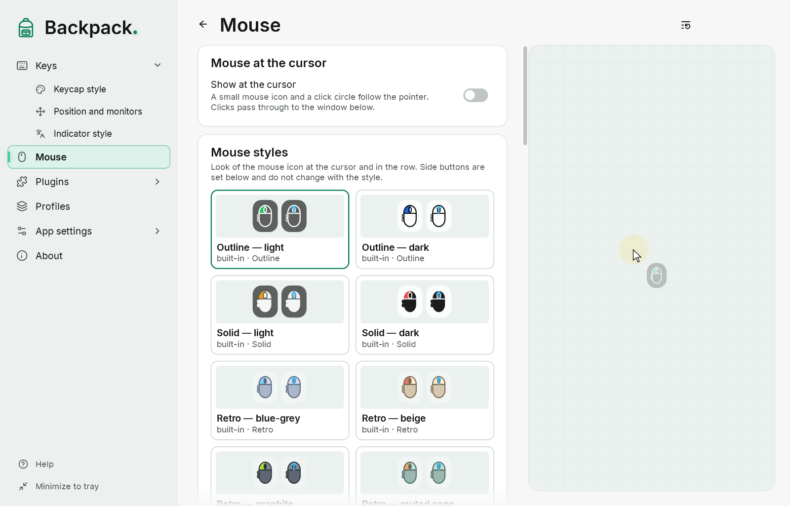
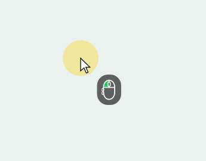
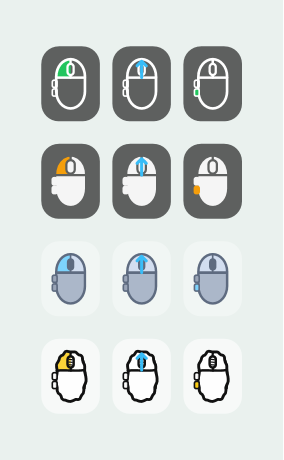

# Mouse

The mouse can be shown in two independent ways:

- **in the keycap row** — buttons as keycaps next to the keys; turned on on the “Keys” page;
- **at the cursor** — a mouse icon, a click circle and a cursor highlight follow the pointer; the “Mouse” section.

## Mouse at the cursor

[Show example](demo:mouse-cursor)

| Option | Default |
|---|---|
| Show at the cursor | off |
| Icon | on; size 30; offset 22 right and 22 down from the pointer tip |
| Icon colors | white outline, black fill at 60 %, pressed button green |
| Click circle | on, appears while a button is pressed; diameter 48; yellow at 35 % |
| Cursor highlight | off; a soft glow that always follows the pointer, 72 DIP |

- The pressed button is highlighted on the icon. Left, right and middle are on the body; “back” and “forward” stick out at the side.
- An unknown button state (for example, after locking) is drawn dashed.
- The window at the cursor never takes focus and lets clicks and dragging through. It follows the pointer on any monitor.
- The pointer position and presses are never saved.

The tray icon menu has quick switches for the icon, the click circle and the cursor highlight. If all parts are off, the “Mouse at the cursor” mode turns off entirely.

Before version 0.4.0-preview.2 the click circle was visible all the time. Now it appears on a press; an enabled always-visible circle was moved to the cursor highlight with the same colour and size, so the look does not change silently.

## Mouse styles

Four ways of drawing the icon, each with ready palettes: **outline**, **solid**, **retro** (blue-grey, beige, graphite, muted sage) and **sketch**. Choose a tile in the “Mouse styles” catalog; save your own the same way as keycap styles ([Styles](11-styles.md)).

Pressing changes only its own part of the icon: the left or right button, the wheel or a side button — not the whole body.

## Side buttons

“Side buttons”: **Hidden**, **One** or **Two**, on the **left** or **right** side. Set it to match your mouse: the number of buttons is not detected automatically. Backpack distinguishes the left, right and middle buttons and X1 (back) and X2 (forward). Extra buttons are often remapped by the mouse driver and do not arrive as separate buttons.

## Scrolling

While the wheel turns, a short arrow in the wheel area shows the actual direction: up, down, and left/right if the mouse reports horizontal scrolling. The arrow color and how long it stays are set in “Scrolling”.

- Scrolling and pressing the middle button are different events: the wheel highlight means a press, the arrow means scrolling.
- Small steps of smooth-scrolling wheels are shown too.
- The arrow is shown on the icon at the cursor; the keycap row does not show scrolling.
