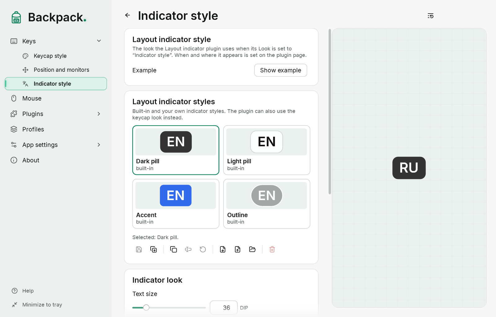

# Layout indicator

When the input language of the active window of another program changes, its code appears for a moment: “EN”, “UK”, “RU” and so on. Since Backpack 0.4.0-preview.5 the indicator is a **plugin from the creator**: it is already in the catalog (“Plugins”), turned off; turn it on there (the first time Backpack asks you to confirm trust). When you update from an earlier version, your settings and hotkey move to the plugin, and it stays off until you turn it on.

[Show example](demo:layout-indicator)

## How it works

- Backpack itself watches the language of the focused window (every 100 ms, only while a plugin that needs layout changes is on) and tells the plugin the code, the name and the reason: a switch in the same window or another window with another language. The plugin decides whether to show it and asks Backpack to draw the indicator. It receives no key presses.
- It does not matter how you switched the language: with a shortcut, with the mouse on the taskbar or by switching windows. Backpack does not guess from key presses.
- A change is accepted once the new value is seen twice in a row, so the indicator appears after about 0.1–0.3 s.
- One change, one display. At start, after unlocking and after waking from sleep the language is only remembered.
- Backpack’s own windows are ignored.

## Settings

On the plugin page (“Plugins” → “Layout indicator”, or its star item in the side menu):

| Option | Default |
|---|---|
| Shown for | 1.2 s (0.2 to 10 s), counted from the moment it appears |
| When switching to a window with another layout | show |
| Layout name under the code | yes |
| Appear and disappear | like keycaps; smooth; instant |
| Look | like keycaps; or the indicator style |
| Place | above the keys; or a screen point (9 choices) with an offset |

The **indicator style** (text size and colour, background, outline, rounding, the style catalog) is a Backpack style: “Keys” → “Indicator style” ([Styles](11-styles.md)). The monitors are chosen in “Position and monitors”. Commands: “Layout indicator: pause / resume” and “Layout indicator: show an example”. The indicator never takes focus and lets clicks through.

## If the indicator does not appear

1. Check that the “Layout indicator” plugin is on in “Plugins” and not paused.
2. Click “Show example” (“Indicator style” page): if the example is visible, display works.
3. While switching, look at the indicator status line in “App settings” → “Checks” or the “Layout” lines in the diagnostics window: they show the last decision — for example “no active window”, “layout unavailable” or “off” (no plugin needs layout changes).
4. If the indicator stays silent in one program but works in others, this is a known limitation: language detection in some programs has not been confirmed by a manual check yet.

## Limitations

- The IME mode (for example kana or Latin in Japanese) is not shown — only the language.
- If Windows has “Let me use a different input method for each app window” on, the language changes when you switch windows, and the indicator shows it.
- Language detection has not been confirmed by a manual check in every program. Not checked: Terminal and console, Microsoft Store apps, browsers, File Explorer, elevated windows.
- Backpack does not capture text and does not interfere with input or IME. Administrator rights are not needed.
