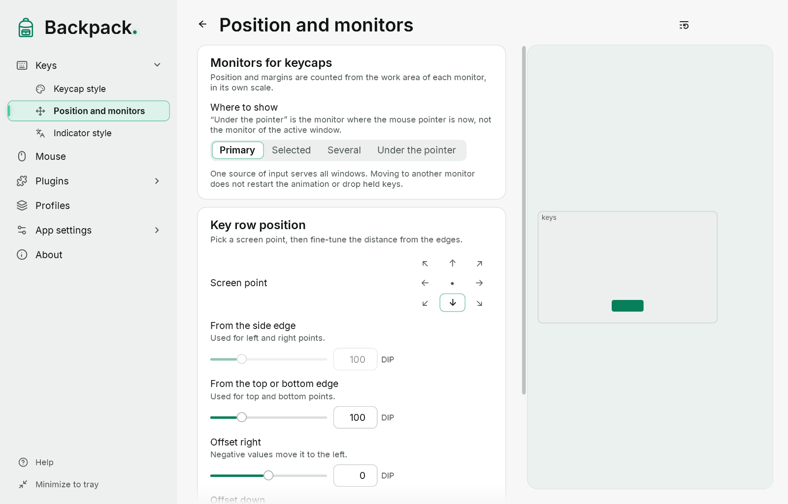

# Position on the screen

The “Keys” → “Position and monitors” page.

[Show example](demo:position)

| Option | Default | Meaning |
|---|---|---|
| Screen point | bottom center | which part of the screen the row sticks to; 9 choices |
| From the side edge | 100 | margin for left and right points |
| From the top or bottom edge | 100 | margin for top and bottom points |
| Offset right / down | 0 / 0 | shift from the point; negative is left / up |

- The diagram in the preview shows where the row will be on the primary monitor.
- The “Bottom center” button restores the default position.
- The row stays inside the work area above the taskbar, even with a large size and large offsets.
- The primary monitor is used.

If you load a profile saved on another computer with a different screen, margins and offsets that are too large are reduced so the row stays on screen. The profile file itself is not changed.
