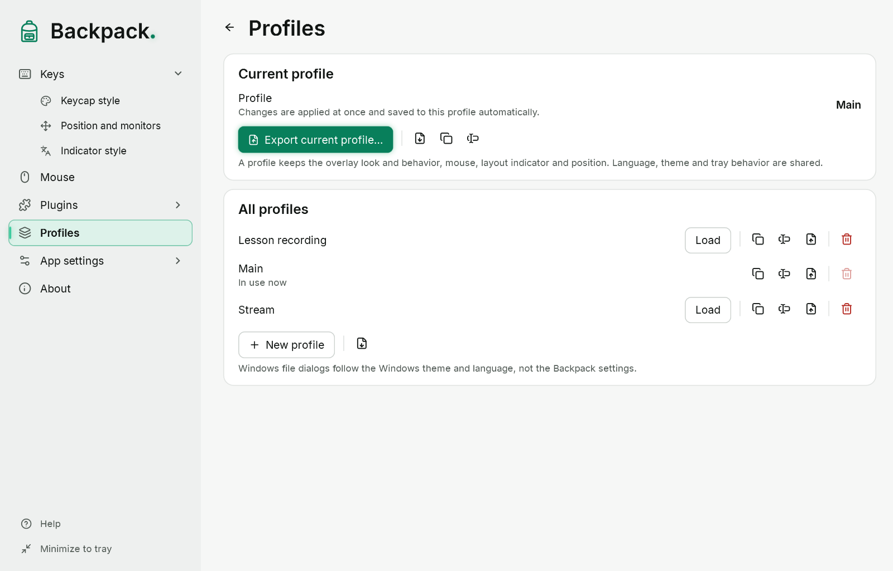

# Profiles

A profile is a complete saved overlay setup for a task: for example, “Lesson recording” with large keycaps and the mouse at the cursor, and “Stream” with “Combinations only”.

## What a profile contains

Everything that changes the overlay: keycap and label look, the filter, linger, trail, animations, the counter, mouse in the row and at the cursor, the layout indicator and the position.

**Not included:** interface language, interface theme, tray behavior and global hotkeys — these are settings of this computer. The capture source and lab start options are not included either. A profile contains no code, no window markup and no key history.

## Current profile and automatic saving

The current profile name is shown on the “Profiles” page and in the tray icon menu. Every change of a setting applies at once and is **saved to the current profile automatically** — there is no “Save” button and no “not saved” mark. Quick series of changes (for example, dragging a slider) are written together, at most twice a second; on switching profiles, exporting and exiting, waiting changes are written immediately.

- A number or colour that is still being typed is not saved: a value is accepted on Enter or when you leave the field, and an incomplete colour such as `#FF0` never reaches the profile.
- If a profile file cannot be written (the disk is full, the folder is read-only), the settings window shows “Changes could not be saved” with the reason and **Try again**. The changes stay applied and are not lost.
- A read-only profile file (a reference profile) is never overwritten: on the first change Backpack creates a working copy “… — my copy” and continues in it.

When Backpack 0.4.0-preview.3 starts for the first time, profiles saved by earlier versions are moved to the new model without losing anything: if the applied settings differed from the saved profile, the applied settings become the profile and the previously saved version stays as a separate profile (the start message names it).

## Create and switch profiles

1. Set up the overlay — the changes go to the current profile.
2. To start another setup, click “New profile” (defaults) or “Duplicate” (a copy of the current one), then “Load” in its row.
3. To switch, click “Load” in a profile row or choose it in the icon menu: “Profile: …”. Waiting changes of the current profile are written first; if that fails, the switch does not happen and the reason is shown.

## Other actions

| Button | Action |
|---|---|
| New profile | a profile with default values |
| Duplicate | a copy named “… — copy” |
| Rename | a new name; the file and id stay the same |
| Delete | after confirmation; the current profile cannot be deleted |
| Export current profile… | the current state of all profile settings, including changes made a moment ago |
| Export… | save a profile from the list to a `.keyoverlay-profile.json` file |
| Import… | add a profile from a file |

## Import and export

- An imported file is checked completely first: format, version, every field and range. If even one problem is found, nothing is added or changed, and Backpack shows the list of problems.
- An imported profile gets a new id, so it never replaces your profiles. After the import Backpack offers to load it.
- Position margins and offsets that are too large are reduced on loading, so the row is visible on this screen.
- Profiles are written through a temporary file: a failure while writing does not damage the previous file.
- File dialogs are Windows system dialogs: they follow the Windows theme and language.

Profiles are stored in the `profiles` folder next to the settings file (`%APPDATA%\Backpack\profiles\`). The format is described by `docs/settings/keyoverlay-lab-profile.schema.json`.

## Profiles and styles

A style is only the look of one element; a profile keeps a full copy of all look parameters, behavior and position ([Styles](11-styles.md)).

- Exporting a profile also writes the styles of your own that it uses. On import they are added to the catalog; if a style with the same identifier but other parameters already exists, the imported one gets a new identifier.
- Even if a style is missing on another computer, the profile keeps its look: the parameters are inside the profile.
