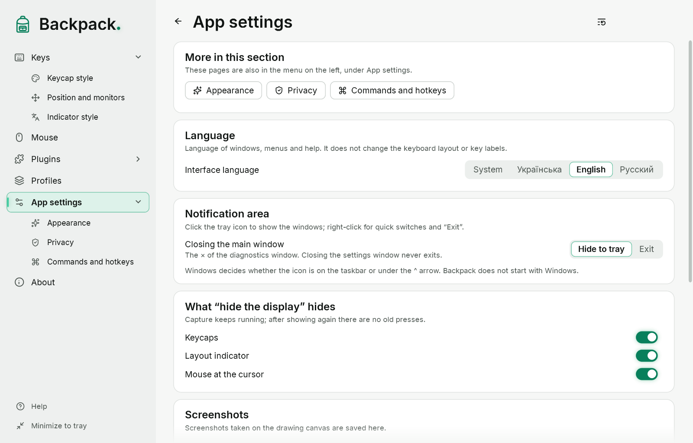

# Diagnostics and privacy

## The diagnostics window

Opens from “App settings” → “Checks” → “Diagnostics window” → “Open” (in the lab mode `--lab` it opens at start). It shows:

- the capture mode (Raw Input, LL hook or comparison) and the state of each source;
- counters of events, repeats, drops and resyncs; processing delays;
- findings — suspicions and confirmed failures;
- the overlay state (visible, on top of other windows);
- messages about loading settings;
- the “Layout” and “Mouse at the cursor” lines.

| Button | Action |
|---|---|
| Settings… | the settings window |
| Help (F1) | this help |
| Hide overlay / Show overlay | hides the overlay on purpose; capture continues |
| Export aggregated JSON… | a file with counters and delays only |
| Freeze UI for 3 s | an overload check; capture keeps working |
| Reset state | treats all keys as released |
| Minimize to tray | hides the Backpack windows |
| Exit | quit completely |

The manual check list is at the bottom; the button above it folds it away.

## What is stored on disk

| File | Contents |
|---|---|
| `settings.json` | current overlay options |
| `app.json` | language, interface theme, tray behavior, current profile, hotkeys, lens, drawing and update options |
| `profiles\*.json` | saved profiles |
| `styles\*.json` | your styles |
| diagnostics export | numbers, flags, finding codes and metric definitions only |

Key codes, typed text, key sequences, the pointer position, windows, titles and programs are never stored. There are no logs, memory dumps or network requests.

## Privacy on a stream

Backpack shows key presses to everyone who sees the screen. Before typing a password:

- hide the display with the hotkey or “Show display” in the icon menu; or
- turn on “Combinations only”.

While the overlay is hidden, presses and releases are still tracked, so no keys are “stuck” when it comes back.

## Known limitations

- Presses on the lock screen, in a UAC prompt and in Ctrl+Alt+Del are invisible to all programs.
- Whether Backpack sees input in programs run as administrator is still being checked.
- Full-screen games in exclusive mode can cover the overlay.
- The overlay is shown on the primary monitor.
- Layout detection has not been confirmed by a manual check in every program.

## Where the files are

The folder is `%APPDATA%\Backpack`. In portable mode (the file `Backpack.portable` next to `Backpack.exe`) it is the `Data` folder next to the program. On the first start Backpack copies settings and profiles from the previous `%APPDATA%\Backpack.Lab` folder and leaves the old files in place. The lens and drawing keep nothing on disk.
