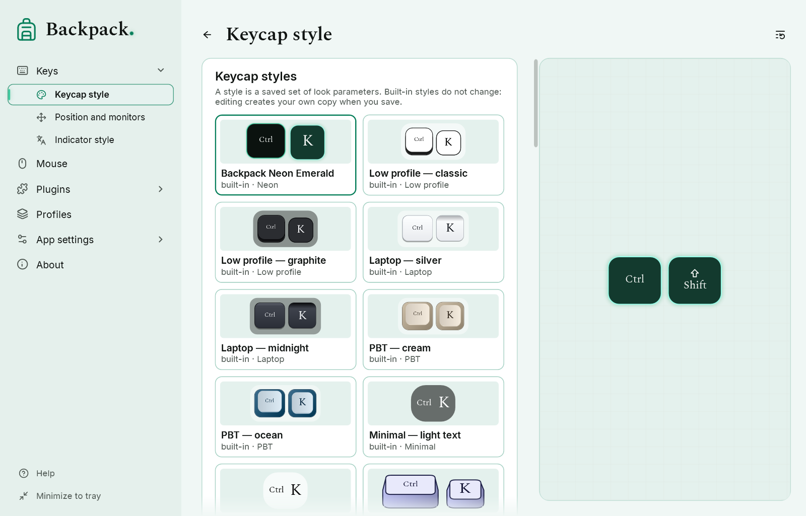
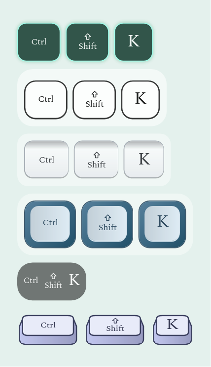

# Styles: keycaps, indicator, mouse

## Style, preset, renderer and profile

| Word | What it is |
|---|---|
| Renderer | the geometry and way of drawing, built into the program: low profile, laptop, PBT, minimal, 3D, neon for keycaps; outline, solid, retro, sketch, neon for the mouse |
| Preset | a built-in style: a renderer with ready colors and parameters. Built-in styles never change |
| Your style | a set of look parameters you saved; it lives in the styles folder |
| Profile | everything together: the look (a full copy of the parameters), behavior and position. See [Profiles](07-profiles.md) |

A style is only the look of one element. Size, labels, animation, filters and position stay in the profile.

## Choose a style

1. Open “Keys” → “Keycap style” (keycaps), “Mouse” or “Keys” → “Indicator style” (indicator).
2. Click a tile in the catalog. The preview and the overlay change at once.
3. The selected tile has an accent frame. The line under the catalog says which style is selected.

**Backpack Neon Emerald** is the style of a new installation: dark keycaps and mouse icon with a thin emerald line and a soft glow that gets stronger while a key or button is pressed. “Glow” on the style page sets its strength; 0 turns it off. If you used Backpack before, your styles stay as they were. “Reset section” returns this brand style.

The 3D renderer shows the key from the front and slightly above: the label stands upright on the top face, the front face and slanted sides are visible, and a press lowers the top face together with the label. Most keys are square; service keys and Space are compact long keys; Enter can be L-shaped (“L-shaped Enter” on the same page).

## Change and save

The style actions are one compact row of icons: **save**, **save as new** | **duplicate**, **rename**, **restore** | **import**, **export**, **open styles folder** | **delete** (kept apart). Every icon has a tooltip with its name (and the reason when it is unavailable); in a narrow window import, export and the folder move to the “…” menu, where they have names.

- Change any color or parameter: the status line shows “changed”.
- “Save style” saves into your own style. For a built-in style it asks for a name and creates your copy — the built-in one does not change.
- “Save as new…” always creates a new style. “Duplicate” copies the selected one.
- “Restore” returns the parameters of the selected style.
- “Rename” and “Delete” work only for your styles. A profile that used a deleted style keeps its look: the parameters are stored in the profile.
- “Drawing method” changes only the geometry and keeps the colors.

## Import, export and the styles folder

- “Export” writes the selected look to a `.backpack-style.json` file. “Import” checks the whole file first; a damaged or foreign file is rejected and nothing changes.
- If a style with the same identifier but other parameters already exists, the imported one gets a new identifier and “(imported)” in the name; nothing is overwritten. The same style is not added twice.
- A style file contains only data: colors, numbers and names. Backpack never loads code, XAML or programs from it.
- “Open styles folder” shows the folder with your styles next to the settings (see [Diagnostics and privacy](09-diagnostics-and-privacy.md)).

## Layout indicator: like keycaps or its own style

“Look” on the page of the Layout indicator plugin: **Like keycaps** takes the keycap colors; **Indicator style** uses the style chosen on “Keys” → “Indicator style” (catalog, text size and colour, background, outline, rounding). When and where the indicator appears is set in the plugin.

## Backing material

The backing behind the group of keycaps (“Keycap style” → “Backing material”) and behind the mouse icon (“Mouse” → “Icon backing material”) can be **Fill** — the backing colour, its transparency is the alpha of the colour — or **Transparent** — no fill, what is behind stays fully visible, and the shape is kept by a thin outline in the backing colour. Size, rounding and fading do not change; labels and button indicators are never affected. Both previews show the result on a light and a dark background. The choice is saved in the keycap or mouse style and in the profile.

Acrylic and Mica are not offered for the backing: on click-through overlay windows Windows applies them to the whole window rectangle, without the rounding and without fading with the keys. A profile or style that asks for them uses the fill, and the page says so.
