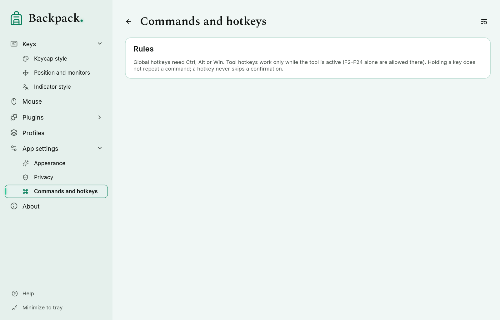
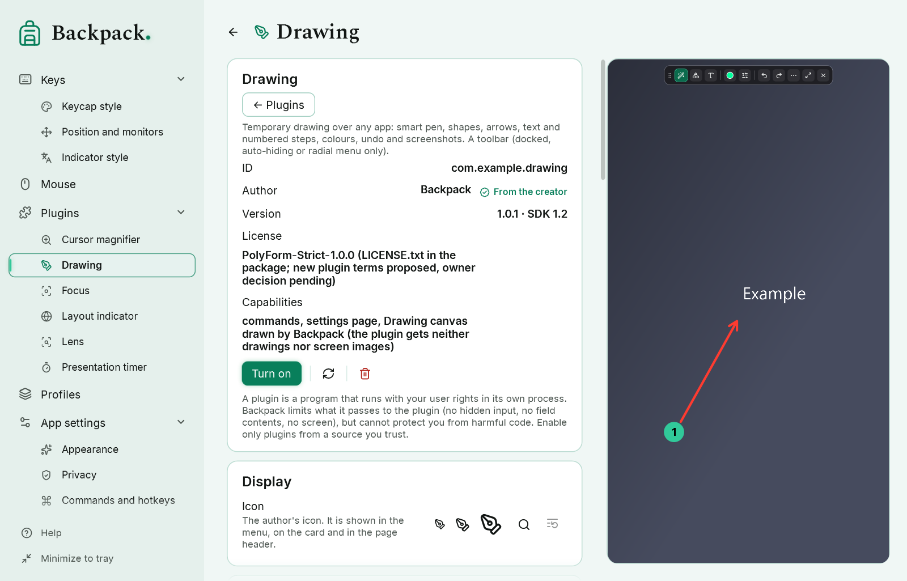
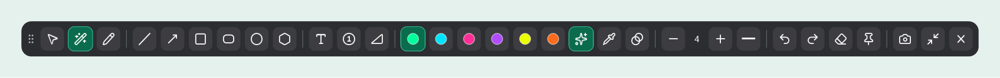
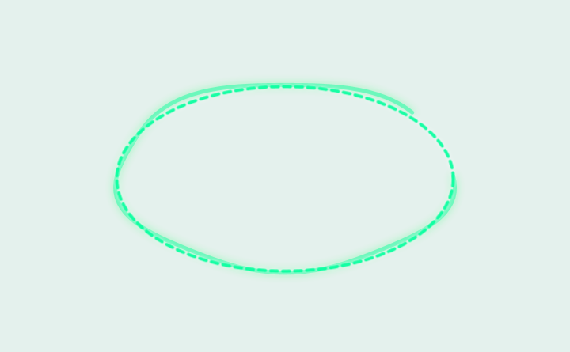
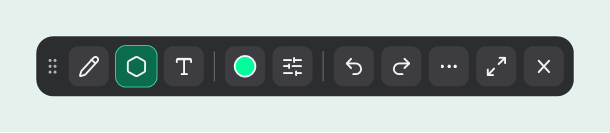
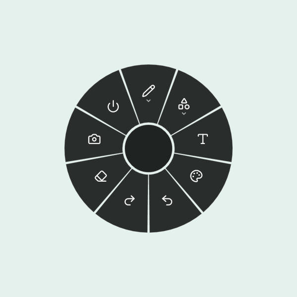
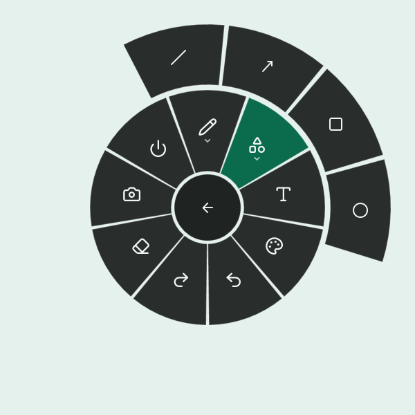

# Commands, hotkeys and drawing

## Commands and hotkeys

“App settings” → “Commands and hotkeys”. Every action of Backpack is one command: a button, a tray menu item, a radial menu sector and a hotkey run the same implementation. Click a field and press the combination; Esc cancels, Backspace removes it.

| Command | Default |
|---|---|
| Show or hide the display | Ctrl+Alt+Shift+O |
| Drawing: start / stop (plugin) | Ctrl+Alt+Shift+D |
| Drawing: radial menu (plugin) | Ctrl+Alt+Shift+R |
| Drawing: screenshot (plugin, only while drawing) | F2 |

Plugin commands appear only while the plugin is on. Other commands (magnifier, lens, focus, timer, layout indicator, cursor highlight, every drawing tool, opening settings pages) have no hotkey until you assign one.

- A global combination needs Ctrl, Alt or Win plus another key. Combinations used by Windows (Win+Space, Alt+Tab, Win+L and others) cannot be assigned.
- If another program already uses the combination, the status says “taken by another program”.
- One combination cannot serve two commands.
- Tool commands work only while the tool is open (for a plugin: while one of its tools is open), so a single key F2–F24 can be used for them. Outside the tool the key stays with other programs.
- A hotkey intercepts only its own combination. Holding the keys does not repeat the command.
- Hotkeys are settings of this computer: importing a profile does not change them. F1 stays local to Backpack windows.

**Moved from earlier versions.** The separate hotkeys of early Backpack versions are ordinary commands with the same keys. Hotkeys of the former built-in drawing, layout indicator, magnifier, lens and Focus move to the plugin commands when Backpack is updated; a hotkey you had removed stays removed.

## Show and hide the display

By default the command hides the keycaps, the layout indicator and the mouse at the cursor; the switches on “App settings” choose the parts. Input capture keeps running, so after showing again there are no old presses and no “stuck” keys. Hiding also closes plugin tools and drawing.

## Drawing

Drawing is a **plugin from the creator** (“Plugins” → “Drawing”); turn it on there. Then press its hotkey or run “Drawing: start / stop” from the tray, the radial menu or the plugin page. While the mode is on, the mouse draws over the live desktop; after you exit, the desktop works as usual. Backpack draws the canvas, the toolbar and the radial menu; the plugin keeps the settings and receives neither the drawings nor the screen image.

| Group | Tools |
|---|---|
| Draw | Select and move, **Smart pen** (default), Pen |
| Shapes | Line, Arrow, Rectangle, Rounded rectangle, Ellipse, Regular polygon |
| Text and marks | Text, Numbered mark |

- Colours: six ready colours, **any colour** (palette, `#RRGGBB` or `#RRGGBBAA` with transparency) and a quick 60 % transparency switch.
- Thickness −/+, solid, dashed or dotted line.
- Undo (Ctrl+Z), redo (Ctrl+Y), clear all; drawings fade after a few seconds or stay until you exit.
- Camera — screenshot, × — exit (also Esc or the drawing hotkey). Drawings are discarded.
- The last tool, colour, thickness and line are remembered in the plugin settings; the screenshot folder is in “App settings”.

### Smart pen

The smart pen turns a drawn line, arc, angle, ellipse, rectangle or polygon (3–8 corners, also a rotated square or a triangle) into a clean editable shape.

- **While you draw**, the recognized shape is shown dashed over the stroke; your stroke stays visible, slightly faded. The suggestion does not jump between shapes on every movement: a new shape appears only after it is recognized several times in a row.
- When recognition is not confident, no suggestion is shown and the stroke stays a stroke.
- **When you release the button**, the result is fixed. Undo returns your original stroke, a second undo removes it. The suggestion itself adds nothing to the history.
- Recognition happens on this computer; strokes are not sent anywhere.
- **Arc**: a smooth curve becomes an arc through three points — the start, the end and a point in the middle. A selected arc has three handles, one for each point. Three points on one line give a straight line, not a broken arc.
- **Angle**: two straight strokes meeting at a corner (a “V” or “L”) become an angle. While the button is held, its size in degrees is shown next to the vertex (the smaller of the two angles, 0–180°). The label moves away from the pointer and stays on the screen. The angle toolbar button keeps the label after you release the button.

### Shift and Alt while drawing shapes

| Key | Rectangle, rounded rectangle, ellipse | Line, arrow | Regular polygon |
|---|---|---|---|
| **Shift** | square or circle | direction in 15° steps | rotation in 15° steps |
| **Alt** | drawn from the centre | — | — |
| **Shift+Alt** | square or circle from the centre | — | — |

The keys work while you drag: press or release them at any moment and the shape changes at once. A short hint about them appears at the bottom of the screen the first time you pick each tool.

### Rounded rectangle and regular polygon

- **Rounded rectangle**: the corner radius is set with −/+ next to the tool (0–120 DIP). The radius is never larger than half of the shorter side.
- **Regular polygon**: press at the centre and drag to a vertex — the distance is the size, the direction turns the polygon. The number of vertices (3–12) is set with −/+ next to the tool. The shape is visible while you build it; a click without dragging creates nothing.
- Recognizing a drawn polygon (smart pen) and building a regular polygon are different tools: the smart pen keeps the corners you drew.

### Select and move

Choose “Select and move”, click a shape, text or mark and drag it. Delete removes the selected item, Esc clears the selection. Moving and deleting are undo steps, like drawing.

A selected shape has **handles**: corners and sides change the size, the round knob above the frame rotates it. The pointer shows what a handle does.

- **Shift** keeps the proportions while resizing and turns in 15° steps while rotating; **Alt** resizes from the centre.
- **Esc** during a drag cancels it and returns the shape as it was.
- One drag is one undo step.
- The line thickness does not change when you resize. Text is scaled as a whole, like a picture; numbered marks only move.

### Compact toolbar

The button with two arrows switches between the full and the compact toolbar (saved in the profile).

The compact toolbar keeps three group buttons (each shows the current tool of its group), the current colour and a line button; the tools, colours and options open in small pop-up groups. The current tool and colour are always visible.

### Toolbar mode

| Option | How it works |
|---|---|
| Always visible | The toolbar stays on screen. Drag it by the handle — the place is remembered; “Back to top center” resets it. |
| Auto-hide at an edge | The toolbar hides at the chosen edge. Hold the pointer at the edge briefly — the toolbar slides in; when the pointer is far away, it hides. |
| Radial menu only | No toolbar. Right click or the radial menu hotkey opens every tool; Esc exits. |

### Text

1. Choose “Text” and click where the text should go.
2. Type; Enter starts a new line. Drag the box by its handle to move it before confirming.
3. Ctrl+Enter or a click outside the box confirms; Esc cancels only this text.

### Screenshot

F2 (only while drawing; change it on the “Commands and hotkeys” page) or the camera button. It captures the monitor where drawing is on, with your drawings but without the toolbar, hints and menu, at the monitor's real pixels. Choose “Save to file”, “Copy” or “Save and copy” and what happens to the drawings afterwards on the page of the Drawing plugin; the folder is in “App settings”. If saving fails, drawings are never removed.

## Radial menu

Press the radial menu hotkey or right-click in drawing mode: a ring appears around the pointer (drawing turns on if it was off).

- **The inner ring** holds the categories and main actions: Draw, Shapes, Text and marks, Colour, Edit, Focus, Show on screen, Plugins (when enabled plugins have commands), Screenshot, Exit.
- **A category opens an outer ring** with its actions; the chosen category stays highlighted. The centre button becomes “Back”.
- **Esc closes one level at a time**: first the outer ring, then the menu. A click in the centre does the same.
- A sector runs only if you press and release the mouse button on the same sector, so a neighbour is never chosen by accident. Unavailable commands (a tool turned off, nothing to undo) are dimmed and cannot be chosen.
- Keyboard: arrows move around the active ring, Enter or Space chooses, Backspace goes back.
- Near a screen edge the menu moves inward so both rings stay fully visible; on a very small screen it becomes smaller.

## Which modes work together

| Together | Rule |
|---|---|
| Focus and drawing | starting Focus closes drawing |
| Radial menu | in drawing mode (the hotkey turns drawing on) |

Esc closes one layer at a time: the pop-up group of the toolbar, the selection, text input, the menu rings, then drawing. After you exit, no window is left catching the mouse. Locking the computer, switching desktops or sleep close everything.
