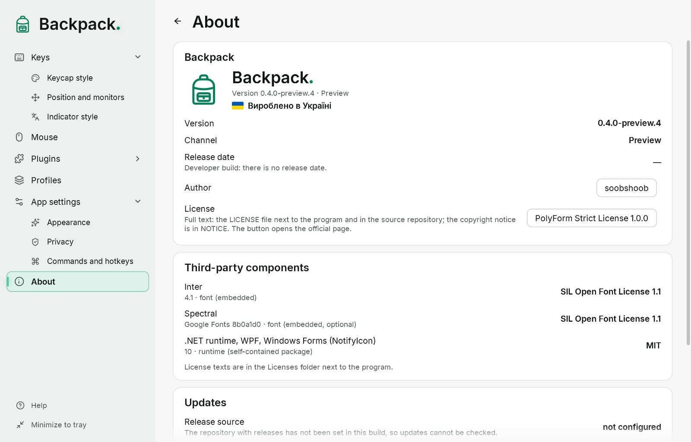

# About Backpack and updates

## The “About” page

- Name, logo, version and channel (Stable or Preview).
- Release date — taken from the release itself. A developer build has no release date and says so.
- Author: soobshoob (link to the GitHub profile; it opens in the browser after you confirm).
- The license of the Backpack core — Mozilla Public License 2.0 (the button opens the official page). The full text is `LICENSE.txt` next to the program, the copyright notice is `NOTICE.txt`. In short: you may use, change and share the program; if you share changed files of the core, their source must stay available under the same license. The license text is what applies.
- The plugin SDK and the plugins from the creator are not under MPL: they have their own terms, listed in `LICENSE-STATUS.md` and in each plugin package.
- “Made in Ukraine”.
- Third-party components with their licenses. Their texts are in the `Licenses` folder next to the program.

## Checking for updates

- “Check” asks GitHub Releases of the Backpack repository for the newest version of the selected channel.
- **Stable** never offers preview versions; **Preview** offers both.
- If a newer version exists, you see its number, date and description and a button that opens the official download page in your browser.
- “Check automatically” (off by default) repeats the check once a day while Backpack runs and shows a short notice at the tray icon.
- Backpack never downloads or runs updates by itself. To update, download the new package from the page and replace the folder (your settings are kept, see below).

Only a request for the list of releases goes to GitHub. Settings, profiles and input are never sent.

## When the check cannot finish

| Message | What it means |
|---|---|
| The release source is not configured | this build does not know the repository with releases; checking is impossible |
| No connection to GitHub | no network or GitHub is unreachable |
| GitHub did not answer in time | the request took longer than 10 seconds |
| GitHub limited the number of requests | try again later |
| GitHub returned an unexpected answer | the answer could not be read |
| Version … exists, but has no Windows x64 package yet | wait for the package |

## Update and remove

- **Update:** quit Backpack (“Exit Backpack” in the tray menu), replace the program folder with the new one and start `Backpack.exe`. Settings, profiles and styles are in `%APPDATA%\Backpack` and stay.
- **Portable mode:** if the file `Backpack.portable` lies next to `Backpack.exe`, settings are kept in the `Data` folder next to the program (when the folder can be written). Copy `Data` to the new folder when updating.
- **Remove:** quit Backpack and delete the program folder. To remove the settings too, delete `%APPDATA%\Backpack` (or `Data` in portable mode). Backpack writes nothing to the registry and does not start with Windows.
