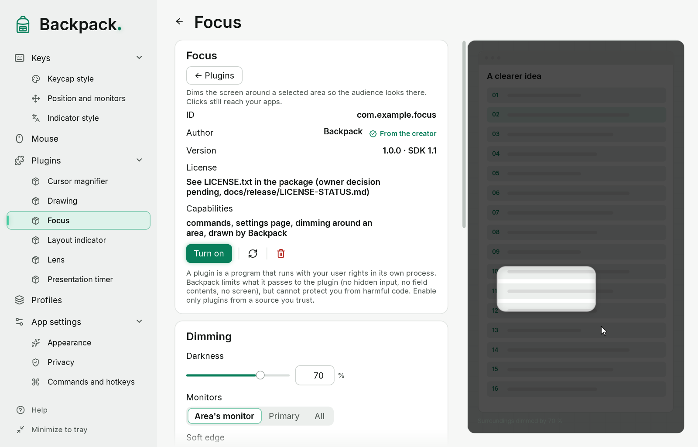
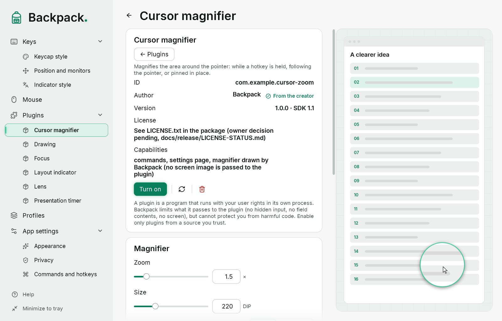

# Magnifier, lens, focus and timer

These tools are **plugins**: each has its own ID, version, settings, commands, page and demo. They come with Backpack in the `Plugins` folder next to the program but are not turned on: import them on the Plugins page and turn on the ones you need (Backpack asks you to confirm trust). How plugins work is described in [Plugins](15-plugins.md).

## Magnifier at the pointer

Three independent commands, each with its own hotkey — there is no mode to choose:

| Command | Behavior |
|---|---|
| “Magnifier: while held” | the magnifier is shown while the hotkey is held; releasing it closes it |
| “Magnifier: follow the pointer on / off” | the magnifier follows the pointer until you press it again |
| “Magnifier: pin here / remove” | a live magnifier stays where the pointer was |

- There is never more than one magnifier on screen: “follow” and “pin” replace each other; holding while a magnifier is already open adds nothing.
- Pressing the same command again closes the magnifier. Esc, locking Windows, turning the plugin off or removing it closes it at once.
- The magnifier has no buttons or handles: the pointer is always inside it, so it is controlled only with commands and Esc.
- Windows does not report releasing a hotkey: Backpack checks it every 30 ms and closes a held magnifier after 5 minutes at the latest.
- Clicks pass through the magnifier. The system pointer and Backpack’s own windows are not in the picture.

## Lens

“Lens: open / close” — select an area with the mouse (Esc cancels; a click without dragging uses the size from the settings). A movable window shows a live magnified copy of the source area; the source is marked with a dashed frame when “Show the source” is on. The lens and the source move independently.

## Focus

“Focus: dim around an area / off” — select an area; the rest of the monitor (or all monitors, as set) is dimmed. The area itself is unchanged: it is not magnified and not a screenshot.

## Controls on hover

Buttons, labels and move and resize handles of the lens, focus and timer are hidden by default — only the content is visible (the magnified picture, the frame, the digits).

- Point at the tool or its compact control area and the panel fades in; move away and it hides after a short delay, without flicker.
- Moving from the tool to its panel does not close the panel. It stays while you drag, resize or have a menu open.
- Hidden elements do not take clicks, and hovering does not take focus from the app below. Clicks on the lens and the focus area reach the app.
- The commands “Lens: show controls” and “Focus: show controls” show the panel without hovering.
- With Windows animations off the panel appears at once. The panel stays within the current monitor.

## Timer

The “Presentation timer” plugin shows a countdown above other windows.

| Command | Action |
|---|---|
| “Timer: start / pause” | start, pause and resume |
| “Timer: reset” | back to the set time |
| “Timer: show / hide the panel” | the panel only; the countdown is not changed |

- Move and resize the panel with the handles shown on hover; digit size, opacity and accent color are in the plugin settings. Settings are kept in the profile.
- The countdown follows the clock, not the ticks of an interface timer: load and drawing delays do not stretch seconds.
- **Sleep:** time keeps running while the computer sleeps. If the countdown ended during sleep, the panel shows 00:00 and the finished state after waking.
- When it ends, 00:00 stays with a subtle accent frame. Sound is a separate setting, off by default.
- After Backpack restarts, the timer does not start by itself and the panel does not appear until the first command.

## Moving over from the built-in tools

In earlier versions the magnifier, lens and focus were built in. When you import the bundled plugins, Backpack moves their settings, hotkeys and menu items over: the old shared “Focus” command goes to the command of the mode that was selected. Moving over does not turn a plugin on and does not confirm trust — you do that.
