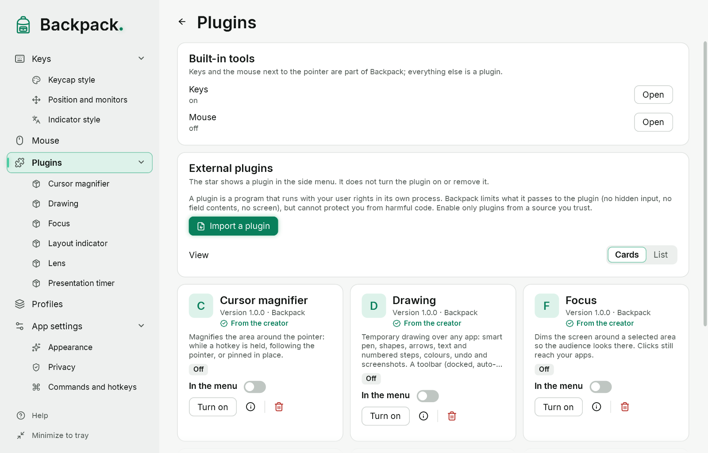

# Plugins

## Installing

“Plugins” → “Import a plugin” → choose a `.bppkg` file. Backpack checks the package (paths, sizes, duplicates, `manifest.json`, the entry assembly, SDK compatibility) and unpacks it. **Importing does not run any code and does not grant trust.** A new or updated plugin is installed turned off.

| Action | Where |
|---|---|
| Details, settings, commands | the “Details” icon or the plugin's star item in the side menu |
| Turn on / off | “Turn on” (text button: it leads to the trust confirmation) / the power icon |
| Update | import a newer version of the same plugin (an older or equal version is refused) |
| Remove | the trash icon, kept apart (asks for confirmation; settings are removed too) |
| Show in the side menu | the “In the menu” star — it does not turn the plugin on or remove it |

Keys and the mouse next to the pointer are part of Backpack. Everything else is a plugin: **Drawing, Layout indicator, Cursor magnifier, Lens, Focus and Timer** come with Backpack as **plugins from the creator**. On start Backpack adds them to the catalog turned off, without running their code; you do not need to look for the packages. They carry the **From the creator** mark: the installed package matches the delivery index of this Backpack version by its SHA-256 checksum. The mark is not based on the author name in the manifest and is not a cryptographic publisher signature; a package you import yourself has no mark.

When you update from an earlier version, the settings, hotkeys and menu items of the former built-in tools move to these plugins, a note says so, and the plugins stay off until you turn them on. A plugin you had turned on stays on after an update delivered with Backpack. A plugin from the creator that you removed is not added back by itself: the “Plugins from the creator that are not installed” card has “Add back”.

### Cards or list



Installed plugins are shown as **cards** by default: the icon (or the first letter of the name on a tile when the package has no icon), the name, version and author, a short description, the state — on, off or error (for example “turned off after repeated crashes”) — the “In the menu” switch, “Details”, “Turn on / off” and “Remove”. The grid has as many columns as fit; long names and descriptions wrap or are shortened with a tooltip. **List** shows the same as rows. The choice is remembered.

### Plugin icon

Each plugin shows an icon in the side menu, on its card and in its page header. The author picks it in `manifest.json` (`"symbol"`, the name of one of the icons built into Backpack). To choose your own: open the plugin's page → “Display” → “Choose an icon”, find one by a word (pen, timer, search…) and click it. Your choice is kept when the plugin is updated; “Use the author's icon” returns the author's. Icons are drawn by Backpack: a plugin cannot load pictures from the internet for them. The star is not offered as an icon — in the menu it means “In the menu”.

Viewing cards reads only `manifest.json` and the icon picture: no plugin code runs. Turning a plugin on for the first time still asks you to confirm trust; a card never skips that and never grants capabilities.

## Trust

A plugin is a program. Before the first start Backpack asks you to confirm that you trust it. The plugin runs in its **own process** with your user rights; if it crashes or hangs, Backpack keeps working. Three crashes within 10 minutes turn the plugin off. To start Backpack without any plugins, run `Backpack.exe --no-plugins`.

What Backpack does **not** give a plugin: input hidden by dynamic privacy, raw keyboard hooks, field contents, window texts or titles, pointer history, the screen. A plugin with the “visible keys” capability gets only key names that passed the privacy filter.

What Backpack **cannot** do: protect you from harmful code. The separate process is not a sandbox — a plugin can do whatever a program started by you can do. Turn on only plugins from a source you trust.

Importing a profile never installs, trusts or starts a plugin.

## Creating a plugin

You need the .NET 10 SDK. The examples are the six plugins from the creator: sources in `lab/samples` (the `Samples` folder in the Backpack package), ready packages in `Plugins`:

| Sample | What it shows |
|---|---|
| `Drawing` | `overlay.draw` — the host drawing canvas, `whileTool` commands (F2 only while drawing), `UpdateSettings` |
| `LayoutIndicator` | `input.layout` and `overlay.indicator` — layout changes and a host-drawn indicator |
| `CursorZoom` | `overlay.magnifier`, a hold command (`hold`) and two toggles |
| `Lens` | `overlay.magnifier` with a separate source area |
| `Focus` | `overlay.dim` — dimming around an area |
| `PresentationTimer` | `overlay.panel` with buttons, a state and a movable panel |

```powershell
dotnet build lab/samples/Drawing/Drawing.csproj -c Release
powershell -ExecutionPolicy Bypass -File tools/pack-plugin.ps1 -Project lab/samples/Drawing/Drawing.csproj -Out artifacts/plugins
```

The result is `artifacts/plugins/<id>-<version>.bppkg`.

A plugin is a .NET class library that references `Backpack.Sdk` (not copied into the package: Backpack provides it) and has a class derived from `BackpackPlugin`:

| Method | When |
|---|---|
| `OnStart()` | the plugin is turned on |
| `OnCommand(id)` | the user ran a command from the manifest |
| `OnSettingsChanged()` | the user changed a setting; values are in `Context.Settings` |
| `OnVisibleKey(key, down)` | only with `input.visible`: a key that passed the privacy filter |
| `OnCommandReleased(id)` | the hotkey of a `"hold": true` command was released |
| `OnToolClosed(tool, reason)` | a host tool was closed (Esc, lock, turning off, `busy` — the canvas is used by another plugin) |
| `OnPanelButton(id)` | a panel button was pressed |
| `OnLayoutChanged(e)` | SDK 1.2, only with `input.layout`: the layout code, name and reason (`switch` or `window`) |
| `OnToolState(tool, values)` | SDK 1.2: the user changed the open tool itself (for drawing: tool, colour, thickness, toolbar place) |
| `OnStop()` | the plugin is turned off or Backpack exits |

`Context.ShowPanel(title, text, progress)` shows a panel over the screen (needs `overlay.panel`); Backpack draws it. `Context.UpdateSettings(values)` (SDK 1.2) writes the plugin's own setting values, checked against the manifest. Methods must return quickly.

### Host tools (SDK 1.1 and 1.2)

`Context.OpenMagnifier(id, request)` opens a magnifier that Backpack draws: at the pointer, pinned or with a source area (`overlay.magnifier`); `Context.OpenDim(id, request)` dims around an area (`overlay.dim`). SDK 1.2 adds `Context.OpenDrawing(id, request)` and `Context.DrawAction(id, action)` — the drawing canvas with the toolbar, radial menu, shapes, smart pen, text, numbers, colours, undo and screenshots (`overlay.draw`, one canvas at a time) — and `Context.ShowIndicator(request)` — a short code with a second line, drawn in the keycap look or the indicator style (`overlay.indicator`). `Context.EditTool(id)` shows a tool's controls and `Context.CloseTool(id)` closes it. **The plugin receives neither a screen image, nor drawings, nor pointer coordinates** — only a message when the tool closes or the user changes its parameters. The panel (`overlay.panel`) can have buttons, a state (`normal`, `warning`, `finished`), an accent and can be moved; buttons and handles appear on hover through the shared host mechanism.

### manifest.json

| Field | Meaning |
|---|---|
| `format`, `formatVersion` | `backpack-plugin`, `1` |
| `id` | reverse-domain style, lower case: `com.example.timer`; `backpack.*` is reserved |
| `name`, `description` | text or `{ "en", "uk", "ru" }` |
| `author`, `version` | version — `1.2.3` or `1.2.3-beta` |
| `sdk` | SDK version the plugin needs, e.g. `1.2` |
| `entry`, `type` | path to the assembly inside the package and the class name |
| `capabilities` | `commands`, `settings`, `overlay.panel`, `overlay.magnifier`, `overlay.dim`, `overlay.draw`, `overlay.indicator`, `input.layout`, `input.visible`, `screen` |
| `dependencies`, `resources`, `locales`, `license` | other assemblies, files in the package, languages, license text |
| `icon` | optional: a `.png` inside the package (listed in `resources`, up to 256 KB) shown on the plugin card |
| `commands` | `{ "id", "title" }` — in “Commands and hotkeys” as `plugin.<id>.<command>`; optional `hold`, and in SDK 1.2 `whileTool` (the hotkey works only while a tool of the plugin is open), `hotkey` (default) and `icon` |
| `settings` | fields `toggle`, `number` (`min`, `max`), `text`, `choice` (`choices`), `color` with `default`; `group`, `hint`, `showWhen`, and in SDK 1.2 `hidden` (stored, not shown) — Backpack draws the page |
| `preview` | a host-drawn demo scene: `magnifier.follow`, `magnifier.region`, `dim`, `panel`, and in SDK 1.2 `drawing` and `indicator` |

Capabilities are checked by Backpack on every message: a panel from a plugin without `overlay.panel` is refused; repeated violations stop the plugin. `screen` is not granted in this version.

### Compatibility

The host accepts a plugin when the major SDK number matches and the minor number is not newer than Backpack's (SDK 1.2 now): plugins built for 1.0 and 1.1 keep working. Packages: up to 64 MB, 500 files, no paths with `..`, drive letters or links.

**Limits on the samples.** Backpack itself is under MPL 2.0, but the SDK and the samples are not: their own terms are proposed and await the owner's decision (see `docs/release/LICENSE-STATUS.md`). Until then PolyForm Strict 1.0.0 applies to them: you may study and use the samples for noncommercial purposes, but this license does not permit changing them or passing on changed copies. A plugin you write from scratch is your code under your license.
