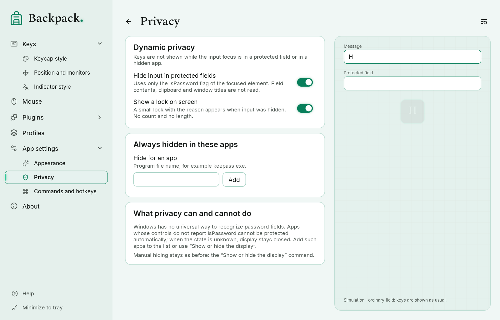

# Privacy, monitors and commands

## Dynamic privacy

“App settings” → “Privacy”. When the input focus moves, Backpack asks Windows UI Automation whether the focused element is a password field (the `IsPassword` property only — never the text, the clipboard or the window title).

| State | Display |
|---|---|
| Ordinary field | shown exactly as with privacy off: Tab, Win combinations and all other keys |
| Protected field | everything hidden, combinations included; the keycaps on screen are cleared |
| Hidden for this app | the app is in your list: hidden |
| Checking | new presses wait for the answer about this field; they appear only if this very field is confirmed ordinary |
| No data | no answer, an error, a timeout or no property: new presses are hidden; keys already shown are released normally |

- A key belongs to the field where it was **pressed**. Tab pressed in an ordinary field is shown although it moves the focus; Win+E and similar combinations are shown although they open a system window.
- Presses that waited are dropped for good when the field turns out to be protected, when there is no answer in time, or when the focus moves on. Hidden input never appears later.
- While a field is checked after a focus change, nothing is shown yet; there is no switching off of protection while it is unclear.
- Keys held while the field was protected do not appear when it opens; display resumes from the next new press. Mouse buttons are still shown.
- Plugins and the second-layout labels receive only what is displayed.
- An optional small lock with the reason appears on screen; it shows no count, no length and no field name.
- Backpack never blocks or changes keys: its keyboard hook only observes input and always passes it on to the application. It asks UI Automation only when the focus moves to another element — once, plus at most three re-checks — and never polls the application you work in. An element that does not report `IsPassword` (for example a CAD 3D viewport) counts as “no data”: Backpack does not show its keys, but the keys still reach the application.
- Right after start, until the UI Automation subscription is ready, an ordinary field is not confirmed: input waits and then is hidden if needed.
- **Windows desktop.** The list of desktop icons (an Explorer list view on the desktop) does not report `IsPassword` at all; earlier this meant “no data”, so presses on the desktop were hidden until you switched to another window. Now only this list — checked by the window classes, the Explorer process, the element type and the framework — counts as an ordinary element: combinations on the desktop are shown as set. Renaming an icon is a separate edit field with its own check. The rest of Explorer, the taskbar and other system windows are not treated as safe. When an element gives no data, Backpack asks again every 1.5 s, so the state recovers without switching windows; presses hidden meanwhile never appear later.

**Limits.** Windows has no universal way to recognize password fields. Many apps report `IsPassword` (Windows controls, WPF, browsers), but some do not, or report it wrongly; such an app cannot be detected. A rare race also remains: if Windows reports the focus change later than you already type in the new field, those keys belong to the previous field. Add risky programs to the list (for example `keepass.exe`) or use “Show or hide the display”.

## Monitors

“Keys” → “Position and monitors” (keycaps) and “Indicator style” (indicator):

| Choice | Meaning |
|---|---|
| Primary | the primary monitor |
| Selected | one chosen monitor |
| Several | all chosen monitors at once |
| Under the pointer | the monitor where the mouse pointer is now (not the monitor of the active window) |

One input source serves all windows. Position and margins are counted from each monitor's work area in its own scale, also for monitors with negative coordinates. When the pointer moves to another monitor the keycaps move with it without duplicates, without restarting the animation and without dropping held keys. If a saved monitor is not connected (for example the profile came from another computer), the primary monitor is used and the page says so.

## Commands and hotkeys

“App settings” → “Commands and hotkeys” lists every action; a button, the tray, the radial menu and a hotkey run the same command. The rules and the default hotkeys are in [Commands, hotkeys and drawing](12-hotkeys-lens-drawing.md).

