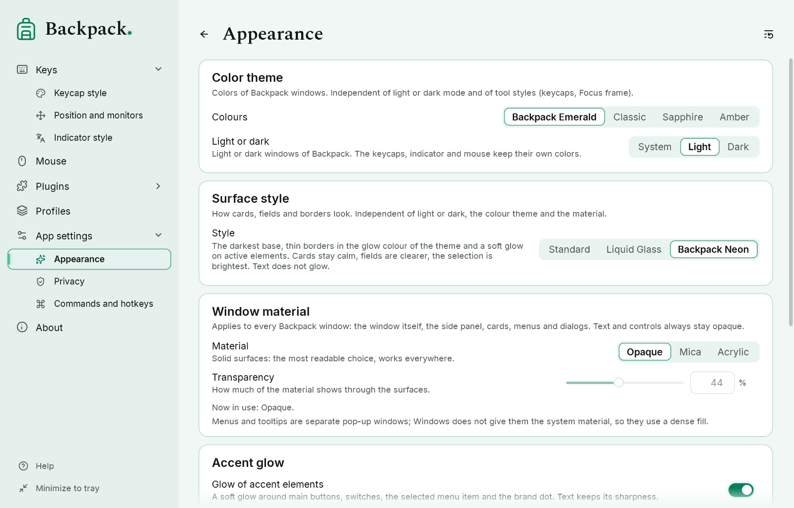
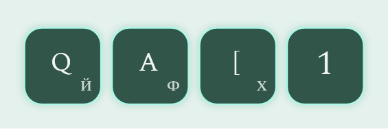

# Appearance, navigation and fonts

## Navigation and the Back button

The menu on the left lists every page; the Backpack logo above it opens Home (its tooltip and accessible name are “Home”). Groups have an arrow: **Keys** (Keycap style, Position and monitors), **Plugins** (installed plugins), **App settings** (Appearance, Privacy, Commands and hotkeys). Opening a group or one of its pages expands it; the current page is highlighted and always scrolled into view. The menu has no scroll bar — scroll with the wheel, touchpad or keyboard; the list edges fade softly, and the last item is fully visible when scrolled to the end. Buttons on pages, F1, help links, favorite plugins and the tray menu open the same pages and keep the menu in sync.

The **Back** arrow next to the page title returns to the previous page of this window; Alt+← and the mouse back button do the same. On Home it is not shown. Going to a page that is already in the history does not create a loop, and a value you were typing is applied before the page changes.

The page has two layouts. In a wide window the live preview is a column of fixed width on the right, as tall as the page area; when there is not enough room, the page switches to a vertical layout with the preview as a strip above the options. Elements are never squeezed: long labels wrap, a control that does not fit next to its label moves under it, and groups of buttons wrap. The preview never scrolls with the page. In a narrow window the menu on the left shows only icons in one column with a square highlight; the menu button opens the full menu over the page. The window can be made as small as 560 × 440 DIP. Moving previews are cut exactly along the rounded frame at any window size and scaling.

## The title bar

The main window has no separate title strip: the large “Backpack.” wordmark above the menu, the page title and the minimize, maximize and close buttons form one top row; the buttons stay on the right and the page title leaves room for them. The window name for Alt+Tab, the taskbar and accessibility stays “Backpack”. Windows behaviour stays: drag the free part of the top row to move, double-click to maximize, right-click or Alt+Space for the window menu, Alt+F4 to close, edges to resize. In Windows 11, hovering over the maximize button shows the snap layouts. Dialogs and the help window keep a compact title strip.

The emerald dot after “Backpack” belongs to the wordmark (menu, Home, About); in Neon and in the gem themes it has a soft glow.

## Default look: Backpack Neon Emerald

A new installation and “Reset section” use **Backpack Neon Emerald**: Backpack Emerald colours with the Backpack Neon surface style, **Light or dark** set to System (dark when Windows is dark), the Mica material with 44 % transparency, the built-in **Spectral** font for headings and keycap labels, and the Backpack Neon Emerald keycaps and mouse icon with an emerald click circle. The Windows mouse pointer itself is never changed. When you update Backpack, the theme, fonts, styles and profiles you have saved stay as they are.

## Colours, light or dark

“App settings” → “Appearance”: **Colours** — Backpack Emerald, Classic, Sapphire or Amber; **Light or dark** — System, Light or Dark. Previews and pictures follow the theme: a light stage in the light theme, a dark one in the dark theme. The colours of your keycap, mouse and plugin styles never change with the theme.

The logo is only the outline of the backpack: green in Emerald, the accent colour in Sapphire and Amber, black on light and white on dark in Classic. The tray icon is dark on a light taskbar and white on a dark taskbar.

## Surface style

“Appearance” separates four independent choices: **light or dark**, the **colour theme**, the **surface style** and the **material with its transparency**. Any combination works; they are not separate themes.

| Style | What it is |
|---|---|
| Standard | calm cards with soft neutral borders |
| Liquid Glass | glass cards with a highlight and light gradient borders (Backpack's own look, not a Windows effect) |
| Backpack Neon | the darkest base, thin borders in the glow colour of the theme (emerald in Backpack Emerald), a soft glow on active elements |

In Neon the borders keep a hierarchy: cards are calm, fields are clearer, the selected item and keyboard focus are brightest; text never glows. The light Neon variant has its own colours, not an inverted dark one. The glow can be turned off or made weaker (“Accent glow”). In high contrast the standard style is used.

## Window material

| Material | What it is |
|---|---|
| Opaque | Solid surfaces: the most readable choice, works everywhere |
| Mica | Windows system material (Windows 11 22H2 or newer) |
| Acrylic | Windows system material with a blurred view of what is behind the window |

**Transparency** sets how much of the material shows through. Only the surfaces change: text and controls always stay opaque. The line under the choice says which material is in use now. When transparency effects are off in Windows, high contrast is on, or Windows is older, the opaque look is used. Menus and tooltips are separate pop-up windows without the system material: they use a dense fill. A profile from an earlier version with the Liquid Glass material opens as Acrylic with the Liquid Glass style.

## Accent glow

In the gem themes (Emerald, Sapphire, Amber) and in the Neon style with any theme, main buttons, switches, the selected menu item and the brand dot have a soft glow. It is on by default; the strength can be changed. The glow is drawn under the element, so text stays sharp. In Classic with the Standard or Liquid Glass style and in high contrast there is no glow.

## Fonts

Each of the two choices has only two options: **Standard** (the built-in Inter) and **Spectral** (built into Backpack, not installed in Windows).

- **Heading font** (“Appearance”) — the page title, the large help headings and the name “Backpack”. All other text — options, hints, buttons, card headings, menus — always stays in the standard font for readability.
- **Keycap font** (“Keycap style”) — labels on keycaps and the layout indicator.

Both are independent, saved in the profile and applied at once. Icons and key symbols are drawings and do not change with the font. Spectral covers Ukrainian, English and Russian letters and digits; characters it lacks (arrows, ⌘ ⌥ ⇧, Greek) come from Inter or Segoe UI, so nothing disappears. Profiles from earlier versions that used another installed font switch to Standard.

## Second layout on keycaps

“Keycap style” → “Second layout on keycaps”. The large label stays English; a small character of another layout appears in the chosen corner — bottom right by default — with a readable gap and a safe margin from the edge.

- **Active layout** — the layout of the app you type in (not of Backpack). When it is English, nothing is added.
- **Chosen layout** — always the layout picked from those installed in Windows.
- **Main label size** and **small label size** are set as a share of the keycap face, so they keep working when you change the keycap size; with two labels the main letter is slightly smaller by default.
- **Corner** and the **horizontal and vertical offset** (−15 % to +35 % of the face, from a safe point near the corner; positive moves towards the centre) place the small label. Both labels always stay inside the face and never cover the R/num marks, the modifier symbols or the press counter.
- The character is what is printed on the key, without Shift, Caps Lock or AltGr; a dead key shows its accent. Keys without one clear character (IME, service keys, the numeric keypad) get no label. Reading it never changes the keyboard state of any app.
- The settings are part of the keycap style and the profile. Offsets from an earlier version are reset when the profile is opened, so letters are not pushed off the face by the new placement.
- Privacy applies first: hidden keys get no labels at all.
