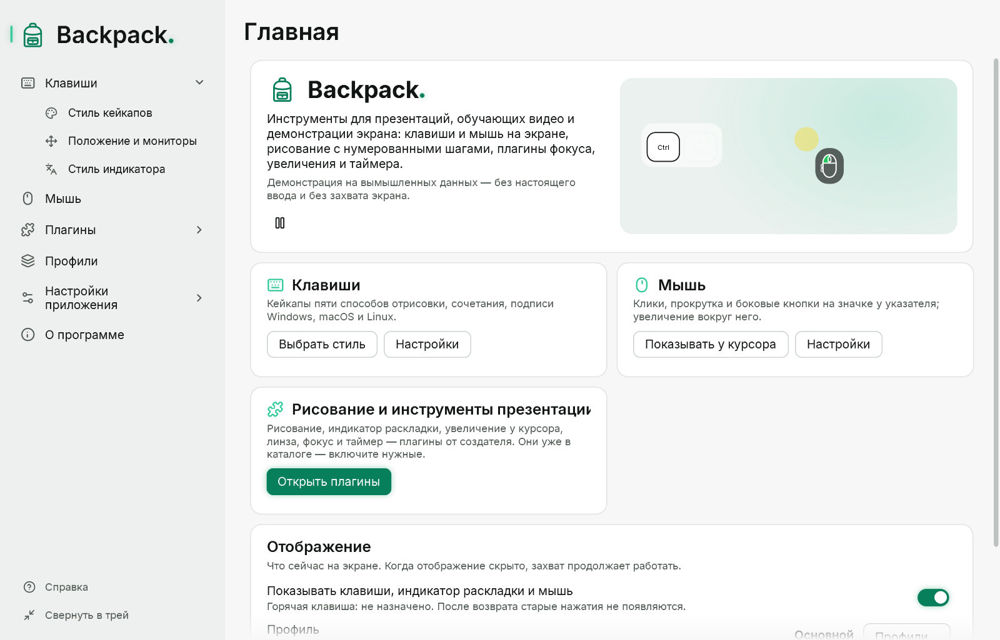

# Начать за минуту

Нужны Windows 10 или 11 (x64). Права администратора не нужны. Распакуйте папку Backpack куда угодно и запустите `Backpack.exe`; ничего дополнительно устанавливать не нужно.

## Что появляется

- **Главное окно** — страница «Главная» с переключателем отображения, активным профилем, быстрыми переключателями и инструментами презентации.
- **Оверлей** — прозрачная полоса внизу основного монитора. Он никогда не забирает фокус, пропускает щелчки к окнам под ним и не показывается на панели задач и в Alt+Tab.
- **Значок в области уведомлений** панели задач. Windows может убрать его в скрытые значки (стрелка ^).

## Пять шагов

1. Быстро напечатайте слово в любой программе: буквы сменяют друг друга на одном месте.
2. Нажмите Ctrl+Shift+K: появятся три кейкапа — сочетание.
3. Откройте «Клавиши» → «Стиль кейкапов» и щёлкните другой стиль в каталоге: превью и оверлей сразу изменятся. Настройки сохраняются автоматически.
4. Нажмите Ctrl+Alt+Shift+O: отображение скроется; нажмите ещё раз — вернётся. Захват продолжает работать.
5. Закройте главное окно крестиком: Backpack останется в трее. Щёлкните значок, чтобы снова открыть главное окно. Чтобы выйти полностью, выберите «Выйти из Backpack» в меню значка.

Подробнее об окнах и значке: [Главное окно, трей, тема и язык](02-interface.md). Чтобы сохранить весь набор настроек: [Профили](07-profiles.md).

## Приватность кратко

Backpack показывает нажатия на экране и никуда их не записывает. Если оверлей виден на трансляции, зрители видят и то, что вы печатаете, в том числе пароли. Перед вводом пароля скройте отображение горячей клавишей или включите «Только сочетания». Подробнее: [Диагностика и приватность](09-diagnostics-and-privacy.md).
