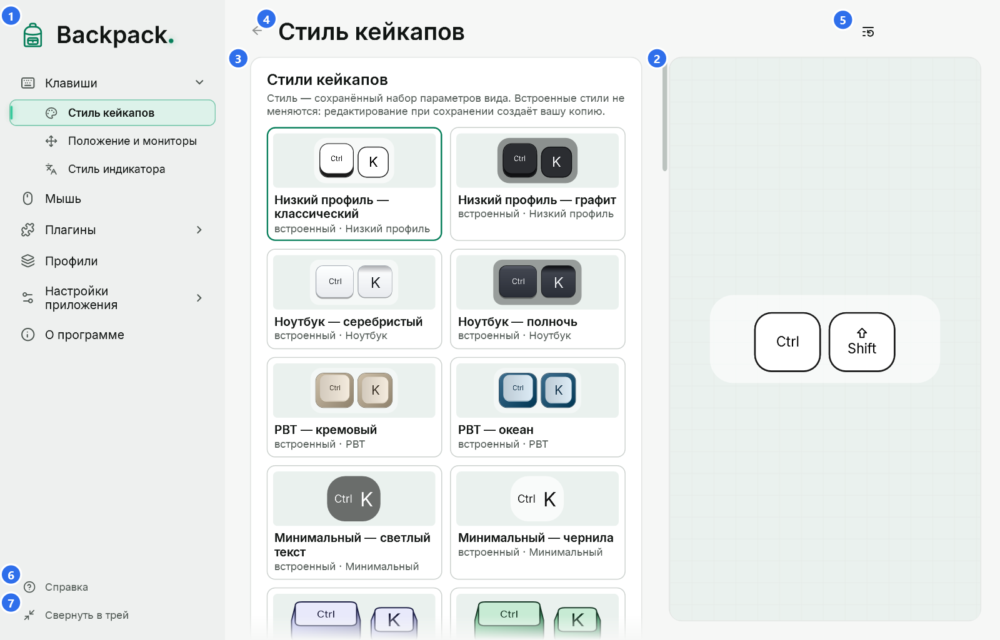
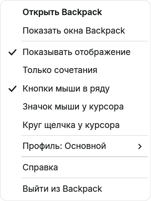
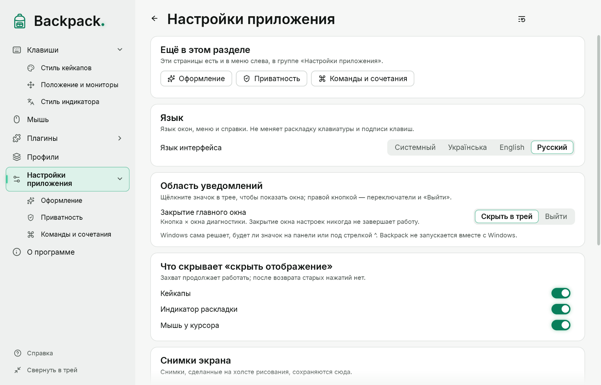

# Главное окно, трей, тема и язык

## Главное окно

Навигация слева: **Главная**, **Клавиши** ▸ (Стиль кейкапов, Положение и мониторы), **Мышь** ▸ (Увеличение у курсора), **Раскладка**, **Фокус**, **Рисование**, избранные плагины, **Плагины** ▸, **Профили**, **Настройки приложения** ▸ (Оформление, Приватность, Команды и сочетания), **О программе**. **Справка** — внизу меню. Стрелка раскрывает группу; стрелка слева от заголовка страницы возвращает назад. В узком окне меню показывает только значки (название — в подсказке; кнопка меню вверху открывает полное меню поверх страницы). См. [Внешний вид, навигация и шрифты](17-appearance-navigation-fonts.md).

1. **Страницы.** Открытие группы или одной из её страниц раскрывает её; текущая страница подсвечена.
2. **Превью.** Пример выбранной страницы, нарисованный тем же рендером, что и оверлей, на придуманных данных. В широком окне это колонка фиксированной ширины справа на всю высоту области страницы, в узком — полоса над параметрами. В обоих случаях превью стоит на месте: прокручиваются только параметры.
3. **Параметры.** Каждое изменение сразу применяется к превью и оверлею; захват ввода не перезапускается.
4. **Заголовок страницы.** Название открытой страницы. Изменения автоматически сохраняются в текущем профиле; профилями управляют на странице «Профили».
5. **Сбросить раздел.** Возвращает значения по умолчанию только открытой страницы.
6. **Справка.** Единственный вход в справку из меню: открывает тему о текущей странице (то же делает F1). Внутри справки — поиск и все разделы.
7. **Свернуть в трей.** Прячет окна Backpack; оверлей продолжает работать.

У числовых параметров есть ползунок и поле: введите число и нажмите Enter. Дробные числа можно вводить с запятой или точкой. Цвета вводятся как `#RRGGBB` или `#RRGGBBAA` (последняя пара — непрозрачность) или выбираются в палитре.

Настройки сохраняются автоматически через полсекунды после изменения и при выходе.

## Главная

«Главная» открывается щелчком по логотипу Backpack над меню (с клавиатуры — Enter или пробел, когда логотип в фокусе) и показывает, что сейчас на экране: переключатель отображения (кейкапы, индикатор раскладки и мышь у курсора), активный профиль, быстрые переключатели, кнопку рисования, переход к плагинам-инструментам и самые используемые страницы. Технические счётчики и проверки — на странице «Настройки приложения».

## Три разных действия: свернуть, закрыть, выйти

| Действие | Что происходит |
|---|---|
| Свернуть в трей | окна Backpack прячутся; оверлей, мышь у курсора, индикатор раскладки и сочетания работают; значок остаётся |
| × главного окна | по умолчанию то же, что «Свернуть в трей»; на странице «Настройки приложения» можно выбрать «Выйти» |
| Выйти | программа завершается полностью: оверлей, значок, окна, сочетания и захват ввода останавливаются |

При первом сворачивании в трей Backpack объясняет, где значок и как выйти. Там же можно выбрать «Лучше выйти».

## Значок в трее

- **Щелчок левой кнопкой** — открыть главное окно.
- **Щелчок правой кнопкой** — быстрое меню.

| Пункт | Что делает |
|---|---|
| Открыть Backpack | возвращает скрытые окна и открывает главное окно |
| Показать или скрыть отображение | скрывает или показывает отображение (что именно — страница «Настройки приложения»); нажатия и отпускания по-прежнему отслеживаются, поэтому после возврата клавиши не «залипают» |
| Только сочетания | тот же переключатель, что в «Клавишах» |
| Кнопки мыши в ряду | кнопки мыши среди кейкапов |
| Значок мыши, круг щелчка и подсветка курсора | части режима «Мышь у курсора» |
| Индикатор раскладки | включает и выключает индикатор |
| Плагины | команды включённых плагинов (увеличение, линза, фокус, таймер) |
| Рисование | та же команда, что на странице и в сочетаниях |
| Профиль: … | переключение профилей; изменения текущего профиля уже сохранены |
| Справка | эта справка |
| Выйти из Backpack | полное завершение |

Отметки в меню всегда показывают текущее состояние. Если главное окно открыто, оно сразу показывает изменение из меню, и наоборот.

Windows решает, будет ли значок на панели задач или среди скрытых. Его можно перетащить на панель или выбрать в параметрах панели задач. Backpack не запускается вместе с Windows.

## Тема интерфейса

«Настройки приложения» → «Оформление»: цвета (Backpack Emerald, Классическая, Сапфир, Янтарь), **Системная**, **Светлая** или **Тёмная**, материал окон и свечение акцентов. Тема сразу применяется ко всем открытым окнам Backpack: главному окну, диагностике, справке, диалогам и меню трея.

- Тема интерфейса **не меняет** оверлей: цвета кейкапов, индикатора раскладки и мыши у курсора задают их стили.
- «Системная» следует параметру Windows «режим приложений» и меняется вместе с ним.
- Окна выбора файла (импорт и экспорт) рисует Windows: они следуют теме и языку Windows, а не настройкам Backpack.

## Язык

«Настройки приложения» → «Язык интерфейса»: **Системный** или один из 19 языков — English, Українська, Deutsch, Français, Español, Italiano, Português, Nederlands, Polski, Čeština, Magyar, Română, Svenska, Dansk, Norsk bokmål, Suomi, Lietuvių, Ελληνικά и Русский. «Системный» берёт язык Windows; если в Backpack его нет, используется английский.

- Справка написана на английском, украинском и русском. На других языках окно справки показывает английский текст и сообщает об этом вверху.

- Язык меняется сразу во всех окнах, меню и справке, без перезапуска и без остановки захвата.
- Язык интерфейса не меняет раскладку клавиатуры, подписи на кейкапах и содержимое профилей.

Язык, тема, поведение трея и сочетания — настройки этого компьютера: в профили они не входят.

## Клавиши в окнах Backpack

| Клавиши | Где | Действие |
|---|---|---|
| F1 | любое окно Backpack | справка о текущем месте |
| Tab / Shift+Tab | главное окно | переход между элементами; фокус показан рамкой |
| стрелки | главное окно | выбор варианта, движение ползунка или маркера палитры |
| Enter | числовое поле | применить значение |
| Esc | палитра, справка, диалоги | закрыть |
| Alt+← / Alt+→ | справка | назад / вперёд |
| Alt+← | главное окно | назад на предыдущую страницу |
| Ctrl+F | справка | поиск |

Эти клавиши действуют, только пока активно окно Backpack. Глобальные сочетания (показ/скрытие, «Фокус», рисование, радиальное меню) описаны в разделе [Команды, сочетания и рисование](12-hotkeys-lens-drawing.md).
