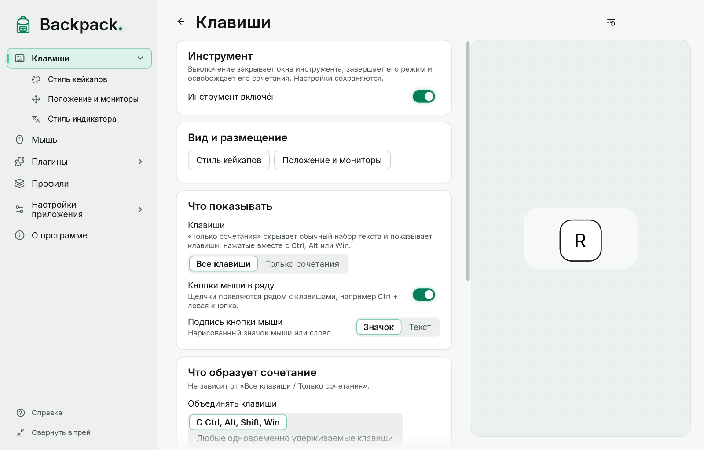
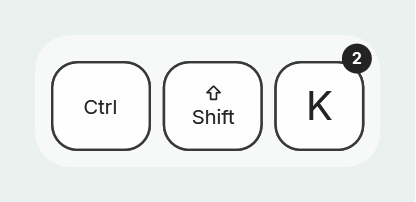
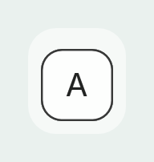
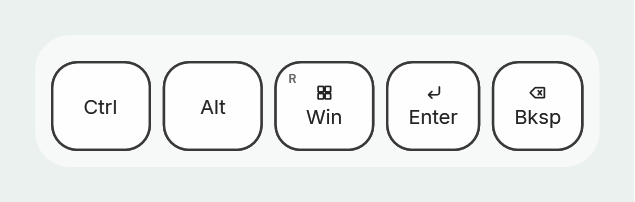
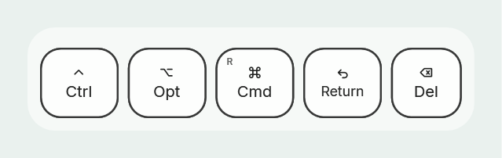
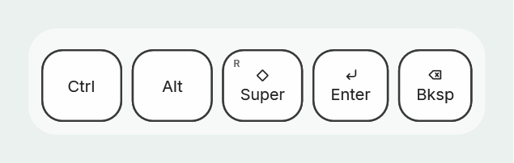

# Клавиши, сочетания и подписи

Страницы настроек «Клавиши» и «Стиль кейкапов».

## Что видно на оверлее

| Вид | Значение |
|---|---|
| верхняя грань опущена | клавиша нажата |
| видна тёмная полоса снизу | клавиша отпущена; исчезнет через выдержку (по умолчанию 5 с) |
| приглушённая подпись и «?» | состояние клавиши неизвестно, например после блокировки компьютера |
| маленькая метка «R» или «num» | правый модификатор или клавиша цифрового блока |
| кружок с числом | клавишу нажали несколько раз, не отпуская сочетание |

## Спокойная печать или след

Параметр «След» на странице «Клавиши».

- **Спокойно** (по умолчанию): каждая новая буква встаёт на место предыдущей, ряд не растёт и не дрожит. Ширина группы, пока она на экране, не уменьшается.
- **Гаснущий след**: отпущенные буквы ненадолго остаются рядом с новыми и гаснут на месте.

[Показать пример: спокойно](demo:trail-none) · [Показать пример: след](demo:trail-fade)

**Выдержка после отпускания** (по умолчанию 5000 мс, от 0 до 20 000) — сколько последние клавиши остаются на экране. Параметр запуска `--linger-ms` заменяет её на один запуск.

## Только сочетания

Параметр «Клавиши»: **Все клавиши** или **Только сочетания**. В режиме «Только сочетания» обычная печать и одиночные модификаторы не показываются, а сочетания с Ctrl, Alt, Win или Shift — показываются.

[Показать пример: только сочетания](demo:combos)

- Удерживаемый модификатор учитывается: нажмите Ctrl, затем S — появится «Ctrl S».
- Ctrl вместе с кнопкой мыши — тоже сочетание, если кнопки мыши показываются в ряду.
- Фильтр меняет только показ: нажатия и отпускания по-прежнему отслеживаются.
- Клавиша присоединяется к сочетанию, только если в момент нажатия удерживается модификатор; быстрое перекрытие букв сочетанием не считается.

## Подписи клавиш

«Стиль кейкапов» → «Подписи клавиш».

| Параметр | Варианты |
|---|---|
| Набор подписей | Windows, macOS, Linux — названия как на клавиатурах этих систем |
| Вид подписей | Смешанно (символ и название), Символы, Текст |
| Пометки левой/правой | метки «R» и «num» в углу |
| Счётчик нажатий | число в углу при повторе внутри сочетания |

[Показать пример: подписи и счётчик](demo:labels)

Набор подписей меняет только надписи на кейкапах. Раскладка клавиатуры и то, что получает программа, остаются прежними. Подписи соответствуют английской раскладке (US) и не зависят от языка интерфейса. Символы клавиш нарисованы внутри программы; ⊞ — нейтральная сетка, а не логотип.

## Кейкап, цвета и анимация

| Параметр | По умолчанию |
|---|---|
| Размер | 32 (от 8 до 128); высота кейкапа — 2,5 × размер |
| Скругление | 0,5 (от 0 до 1) |
| Цвета | верх белый, бок #1A1A1A, подпись чёрная, обводка 2 #1A1A1A, фон ряда белый 60 % |
| Появление и исчезновение | плавно, 250 мс; или без анимации |
| Анимация нажатия | включена: верх опускается за 100 мс |

Кнопки мыши в ряду: параметры «Кнопки мыши в ряду» и «Подпись кнопки мыши» (значок или текст). Мышь у курсора — отдельный режим, см. [Мышь](04-mouse.md).

## Любые одновременно удерживаемые клавиши

«Клавиши» → «Что образует сочетание»: **С Ctrl, Alt, Shift, Win** (по умолчанию) или **Любые одновременно удерживаемые клавиши**. Работает вместе с «Все клавиши / Только сочетания».

- С «Любыми одновременно удерживаемыми клавишами» A+B и другие сочетания без модификаторов показываются одной группой.
- Одновременными считаются только клавиши, которые действительно удерживаются вместе. Отпущенная клавиша, которая ещё видна, не присоединяется; клавиша в состоянии «?» тоже.
- Удержание клавиши (автоповтор) не добавляет второй кейкап.
- **Порог одновременности** (по умолчанию 150 мс) отличает сочетание от быстрой печати. Клавиши объединяются, только если первая удерживается не меньше порога или обе ещё удерживаются после него. При быстрой печати первая клавиша отпускается раньше — группы нет. 0 — без порога (старый способ: любое перекрытие образует группу).
- Переключение параметра не возвращает старые нажатия.

Backpack показывает только то, что клавиатура и Windows сообщают программам. Некоторые сочетания Windows или другие программы обрабатывают раньше, чем их увидит Backpack, а некоторые клавиатуры вообще не могут сообщить определённые сочетания. См. [Что делать, если…](08-troubleshooting.md).
