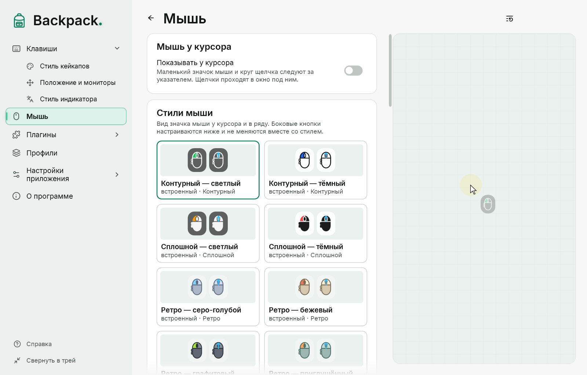
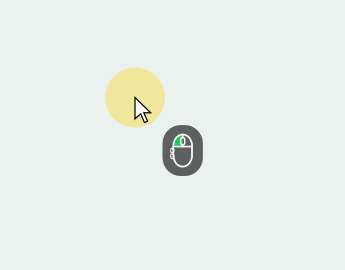
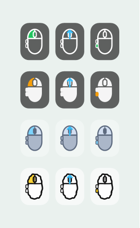

# Мышь

Мышь показывается двумя независимыми способами:

- **в ряду кейкапов** — кнопки как кейкапы, рядом с клавишами; включается на странице «Клавиши»;
- **у курсора** — значок мыши и круг щелчка следуют за указателем; раздел «Мышь».

## Мышь у курсора

[Показать пример](demo:mouse-cursor)

| Параметр | По умолчанию |
|---|---|
| Показывать у курсора | выключено |
| Значок | включён; размер 30; смещение 22 вправо и 22 вниз от острия указателя |
| Цвета значка | контур белый, заливка чёрная 60 %, нажатая кнопка зелёная |
| Круг щелчка | включён, появляется, пока кнопка нажата; диаметр 48; жёлтый, 35 % |
| Подсветка курсора | выключена; мягкое свечение, которое всегда следует за указателем, 72 DIP |

- Нажатая кнопка подсвечивается на значке. Левая, правая и средняя — на корпусе; «назад» и «вперёд» — выступы сбоку.
- Неизвестное состояние кнопки (например, после блокировки) показывается пунктиром.
- Окно у курсора не получает фокус и пропускает щелчки и перетаскивание. Оно следует за указателем на любом мониторе.
- Положение указателя и нажатия нигде не сохраняются.

В меню значка в трее есть быстрые переключатели для значка, круга щелчка и подсветки курсора. Если выключить все части, режим «Мышь у курсора» выключается целиком.

До версии 0.4.0-preview.2 круг щелчка был виден постоянно. Теперь он появляется при нажатии; включённый постоянный круг перенесён в подсветку курсора с тем же цветом и размером, поэтому вид не меняется незаметно.

## Стили мыши

Четыре способа отрисовки значка, у каждого — готовые палитры: **контурный**, **сплошной**, **ретро** (серо-голубой, бежевый, графитовый, приглушённый шалфей) и **скетч**. Выберите плитку в каталоге «Стили мыши»; свой стиль сохраняется так же, как стиль кейкапов ([Стили](11-styles.md)).

Нажатие меняет только свою часть значка: левую или правую кнопку, колесо или боковую кнопку — а не весь корпус.

## Боковые кнопки

«Боковые кнопки»: **Скрыть**, **Одна** или **Две**, **слева** или **справа**. Настройте под свою мышь: количество кнопок автоматически не определяется. Backpack различает левую, правую и среднюю кнопки и X1 (назад) и X2 (вперёд). Дополнительные кнопки часто переназначает драйвер мыши, и они не приходят как отдельные кнопки.

## Прокрутка

Пока колесо вращается, короткая стрелка в области колеса показывает фактическое направление: вверх, вниз и влево/вправо, если мышь сообщает горизонтальную прокрутку. Цвет стрелки и время показа задаются в «Прокрутке».

- Прокрутка и нажатие средней кнопки — разные события: подсвеченное колесо означает нажатие, стрелка — прокрутку.
- Мелкие шаги плавных колёс тоже показываются.
- Стрелка показывается на значке у курсора; ряд кейкапов прокрутку не показывает.
