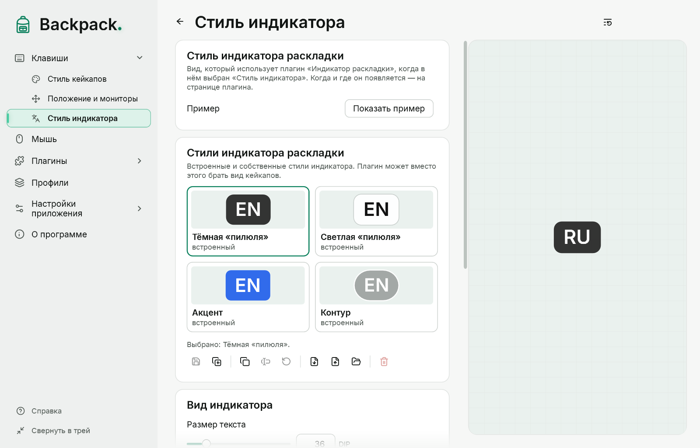

# Индикатор раскладки

Когда язык ввода активного окна другой программы меняется, на мгновение появляется его код: «EN», «UK», «RU» и т. д. Начиная с Backpack 0.4.0-preview.5 индикатор — **плагин от создателя**: он уже есть в каталоге («Плагины»), выключенный; включите его там (в первый раз Backpack попросит подтвердить доверие). После обновления с предыдущей версии ваши настройки и сочетание переходят в плагин, а сам он остаётся выключенным, пока вы его не включите.

[Показать пример](demo:layout-indicator)

## Как это работает

- Backpack сам следит за языком окна в фокусе (каждые 100 мс и только пока включён плагин, которому нужны смены раскладки) и сообщает плагину код, название и причину: переключение в том же окне или другое окно с другим языком. Плагин решает, показывать ли, и просит Backpack нарисовать индикатор. Нажатий клавиш он не получает.
- Неважно, как вы переключили язык: сочетанием, мышью на панели задач или переходом к другому окну. Backpack не угадывает по нажатиям.
- Смена принимается, когда новое значение увидено дважды подряд, поэтому индикатор появляется примерно через 0,1–0,3 с.
- Одна смена — один показ. При запуске, после разблокировки и выхода из сна язык только запоминается.
- Собственные окна Backpack не учитываются.

## Настройки

На странице плагина («Плагины» → «Индикатор раскладки» или его пункт со звёздочкой в боковом меню):

| Параметр | По умолчанию |
|---|---|
| Показывается | 1,2 с (от 0,2 до 10 с), отсчёт от момента появления |
| При переходе к окну с другой раскладкой | показывать |
| Название раскладки под кодом | да |
| Появление и исчезновение | как кейкапы; плавно; мгновенно |
| Вид | как кейкапы; или стиль индикатора |
| Место | над клавишами; или точка экрана (9 вариантов) со сдвигом |

**Стиль индикатора** (размер и цвет текста, фон, рамка, скругление, каталог стилей) — это стиль Backpack: «Клавиши» → «Стиль индикатора» ([Стили](11-styles.md)). Мониторы выбираются в «Положение и мониторы». Команды: «Индикатор раскладки: приостановить / продолжить» и «Индикатор раскладки: показать пример». Индикатор никогда не забирает фокус и пропускает щелчки.

## Если индикатор не появляется

1. Проверьте, что плагин «Индикатор раскладки» включён в «Плагинах» и не приостановлен.
2. Нажмите «Показать пример» (страница «Стиль индикатора»): если пример виден, показ работает.
3. Во время переключения посмотрите строку состояния индикатора в «Настройках приложения» → «Проверки» или строки «Раскладка» в окне диагностики: там последнее решение — например, «нет активного окна», «раскладка недоступна» или «выключено» (ни одному плагину не нужны смены раскладки).
4. Если индикатор молчит в одной программе, а в других работает, это известное ограничение: определение языка в некоторых программах ещё не подтверждено ручной проверкой.

## Ограничения

- Режим IME (например, кана или латиница в японском) не показывается — только язык.
- Если в Windows включено «Разрешить выбирать метод ввода для каждого окна приложения», язык меняется при переключении окон, и индикатор это показывает.
- Определение языка не подтверждено ручной проверкой в каждой программе. Не проверено: Терминал и консоль, приложения Microsoft Store, браузеры, Проводник, окна с правами администратора.
- Backpack не перехватывает текст и не вмешивается во ввод или IME. Права администратора не нужны.
