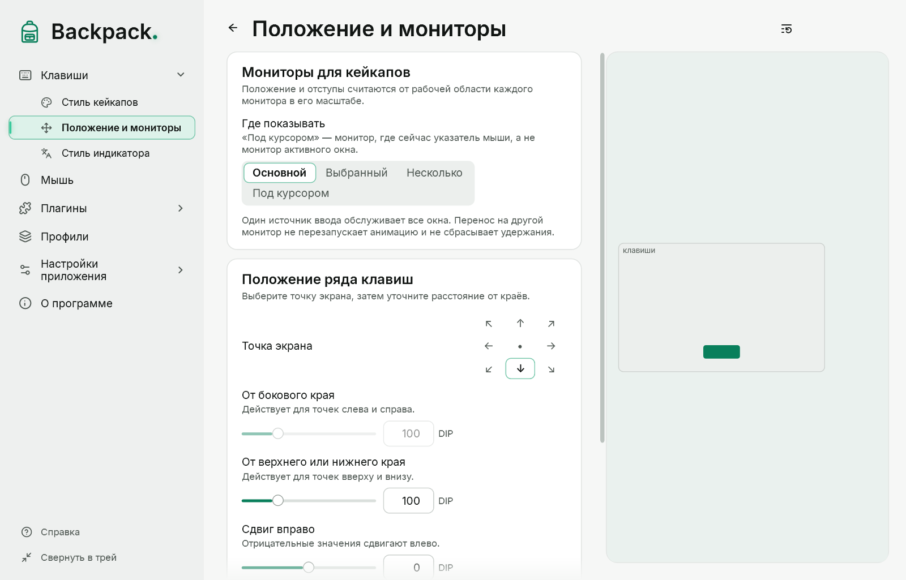

# Положение на экране

Страница «Клавиши» → «Положение и мониторы».

[Показать пример](demo:position)

| Параметр | По умолчанию | Что значит |
|---|---|---|
| Точка экрана | внизу по центру | к какой части экрана прижат ряд; 9 вариантов |
| От бокового края | 100 | отступ для точек слева и справа |
| От верхнего или нижнего края | 100 | отступ для точек вверху и внизу |
| Сдвиг вправо / вниз | 0 / 0 | сдвиг от точки; отрицательный — влево / вверх |

- Схема в превью показывает, где окажется ряд на основном мониторе.
- Кнопка «Внизу по центру» возвращает положение по умолчанию.
- Ряд не выходит за рабочую область экрана над панелью задач, даже при большом размере и больших сдвигах.
- Используется основной монитор.

Если загрузить профиль, сохранённый на другом компьютере с другим экраном, слишком большие отступы и сдвиги уменьшаются, чтобы ряд остался на экране. Файл профиля при этом не меняется.
