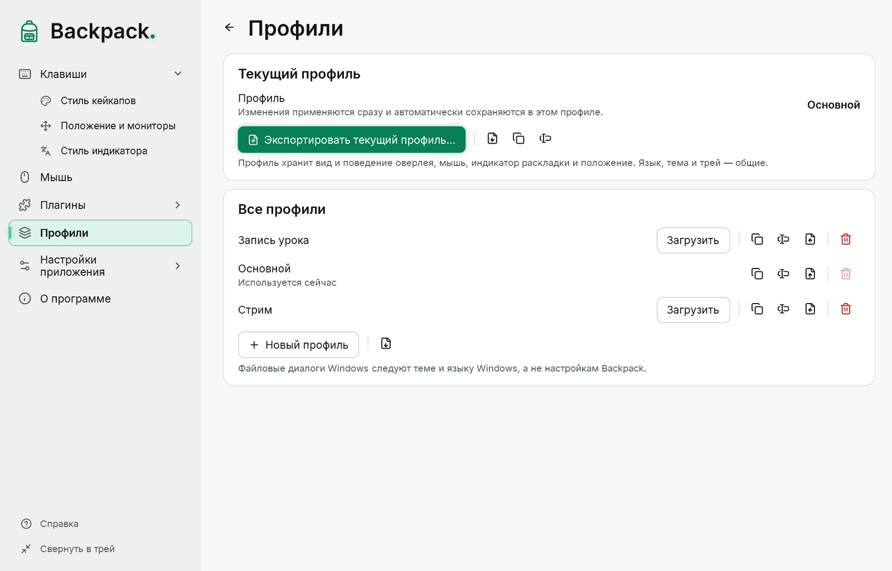

# Профили

Профиль — сохранённая целиком настройка оверлея под задачу: например, «Запись урока» с крупными кейкапами и мышью у курсора и «Стрим» с режимом «Только сочетания».

## Что входит в профиль

Всё, что меняет оверлей: вид кейкапов и подписей, фильтр, выдержка, след, анимации, счётчик, мышь в ряду и у курсора, индикатор раскладки и положение.

**Не входят:** язык интерфейса, тема интерфейса, поведение трея и глобальные горячие клавиши — это настройки этого компьютера. Источник захвата и параметры лабораторного запуска тоже не входят. В профиле нет кода, разметки окон и истории нажатий.

## Текущий профиль и автоматическое сохранение

Название текущего профиля показано на странице «Профили» и в меню значка в трее. Каждое изменение настройки применяется сразу и **автоматически сохраняется в текущем профиле** — кнопки «Сохранить» и отметки «не сохранён» нет. Быстрые серии изменений (например, движение ползунка) записываются вместе, не чаще двух раз в секунду; при переключении профиля, экспорте и выходе ожидающие изменения записываются немедленно.

- Число или цвет, которые ещё вводятся, не сохраняются: значение принимается по Enter или при уходе из поля, а неполный цвет вроде `#FF0` в профиль не попадает.
- Если файл профиля не удалось записать (диск заполнен, папка только для чтения), в окне настроек появляется «Не удалось сохранить изменения» с причиной и кнопкой **Повторить**. Изменения остаются применёнными и не пропадают.
- Файл профиля только для чтения (эталонный профиль) никогда не перезаписывается: при первом изменении Backpack создаёт рабочую копию «… — моя копия» и продолжает в ней.

При первом запуске Backpack 0.4.0-preview.3 профили, сохранённые прежними версиями, переносятся в новую модель без потерь: если применённые настройки отличались от сохранённого профиля, применённые становятся профилем, а прежняя сохранённая версия остаётся отдельным профилем (её название указано в сообщении при запуске).

## Создать и переключить профиль

1. Настройте отображение — изменения попадают в текущий профиль.
2. Чтобы начать другую настройку, нажмите «Новый профиль» (значения по умолчанию) или «Дублировать» (копия текущего), затем «Загрузить» в его строке.
3. Чтобы переключиться, нажмите «Загрузить» в строке профиля или выберите его в меню значка: «Профиль: …». Сначала записываются ожидающие изменения текущего профиля; если это не удалось, переключения нет, причина показана.

## Остальные действия

| Кнопка | Действие |
|---|---|
| Новый профиль | профиль со значениями по умолчанию |
| Дублировать | копия профиля с названием «… — копия» |
| Переименовать | новое название; файл и идентификатор не меняются |
| Удалить | после подтверждения; текущий профиль удалить нельзя |
| Экспортировать текущий профиль… | актуальное состояние всех настроек профиля, включая только что сделанные изменения |
| Экспорт… | сохранить профиль из списка в файл `.keyoverlay-profile.json` |
| Импорт… | добавить профиль из файла |

## Импорт и экспорт

- Импортируемый файл сначала проверяется целиком: формат, версия, каждое поле и диапазон. Если найдена хотя бы одна проблема, ничего не добавляется и не меняется, а Backpack показывает список проблем.
- Импортированный профиль получает новый идентификатор, поэтому не заменяет ваши профили. После импорта Backpack предложит загрузить его.
- Слишком большие отступы и сдвиги положения уменьшаются при загрузке, чтобы ряд был виден на этом экране.
- Профили записываются через временный файл: сбой во время записи не портит прежний файл.
- Окна выбора файла — системные окна Windows: они следуют теме и языку Windows.

Профили хранятся в папке `profiles` рядом с файлом настроек (`%APPDATA%\Backpack\profiles\`). Формат описан схемой `docs/settings/keyoverlay-lab-profile.schema.json`.

## Профили и стили

Стиль — только вид одного элемента; профиль хранит полную копию всех параметров вида, поведение и положение ([Стили](11-styles.md)).

- Экспорт профиля записывает и ваши собственные стили, которые он использует. При импорте они добавляются в каталог; если стиль с тем же идентификатором, но другими параметрами уже есть, импортированный получает новый идентификатор.
- Даже если стиля нет на другом компьютере, профиль сохраняет вид: параметры записаны в профиле.
