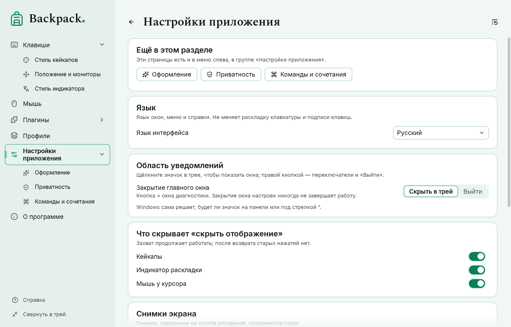

# Диагностика и приватность

## Окно диагностики

Открывается из «Настройки приложения» → «Проверки» → «Окно диагностики» → «Открыть» (в лабораторном режиме `--lab` — при запуске). Показывает:

- режим захвата (Raw Input, LL-хук или сравнение) и состояние каждого источника;
- счётчики событий, повторов, потерь и ресинхронизаций; задержки обработки;
- находки — подозрения и подтверждённые отказы;
- состояние оверлея (видим ли, поверх ли других окон);
- сообщения о загрузке настроек;
- строки «Раскладка» и «Мышь у курсора».

| Кнопка | Действие |
|---|---|
| Настройки… | окно настроек |
| Справка (F1) | эта справка |
| Скрыть оверлей / Показать оверлей | намеренно скрывает оверлей; захват продолжается |
| Экспорт агрегированного JSON… | файл только со счётчиками и задержками |
| Заморозить UI на 3 с | проверка перегрузки; захват продолжает работать |
| Сбросить состояние | считает все клавиши отпущенными |
| Свернуть в трей | прячет окна Backpack |
| Выйти | полный выход |

Внизу — список ручной проверки; кнопка над ним сворачивает его.

## Что сохраняется на диске

| Файл | Содержимое |
|---|---|
| `settings.json` | текущие параметры оверлея |
| `app.json` | язык, тема интерфейса, поведение трея, текущий профиль, горячие клавиши, параметры линзы, рисования и обновлений |
| `profiles\*.json` | сохранённые профили |
| `styles\*.json` | ваши стили |
| экспорт диагностики | только числа, флаги, коды находок и определения метрик |

Нигде не сохраняются коды клавиш, набранный текст, последовательности нажатий, положение указателя, окна, заголовки и программы. Логов, дампов памяти и сетевых обращений нет.

## Приватность на трансляции

Backpack показывает нажатия всем, кто видит экран. Перед вводом пароля:

- скройте отображение горячей клавишей или «Показывать отображение» в меню значка; или
- включите «Только сочетания».

Пока оверлей скрыт, нажатия и отпускания продолжают отслеживаться, поэтому после показа на экране не будет «залипших» клавиш.

## Известные ограничения

- Нажатия на экране блокировки, в окне UAC и Ctrl+Alt+Del не видны никаким программам.
- Видит ли Backpack ввод в программах, запущенных от имени администратора, ещё проверяется.
- Полноэкранные игры в эксклюзивном режиме могут перекрывать оверлей.
- Оверлей показывается на основном мониторе.
- Определение раскладки подтверждено ручной проверкой не во всех программах.

## Где лежат файлы

Папка — `%APPDATA%\Backpack`. В режиме portable (файл `Backpack.portable` рядом с `Backpack.exe`) — папка `Data` рядом с программой. Линза и рисование ничего не сохраняют на диске.
