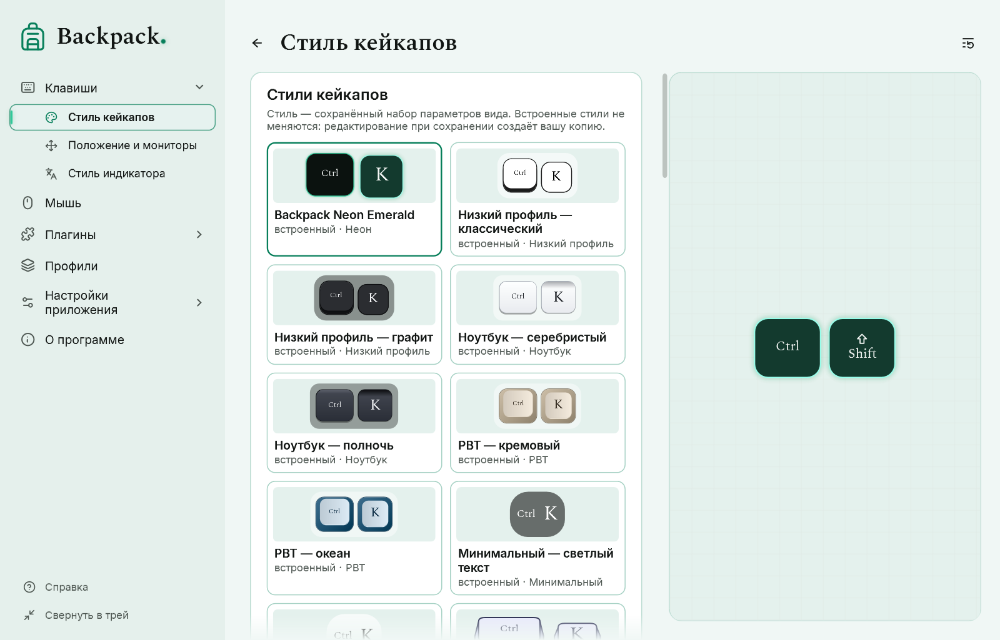
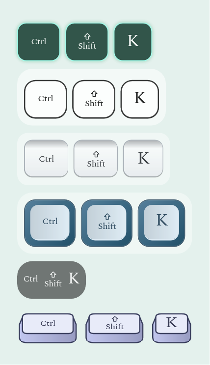

# Стили: кейкапы, индикатор, мышь

## Стиль, пресет, рендер и профиль

| Слово | Что это |
|---|---|
| Рендер | геометрия и способ отрисовки, встроенные в программу: низкий профиль, ноутбук, PBT, минимальный, объёмный, неон для кейкапов; контурный, сплошной, ретро, скетч, неон для мыши |
| Пресет | встроенный стиль: рендер с готовыми цветами и параметрами. Встроенные стили никогда не меняются |
| Ваш стиль | сохранённый вами набор параметров вида; лежит в папке стилей |
| Профиль | всё вместе: вид (полная копия параметров), поведение и положение. См. [Профили](07-profiles.md) |

Стиль — это только вид одного элемента. Размер, подписи, анимация, фильтры и положение остаются в профиле.

## Выбрать стиль

1. Откройте «Клавиши» → «Стиль кейкапов» (кейкапы), «Мышь» или «Клавиши» → «Стиль индикатора» (индикатор).
2. Щёлкните плитку в каталоге. Превью и оверлей сразу изменятся.
3. У выбранной плитки акцентная рамка. Строка под каталогом говорит, какой стиль выбран.

**Backpack Neon Emerald** — стиль новой установки: тёмные кейкапы и значок мыши с тонкой изумрудной линией и мягким свечением, которое усиливается, пока клавиша или кнопка нажата. «Свечение» на странице стиля задаёт его силу; 0 выключает. Если вы уже пользовались Backpack, ваши стили остаются как были. «Сбросить раздел» возвращает этот фирменный стиль.

Объёмный рендер показывает клавишу спереди и немного сверху: подпись стоит прямо на верхней грани, видны передняя грань и скошенные боковины, а нажатие опускает верхнюю грань вместе с подписью. Большинство клавиш квадратные; служебные клавиши и пробел — компактные удлинённые; Enter может быть Г-образным («Г-образный Enter» на той же странице).

## Изменить и сохранить

Действия со стилями — один компактный ряд значков: **сохранить**, **сохранить как новый** | **дублировать**, **переименовать**, **восстановить** | **импорт**, **экспорт**, **открыть папку стилей** | **удалить** (отдельно). У каждого значка есть подсказка с названием (и причиной, когда действие недоступно); в узком окне импорт, экспорт и папка переходят в меню «…», где у них есть названия.

- Измените любой цвет или параметр: строка состояния покажет «изменён».
- «Сохранить стиль» сохраняет в ваш стиль. Для встроенного стиля просит название и создаёт вашу копию — встроенный не меняется.
- «Сохранить как новый…» всегда создаёт новый стиль. «Дублировать» копирует выбранный.
- «Восстановить» возвращает параметры выбранного стиля.
- «Переименовать» и «Удалить» работают только для ваших стилей. Профиль, использовавший удалённый стиль, сохраняет свой вид: параметры хранятся в профиле.
- «Способ отрисовки» меняет только геометрию и сохраняет цвета.

## Импорт, экспорт и папка стилей

- «Экспорт» записывает выбранный вид в файл `.backpack-style.json`. «Импорт» сначала проверяет файл целиком; повреждённый или чужой файл отклоняется, и ничего не меняется.
- Если стиль с тем же идентификатором, но другими параметрами уже есть, импортированный получает новый идентификатор и «(импорт)» в названии; ничего не перезаписывается. Тот же стиль второй раз не добавляется.
- Файл стиля содержит только данные: цвета, числа и названия. Backpack никогда не загружает из него код, XAML или программы.
- «Открыть папку стилей» показывает папку с вашими стилями рядом с настройками (см. [Диагностика и приватность](09-diagnostics-and-privacy.md)).

## Индикатор раскладки: как у кейкапов или собственный стиль

«Вид» на странице плагина «Индикатор раскладки»: **Как кейкапы** берёт цвета кейкапов; **Стиль индикатора** использует стиль, выбранный в «Клавиши» → «Стиль индикатора» (каталог, размер и цвет текста, фон, рамка, скругление). Когда и где появляется индикатор — настраивается в плагине.

## Материал подложки

Подложка под группой кейкапов («Стиль кейкапов» → «Материал подложки») и под значком мыши («Мышь» → «Материал подложки значка») может быть **заливкой** — цвет подложки, прозрачность — альфа цвета — или **прозрачной** — без заливки, то, что позади, видно полностью, а форму держит тонкий контур цвета подложки. Размер, скругление и исчезновение не меняются; подписи и индикаторы кнопок не затрагиваются. Оба превью показывают результат на светлом и тёмном фоне. Выбор сохраняется в стиле кейкапов или мыши и в профиле.

Acrylic и Mica для подложки не предлагаются: на прозрачных для щелчков окнах оверлея Windows применяет их ко всему прямоугольнику окна, без скругления и без исчезновения вместе с клавишами. Профиль или стиль, который их запрашивает, использует заливку, и страница об этом говорит.
