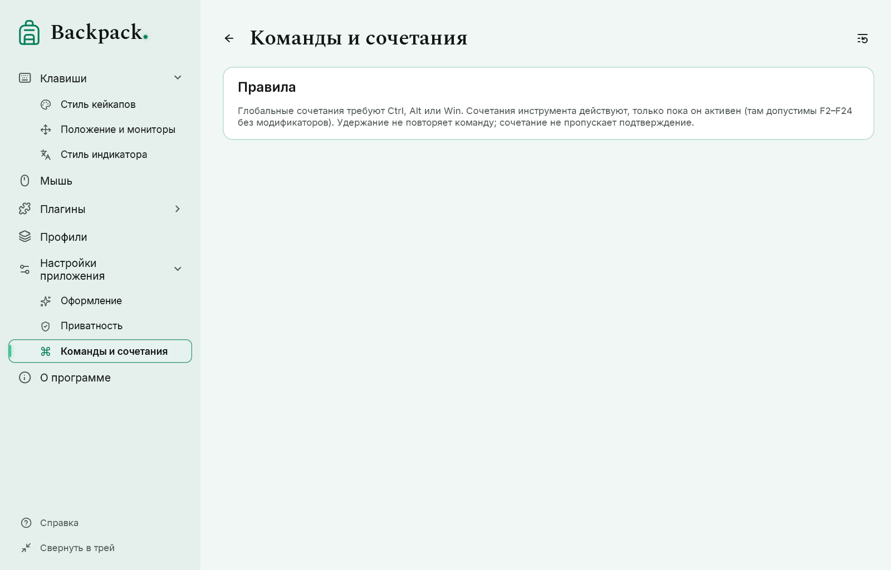
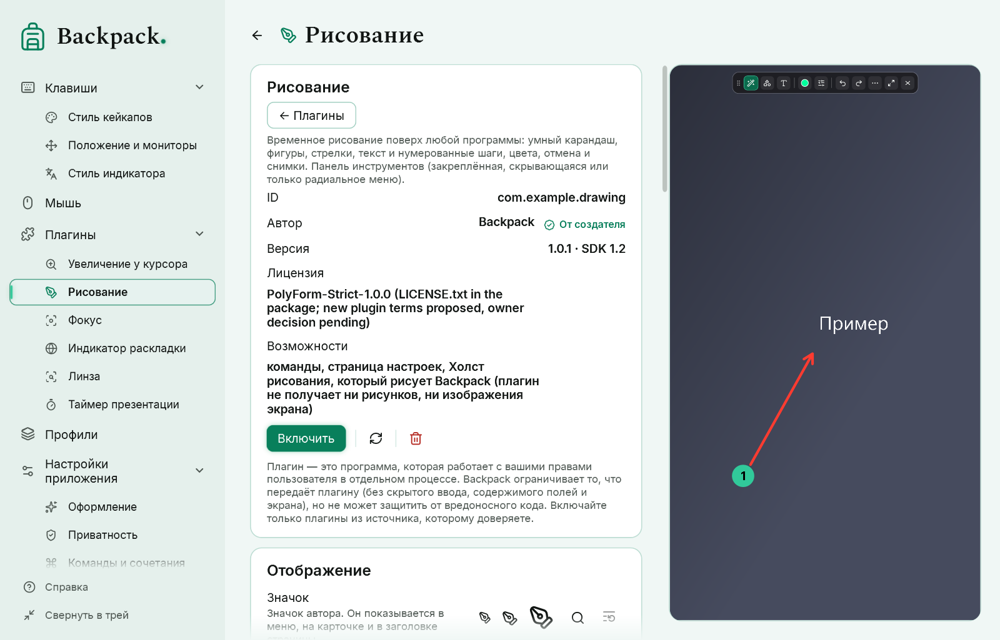
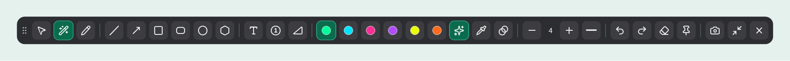
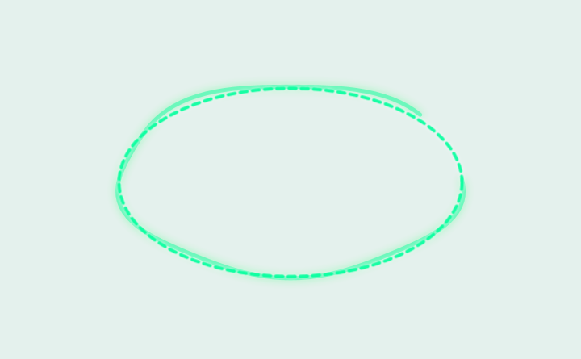
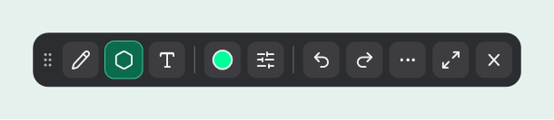
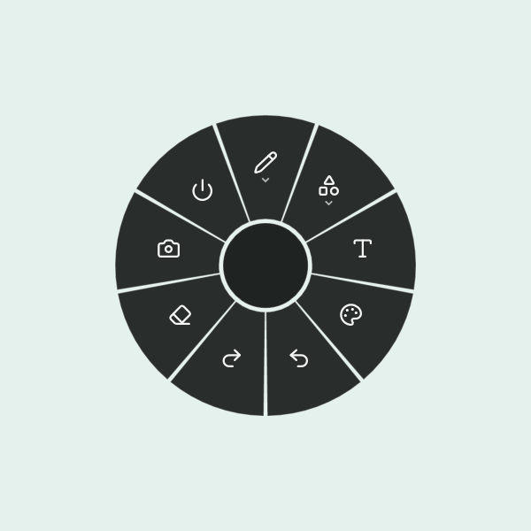
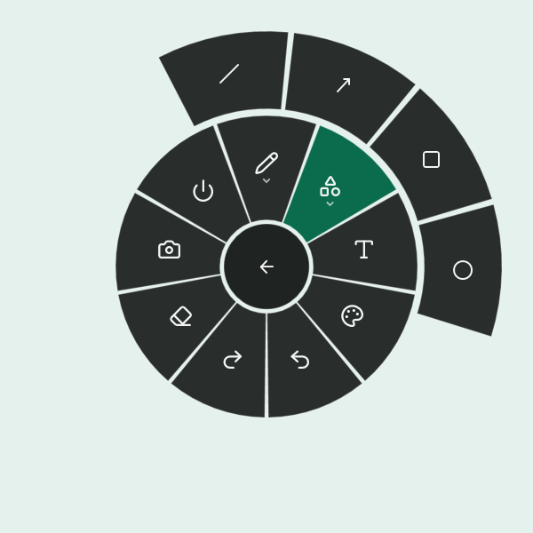

# Команды, сочетания и рисование

## Команды и сочетания

«Настройки приложения» → «Команды и сочетания». Каждое действие Backpack — одна команда: кнопка, пункт меню трея, сектор радиального меню и сочетание выполняют одну и ту же реализацию. Щёлкните поле и нажмите сочетание; Esc отменяет, Backspace удаляет.

| Команда | По умолчанию |
|---|---|
| Показать или скрыть отображение | Ctrl+Alt+Shift+O |
| Рисование: начать / завершить (плагин) | Ctrl+Alt+Shift+D |
| Рисование: радиальное меню (плагин) | Ctrl+Alt+Shift+R |
| Рисование: снимок экрана (плагин, только во время рисования) | F2 |

Команды плагина появляются, только когда плагин включён. Остальные команды (увеличение, линза, фокус, таймер, индикатор раскладки, подсветка курсора, каждый инструмент рисования, открытие страниц настроек) не имеют сочетания, пока вы его не назначите.

- Глобальному сочетанию нужны Ctrl, Alt или Win и ещё одна клавиша. Сочетания, которые использует Windows (Win+Space, Alt+Tab, Win+L и другие), назначить нельзя.
- Если сочетание уже занято другой программой, в состоянии написано «занято другой программой».
- Одно сочетание не может обслуживать две команды.
- Команды инструмента действуют только пока инструмент открыт (для плагина — пока открыт один из его инструментов), поэтому для них можно взять одну клавишу F2–F24. Вне инструмента клавиша остаётся другим программам.
- Сочетание перехватывает только своё сочетание. Удержание клавиш не повторяет команду.
- Сочетания — настройка этого компьютера: импорт профиля их не меняет. F1 остаётся локальной в окнах Backpack.

**Перенесено из прежних версий.** Отдельные сочетания ранних версий Backpack — обычные команды с теми же клавишами. Сочетания прежних встроенных рисования, индикатора раскладки, увеличения, линзы и «Фокуса» при обновлении Backpack переходят к командам плагинов; снятое вами сочетание остаётся снятым.

## Показать и скрыть отображение

По умолчанию команда скрывает кейкапы, индикатор раскладки и мышь у курсора; переключатели на странице «Настройки приложения» выбирают части. Захват ввода продолжается, поэтому после показа нет старых нажатий и «залипших» клавиш. Скрытие также закрывает инструменты плагинов и рисование.

## Рисование

Рисование — **плагин от создателя** («Плагины» → «Рисование»); включите его там. Затем нажмите его сочетание или выполните «Рисование: начать / завершить» из трея, радиального меню или страницы плагина. Пока режим включён, мышь рисует поверх живого рабочего стола; после выхода рабочий стол работает как обычно. Холст, панель и радиальное меню рисует Backpack; плагин хранит настройки и не получает ни рисунков, ни изображения экрана.

| Группа | Инструменты |
|---|---|
| Рисовать | Выбор и перемещение, **Умный карандаш** (по умолчанию), Карандаш |
| Фигуры | Линия, Стрелка, Прямоугольник, Скруглённый прямоугольник, Эллипс, Правильный многоугольник |
| Текст и отметки | Текст, Нумерованная отметка |

- Цвета: шесть готовых, **любой цвет** (палитра, `#RRGGBB` или `#RRGGBBAA` с прозрачностью) и быстрый переключатель прозрачности 60 %.
- Толщина −/+, сплошная, пунктирная или точечная линия.
- Отменить (Ctrl+Z), повторить (Ctrl+Y), очистить всё; рисунки исчезают через несколько секунд или остаются до выхода.
- Камера — снимок, × — выход (также Esc или сочетание рисования). Рисунки не сохраняются.
- Последние инструмент, цвет, толщина и линия запоминаются в настройках плагина; папка снимков — в «Настройках приложения».

### Умный карандаш

Умный карандаш превращает нарисованную линию, дугу, угол, эллипс, прямоугольник или многоугольник (3–8 углов, в том числе повёрнутый квадрат или треугольник) в ровную фигуру, которую можно менять.

- **Во время рисования** распознанная фигура показывается пунктиром поверх штриха; ваш штрих остаётся виден, немного приглушённым. Предложение не перескакивает между фигурами при каждом движении: новая фигура появляется только после нескольких распознаваний подряд.
- Если распознавание не уверено, предложения нет и штрих остаётся штрихом.
- **Когда отпускаете кнопку**, результат фиксируется. Отмена возвращает ваш исходный штрих, вторая отмена убирает и его. Само предложение ничего не добавляет в историю.
- Распознавание выполняется на этом компьютере; штрихи никуда не отправляются.
- **Дуга**: плавная кривая становится дугой через три точки — начало, конец и точку посередине. У выбранной дуги три ручки, по одной на каждую точку. Три точки на одной прямой дают прямую линию, а не ломаную дугу.
- **Угол**: два прямых штриха, сходящихся в углу («V» или «L»), становятся углом. Пока кнопка зажата, у вершины показана его величина в градусах (меньший из двух углов, 0–180°). Подпись отходит от указателя и остаётся в пределах экрана. Кнопка угла на панели оставляет подпись и после того, как вы отпустите кнопку.

### Shift и Alt при рисовании фигур

| Клавиша | Прямоугольник, скруглённый прямоугольник, эллипс | Линия, стрелка | Правильный многоугольник |
|---|---|---|---|
| **Shift** | квадрат или круг | направление шагами по 15° | поворот шагами по 15° |
| **Alt** | от центра | — | — |
| **Shift+Alt** | квадрат или круг от центра | — | — |

Клавиши действуют во время протягивания: нажмите или отпустите их в любой момент — фигура изменится сразу. Короткая подсказка о них появляется внизу экрана, когда вы впервые выбираете каждый инструмент.

### Скруглённый прямоугольник и правильный многоугольник

- **Скруглённый прямоугольник**: радиус углов задаётся −/+ рядом с инструментом (0–120 DIP). Радиус никогда не больше половины меньшей стороны.
- **Правильный многоугольник**: нажмите в центре и тяните к вершине — расстояние задаёт размер, направление поворачивает фигуру. Число вершин (3–12) задаётся −/+ рядом с инструментом. Фигуру видно во время построения; щелчок без протягивания ничего не создаёт.
- Распознавание нарисованного многоугольника (умный карандаш) и построение правильного многоугольника — разные инструменты: умный карандаш сохраняет нарисованные вами углы.

### Выбор и перемещение

Выберите «Выбор и перемещение», щёлкните фигуру, текст или отметку и перетащите. Delete удаляет выбранное, Esc снимает выбор. Перемещение и удаление — шаги истории, как и рисование.

У выбранной фигуры есть **ручки**: углы и стороны меняют размер, круглая ручка над рамкой поворачивает фигуру. Указатель показывает, что делает ручка.

- **Shift** сохраняет пропорции при изменении размера и поворачивает шагами по 15°; **Alt** меняет размер от центра.
- **Esc** во время перетаскивания отменяет его и возвращает фигуру как была.
- Одно перетаскивание — один шаг истории.
- Толщина линии при изменении размера не меняется. Текст масштабируется целиком, как картинка; нумерованные отметки только перемещаются.

### Компактная панель

Кнопка с двумя стрелками переключает полную и компактную панель (сохраняется в профиле).

Компактная панель оставляет три кнопки групп (каждая показывает текущий инструмент своей группы), текущий цвет и кнопку линии; инструменты, цвета и параметры открываются в небольших всплывающих группах. Текущие инструмент и цвет всегда видны.

### Вид панели

| Вариант | Как работает |
|---|---|
| Всегда видна | Панель остаётся на экране. Перетаскивайте за ручку — место запоминается; «Вернуть наверх по центру» сбрасывает его. |
| Автоскрытие у края | Панель прячется у выбранного края. Задержите указатель у края — панель выезжает; когда указатель далеко, прячется. |
| Только радиальное меню | Панели нет. Правый щелчок или сочетание радиального меню открывает все инструменты; Esc — выход. |

### Текст

1. Выберите «Текст» и щёлкните там, где должен быть текст.
2. Печатайте; Enter начинает новую строку. Перетащите поле за ручку, чтобы передвинуть его до подтверждения.
3. Ctrl+Enter или щелчок вне поля подтверждает; Esc отменяет только этот текст.

### Снимок

F2 (меняется на странице «Команды и сочетания») или кнопка камеры. Снимается монитор, где включено рисование, с вашими рисунками, но без панели, подсказок и меню, в настоящих пикселях монитора. «Сохранить в файл», «Копировать» или «Сохранить и копировать» и что делать с рисунками после снимка — на странице плагина «Рисование»; папка — в «Настройках приложения». Если сохранить не удалось, рисунки никогда не удаляются.

## Радиальное меню

Нажмите сочетание радиального меню или правую кнопку в режиме рисования: вокруг указателя появляется кольцо (рисование включается, если было выключено).

- **Внутреннее кольцо** — категории и основные действия: Рисование, Фигуры, Текст и отметки, Цвет, Правка, Фокус, Показ на экране, Плагины (когда у включённых плагинов есть команды), Снимок, Выход.
- **Категория открывает внешнее кольцо** с её действиями; выбранная категория остаётся подсвеченной. Кнопка в центре становится «Назад».
- **Esc закрывает по одному уровню**: сначала внешнее кольцо, затем меню. Щелчок в центре делает то же.
- Сектор срабатывает, только если нажать и отпустить кнопку мыши на одном и том же секторе, поэтому соседний не выберется случайно. Недоступные команды (выключенный инструмент, нечего отменять) приглушены и не выбираются.
- Клавиатура: стрелки — по кругу активного кольца, Enter или Пробел — выбрать, Backspace — назад.
- У края экрана меню сдвигается внутрь, чтобы оба кольца были видны целиком; на очень маленьком экране оно уменьшается.

## Какие режимы работают вместе

| Вместе | Правило |
|---|---|
| Фокус и рисование | запуск «Фокуса» закрывает рисование |
| Радиальное меню | в режиме рисования (сочетание включает рисование) |

Esc закрывает по одному слою: всплывающую группу панели, выбор, ввод текста, кольца меню, затем рисование. После выхода не остаётся ни одного окна, перехватывающего мышь. Блокировка компьютера, смена рабочего стола или сон закрывают всё.
