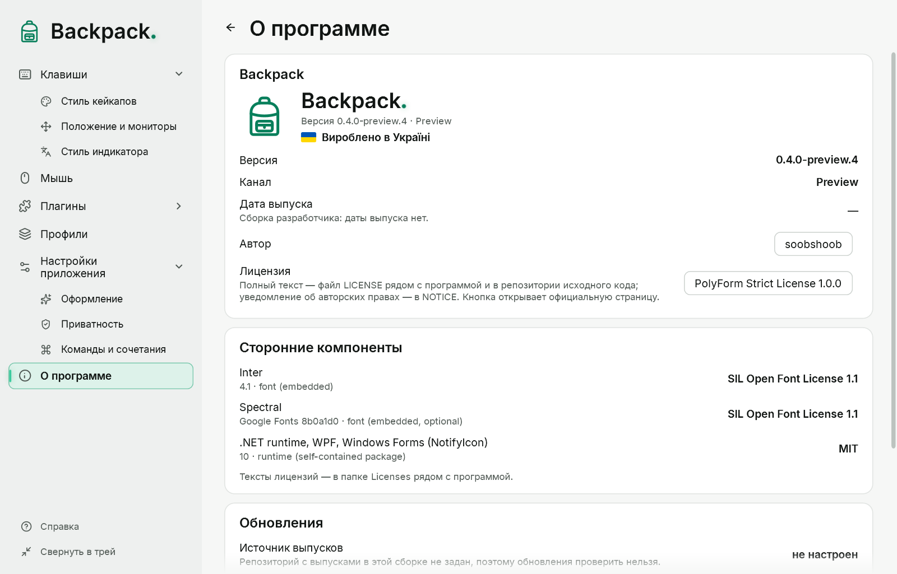

# О Backpack и обновления

## Страница «О программе»

- Название, логотип, версия и канал (Stable или Preview).
- Дата выпуска — берётся из самого выпуска. У сборки разработчика даты выпуска нет, и это написано.
- Автор: soobshoob (ссылка на профиль GitHub; открывается в браузере после подтверждения).
- Лицензия ядра Backpack — Mozilla Public License 2.0 (кнопка открывает официальную страницу). Полный текст — `LICENSE.txt` рядом с программой, уведомление об авторских правах — `NOTICE.txt`. Коротко: программу можно использовать, изменять и распространять; если вы распространяете изменённые файлы ядра, их исходный код должен оставаться доступным по той же лицензии. Действует именно текст лицензии.
- SDK для плагинов и плагины от автора не подпадают под MPL: у них собственные условия, перечисленные в `LICENSE-STATUS.md` и в каждом пакете плагина.
- «Сделано в Украине».
- Сторонние компоненты с их лицензиями. Их тексты — в папке `Licenses` рядом с программой.

## Проверка обновлений

- «Проверить» запрашивает у GitHub Releases репозитория Backpack самую новую версию выбранного канала.
- **Stable** никогда не предлагает предварительные версии; **Preview** предлагает оба вида.
- Если есть более новая версия, вы увидите её номер, дату и описание и кнопку, которая открывает официальную страницу загрузки в браузере.
- «Проверять автоматически» (по умолчанию выключено) повторяет проверку раз в сутки, пока работает Backpack, и показывает краткое уведомление у значка в трее.
- Backpack никогда не скачивает и не запускает обновления сам. Чтобы обновиться, скачайте новый пакет со страницы и замените папку (настройки сохраняются, см. ниже).

В GitHub уходит только запрос списка выпусков. Настройки, профили и ввод никогда не отправляются.

## Когда проверка не может завершиться

| Сообщение | Что это значит |
|---|---|
| Источник выпусков не настроен | эта сборка не знает репозиторий с выпусками; проверить невозможно |
| Нет соединения с GitHub | нет сети или GitHub недоступен |
| GitHub не ответил вовремя | запрос длился больше 10 секунд |
| GitHub ограничил число запросов | попробуйте позже |
| GitHub вернул неожиданный ответ | ответ не удалось прочитать |
| Версия … есть, но пакета для Windows x64 ещё нет | дождитесь пакета |

## Обновление и удаление

- **Обновление:** выйдите из Backpack («Выйти из Backpack» в меню трея), замените папку программы новой и запустите `Backpack.exe`. Настройки, профили и стили лежат в `%APPDATA%\Backpack` и остаются.
- **Режим portable:** если рядом с `Backpack.exe` лежит файл `Backpack.portable`, настройки хранятся в папке `Data` рядом с программой (когда в неё можно писать). При обновлении скопируйте `Data` в новую папку.
- **Удаление:** выйдите из Backpack и удалите папку программы. Чтобы удалить и настройки, удалите `%APPDATA%\Backpack` (или `Data` в режиме portable). Backpack ничего не пишет в реестр и не запускается вместе с Windows.
