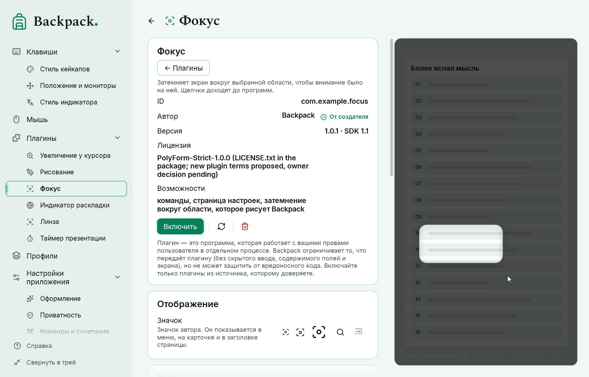
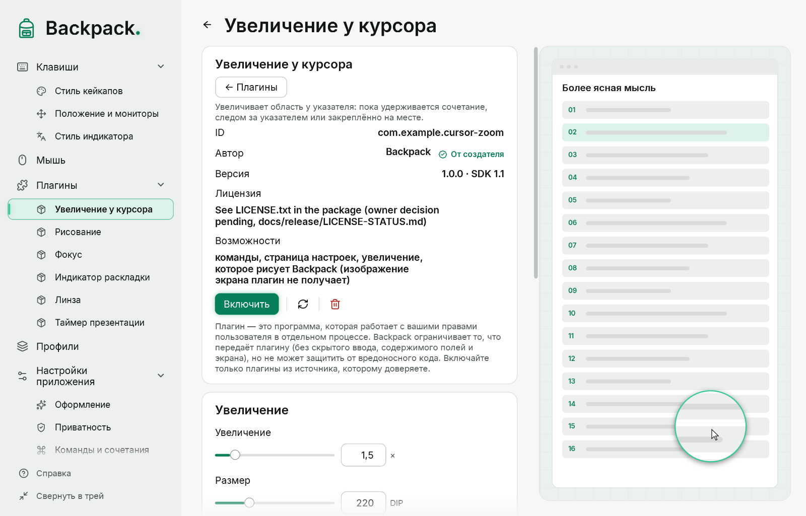

# Увеличение, линза, фокус и таймер

Эти инструменты — **плагины**: у каждого свой идентификатор, версия, настройки, команды, страница и демонстрация. Они поставляются вместе с Backpack в папке `Plugins` рядом с программой, но не включены: импортируйте их на странице «Плагины» и включите нужные (Backpack попросит подтвердить доверие). Как устроены плагины — в разделе [Плагины](15-plugins.md).

## Увеличение у курсора

Три независимые команды — у каждой своё сочетание, режим выбирать не нужно:

| Команда | Поведение |
|---|---|
| «Увеличение: пока удерживается» | увеличение видно, пока сочетание нажато; отпускание закрывает |
| «Увеличение: следом за указателем вкл. / выкл.» | увеличение следует за указателем до повторного нажатия |
| «Увеличение: закрепить здесь / убрать» | живое увеличение остаётся там, где был указатель |

- На экране всегда не больше одного увеличения: «следом» и «закрепить» заменяют друг друга; удержание во время уже открытого увеличения ничего не добавляет.
- Повторное нажатие той же команды закрывает увеличение. Esc, блокировка Windows, отключение или удаление плагина закрывают его сразу.
- У увеличения нет кнопок и ручек: указатель всегда внутри него, поэтому управление только командами и Esc.
- Windows не сообщает об отпускании сочетания: Backpack проверяет его каждые 30 мс и закрывает удержание не позже чем через 5 минут.
- Клики проходят сквозь увеличение. Системный указатель и собственные окна Backpack в изображение не попадают.

## Линза

«Линза: открыть / закрыть» — выделите область мышью (Esc — отмена, щелчок без перетаскивания — область размера из настроек). Появляется перемещаемое окно с живой увеличенной копией области-источника; источник отмечен пунктирной рамкой, если включено «Показывать источник». Линза и источник перемещаются независимо.

## Фокус

«Фокус: затемнить вокруг области / выкл.» — выделите область; остальная часть монитора (или все мониторы, по настройке) затемняется. Сама область не меняется: это не увеличение и не снимок.

## Снимок поверх окон

Плагин «Снимок поверх окон» держит **неподвижное изображение** части экрана поверх других окон — например, чертёж рядом с моделью в CAD на одном мониторе. Это не живое зеркало: изображение не меняется, пока вы не снимете новое.

| Команда (сочетание по умолчанию) | Действие |
|---|---|
| «Снимок поверх окон: снять область / заменить» (Ctrl+Alt+Shift+S) | выберите область мышью — изображение появится сразу. Если снимок уже есть, новый заменит его |
| «Снимок поверх окон: развернуть / свернуть» (Ctrl+Alt+Shift+E, только пока есть снимок) | развернуть почти на весь экран и обратно |
| «Снимок поверх окон: показать / скрыть», «удалить снимок», «показать управление», «сбросить настройки и место» | без сочетания по умолчанию — назначьте на странице плагина |

- **Выбор:** протяните прямоугольник; щелчок без протягивания берёт размер по умолчанию; Esc или правая кнопка отменяют (прежний снимок остаётся). Окно выбора и текущий снимок скрываются до съёмки, поэтому в изображение не попадают. Изображение сохраняет полное разрешение снятых пикселей.
- **Перемещение и размер:** тяните само изображение или ручку над ним; ручка в углу меняет размер и сохраняет пропорции. Ручки и кнопки «Развернуть», «Заменить», «Скрыть» и «Удалить» появляются при наведении, как у линзы. Место и размер запоминаются.
- **Разворачивание:** двойной щелчок по изображению, **пробел, пока указатель над ним**, сочетание или кнопка. Изображение занимает примерно 90–95 % рабочей области монитора в своих пропорциях. Свернуть — так же, а также Esc, щелчком вне его или переключением на другое окно — снимок возвращается точно на прежнее место и в прежний размер.
- **Пробел** перехватывается, только пока указатель над снимком, кнопки мыши отпущены и в активном окне не вводится текст; иначе пробел остаётся программам. Если это мешает, выключите «Пробел над снимком» и пользуйтесь сочетанием.
- Изображение не забирает фокус клавиатуры, а щелчки вне его доходят до программы под ним. «Щелчки проходят сквозь снимок» делает прозрачным для мыши и само изображение.
- Изображение хранится **только в памяти**: оно никогда не записывается на диск и не передаётся плагину. Оно исчезает, когда вы его удаляете, выключаете плагин или выходите из Backpack (а также, если вы так выберете, при блокировке Windows).

## Управление при наведении

Кнопки, подписи и ручки перемещения и размера у линзы, фокуса и таймера по умолчанию скрыты — видно только содержимое (увеличенное изображение, рамка, цифры).

- Наведите указатель на инструмент или его компактную область управления — панель плавно появится; уйдите — скроется с небольшой задержкой, без мигания.
- Переход с инструмента на панель её не закрывает. Во время перетаскивания, изменения размера и открытого меню панель остаётся.
- Скрытые элементы не перехватывают щелчки, наведение не забирает фокус у приложения под инструментом. Щелчки по линзе и области фокуса проходят к приложению.
- Команды «Линза: показать управление» и «Фокус: показать управление» показывают панель без наведения.
- При выключенных анимациях Windows панель появляется сразу. Панель держится в пределах текущего монитора.

## Таймер

Плагин «Таймер презентации» показывает обратный отсчёт поверх других окон.

| Команда | Действие |
|---|---|
| «Таймер: старт / пауза» | запуск, пауза и продолжение |
| «Таймер: сбросить» | возврат к заданному времени |
| «Таймер: показать / скрыть панель» | панель без изменения отсчёта |

- Панель перемещается и растягивается за ручки, которые видны при наведении; размер цифр, прозрачность и цвет акцента — в настройках плагина. Настройки сохраняются в профиле.
- Отсчёт идёт по часам, а не по срабатываниям таймера интерфейса: нагрузка и задержки отрисовки не растягивают секунды.
- **Сон компьютера:** время во сне тоже идёт. Если отсчёт закончился во сне, после пробуждения панель показывает 00:00 и состояние «закончено».
- По окончании остаётся 00:00 и ненавязчивая рамка акцента. Звук — отдельная настройка, по умолчанию выключена.
- После перезапуска Backpack таймер не запускается сам и панель не появляется до первой команды.

## Перенос со встроенных инструментов

В прежних версиях лупа, линза и фокус были встроены. При импорте поставляемых плагинов Backpack переносит их настройки, сочетания и пункты меню: прежняя общая команда «Фокус» переходит в команду того режима, который был выбран. Перенос не включает плагин и не подтверждает доверие — это делаете вы.
