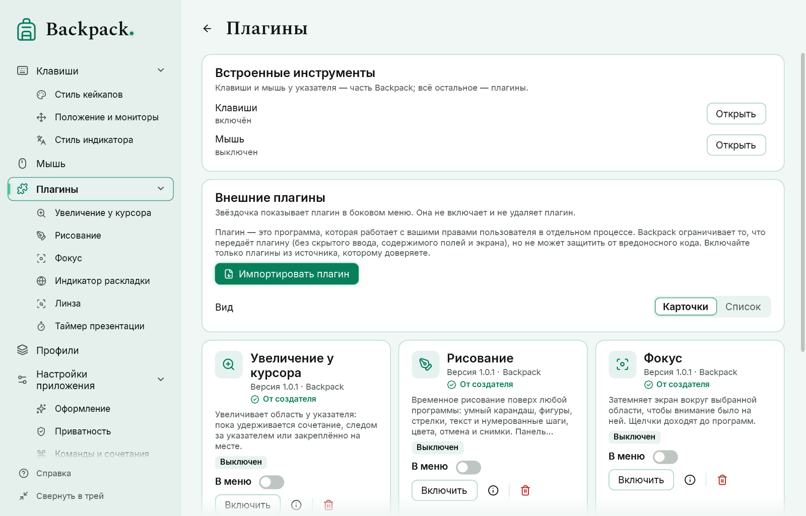

# Плагины

## Установка

«Плагины» → «Импортировать плагин» → выберите файл `.bppkg`. Backpack проверяет пакет (пути, размеры, дубликаты, `manifest.json`, входную сборку, совместимость SDK) и распаковывает его. **Импорт не запускает никакого кода и не даёт доверия.** Новый или обновлённый плагин устанавливается выключенным.

| Действие | Где |
|---|---|
| Подробно, настройки, команды | значок «Подробнее» или пункт плагина со звёздочкой в боковом меню |
| Включить / выключить | «Включить» (текстовая кнопка: ведёт к подтверждению доверия) / значок питания |
| Обновить | импортировать более новую версию того же плагина (старая или та же версия отклоняется) |
| Удалить | значок корзины, отделённый от остальных (просит подтверждения; настройки тоже удаляются) |
| Показывать в боковом меню | звёздочка «В меню» — она не включает и не удаляет плагин |

Клавиши и мышь у указателя — часть Backpack. Всё остальное — плагины: **Рисование, Индикатор раскладки, Увеличение у курсора, Линза, Фокус, Таймер и Снимок поверх окон** поставляются с Backpack как **плагины от создателя**. При запуске Backpack добавляет их в каталог выключенными, не запуская их код; искать пакеты не нужно. У них есть отметка **От создателя**: установленный пакет совпадает с индексом поставки этой версии Backpack по контрольной сумме SHA-256. Отметка не зависит от имени автора в manifest и не является криптографической подписью издателя; у пакета, который вы импортируете сами, отметки нет.

После обновления с предыдущей версии настройки, сочетания и пункты меню прежних встроенных инструментов переходят к этим плагинам, об этом появляется уведомление, а плагины остаются выключенными, пока вы их не включите. Включённый вами плагин остаётся включённым после обновления, поставленного вместе с Backpack. Удалённый вами плагин от создателя сам не возвращается: в карточке «Плагины от создателя, которые не установлены» есть «Добавить снова».

### Карточки или список



Установленные плагины по умолчанию показаны **карточками**: иконка (или первая буква названия на плитке, если в пакете нет иконки), название, версия и автор, краткое описание, состояние — включён, выключен или ошибка (например, «отключён после повторных сбоев») — переключатель «В меню», «Подробнее», «Включить / Выключить» и «Удалить». В сетке столько столбцов, сколько помещается; длинные названия и описания переносятся или сокращаются с подсказкой. **Список** показывает то же строками. Выбор запоминается.

### Значок плагина

Каждый плагин показывает значок в боковом меню, на карточке и в шапке своей страницы. Автор выбирает его в `manifest.json` (`"symbol"`, имя одного из значков, встроенных в Backpack). Чтобы выбрать свой: откройте страницу плагина → «Отображение» → «Выбрать значок», найдите нужный по слову (pen, timer, search…) и щёлкните. Ваш выбор сохраняется при обновлении плагина; «Вернуть значок автора» возвращает авторский. Значки рисует Backpack: плагин не может загружать для них картинки из интернета. Звёздочки среди значков нет — в меню она означает «В меню».

Просмотр карточек читает только `manifest.json` и картинку иконки: код плагина не запускается. Первое включение плагина, как и раньше, просит подтвердить доверие; карточка этого не обходит и возможностей не даёт.

## Доверие

Плагин — это программа. Перед первым запуском Backpack просит подтвердить, что вы ему доверяете. Плагин работает в **отдельном процессе** с вашими правами пользователя; если он сбоит или зависает, Backpack продолжает работать. Три сбоя за 10 минут выключают плагин. Чтобы запустить Backpack без плагинов, выполните `Backpack.exe --no-plugins`.

Чего Backpack **не передаёт** плагину: ввод, скрытый динамической приватностью, сырые хуки клавиатуры, содержимое полей, тексты и заголовки окон, историю указателя, экран. Плагин с возможностью «видимые клавиши» получает только названия клавиш, прошедших фильтр приватности.

Чего Backpack **не может**: защитить от вредоносного кода. Отдельный процесс — не песочница: плагин может то же, что любая запущенная вами программа. Включайте только плагины из источника, которому доверяете.

Импорт профиля никогда не устанавливает, не подтверждает доверие и не запускает плагин.

## Создание плагина

Нужен .NET 10 SDK. Примеры — семь плагинов от создателя: исходный код в `lab/samples` (папка `Samples` в пакете Backpack), готовые пакеты в `Plugins`:

| Пример | Что показывает |
|---|---|
| `Drawing` | `overlay.draw` — холст рисования хоста, команды `whileTool` (F2 только во время рисования), `UpdateSettings` |
| `LayoutIndicator` | `input.layout` и `overlay.indicator` — смены раскладки и индикатор, который рисует хост |
| `CursorZoom` | `overlay.magnifier`, команда удержания (`hold`) и два переключателя |
| `Lens` | `overlay.magnifier` с отдельной областью-источником |
| `Focus` | `overlay.dim` — затемнение вокруг области |
| `PresentationTimer` | `overlay.panel` с кнопками, состоянием и перемещаемой панелью |
| `SnapshotOverlay` | `overlay.snapshot` (SDK 1.3) — неподвижный снимок области экрана в плавающем окне, команды `whileTool`, `UpdateSettings` для «сбросить» |

```powershell
dotnet build lab/samples/Drawing/Drawing.csproj -c Release
powershell -ExecutionPolicy Bypass -File tools/pack-plugin.ps1 -Project lab/samples/Drawing/Drawing.csproj -Out artifacts/plugins
```

Результат — `artifacts/plugins/<id>-<version>.bppkg`.

Плагин — библиотека классов .NET, которая ссылается на `Backpack.Sdk` (в пакет не копируется: её предоставляет Backpack) и содержит класс, производный от `BackpackPlugin`:

| Метод | Когда |
|---|---|
| `OnStart()` | плагин включён |
| `OnCommand(id)` | пользователь выполнил команду из manifest |
| `OnSettingsChanged()` | пользователь изменил настройку; значения — в `Context.Settings` |
| `OnVisibleKey(key, down)` | только с `input.visible`: клавиша, прошедшая фильтр приватности |
| `OnCommandReleased(id)` | отпущено сочетание команды с `"hold": true` |
| `OnToolClosed(tool, reason)` | инструмент хоста закрыт (Esc, блокировка, выключение, `busy` — холст занят другим плагином) |
| `OnPanelButton(id)` | нажата кнопка панели |
| `OnLayoutChanged(e)` | SDK 1.2, только с `input.layout`: код, название раскладки и причина (`switch` или `window`) |
| `OnToolState(tool, values)` | SDK 1.2: пользователь изменил открытый инструмент на нём самом (для рисования: инструмент, цвет, толщина, место панели) |
| `OnStop()` | плагин выключен или Backpack завершается |

`Context.ShowPanel(title, text, progress)` показывает панель поверх экрана (нужна `overlay.panel`); рисует её Backpack. `Context.UpdateSettings(values)` (SDK 1.2) записывает собственные значения настроек плагина, проверенные по manifest. Методы должны быстро возвращать управление.

### Инструменты хоста (SDK 1.1 и 1.2)

`Context.OpenMagnifier(id, request)` открывает увеличение, которое рисует Backpack: у указателя, закреплённое или с областью-источником (`overlay.magnifier`); `Context.OpenDim(id, request)` затемняет вокруг области (`overlay.dim`). SDK 1.2 добавляет `Context.OpenDrawing(id, request)` и `Context.DrawAction(id, action)` — холст рисования с панелью, радиальным меню, фигурами, умным карандашом, текстом, номерами, цветами, отменой и снимками (`overlay.draw`, один холст одновременно) — и `Context.ShowIndicator(request)` — короткий код со второй строкой в виде кейкапов или стиле индикатора (`overlay.indicator`). SDK 1.3 добавляет `Context.OpenSnapshot(id, request)` и `Context.SnapshotAction(id, action)` — неподвижный снимок области, которую выбирает пользователь, в окне поверх других, которое можно перемещать, менять размер и на время разворачивать (`overlay.snapshot`); изображение остаётся в памяти Backpack. `Context.EditTool(id)` показывает управление инструментом, `Context.CloseTool(id)` закрывает его. **Плагин не получает ни изображения экрана, ни рисунков, ни координат указателя** — только сообщение, когда инструмент закрыт или пользователь изменил его параметры. Панель (`overlay.panel`) может иметь кнопки, состояние (`normal`, `warning`, `finished`), акцент и перемещаться; кнопки и ручки появляются при наведении через общий механизм хоста.

### manifest.json

| Поле | Значение |
|---|---|
| `format`, `formatVersion` | `backpack-plugin`, `1` |
| `id` | в стиле обратного домена, строчными буквами: `com.example.timer`; `backpack.*` зарезервировано |
| `name`, `description` | текст или `{ "en", "uk", "ru" }` |
| `author`, `version` | версия — `1.2.3` или `1.2.3-beta` |
| `sdk` | нужная версия SDK, например `1.2` |
| `entry`, `type` | путь к сборке в пакете и имя класса |
| `capabilities` | `commands`, `settings`, `overlay.panel`, `overlay.magnifier`, `overlay.dim`, `overlay.draw`, `overlay.indicator`, `overlay.snapshot`, `input.layout`, `input.visible`, `screen` |
| `dependencies`, `resources`, `locales`, `license` | другие сборки, файлы в пакете, языки, текст лицензии |
| `icon` | необязательно: `.png` в пакете (указан в `resources`, до 256 КБ) для карточки плагина |
| `commands` | `{ "id", "title" }` — в «Командах и сочетаниях» как `plugin.<id>.<команда>`; необязательно `hold`, а в SDK 1.2 — `whileTool` (сочетание действует только пока открыт инструмент плагина), `hotkey` (по умолчанию) и `icon` |
| `settings` | поля `toggle`, `number` (`min`, `max`), `text`, `choice` (`choices`), `color` с `default`; `group`, `hint`, `showWhen`, а в SDK 1.2 — `hidden` (хранится, не показывается) — страницу рисует Backpack |
| `preview` | демонстрация, которую рисует хост: `magnifier.follow`, `magnifier.region`, `dim`, `panel`, а в SDK 1.2 — `drawing` и `indicator` |

Возможности Backpack проверяет в каждом сообщении: панель от плагина без `overlay.panel` отклоняется; повторные нарушения останавливают плагин. `screen` в этой версии не предоставляется.

### Совместимость

Хост принимает плагин, если старший номер SDK совпадает, а младший не новее версии Backpack (сейчас SDK 1.3): плагины для 1.0, 1.1 и 1.2 продолжают работать. Пакеты: до 64 МБ, 500 файлов, без путей с `..`, букв дисков и ссылок.

**Ограничения по примерам.** Сам Backpack распространяется по MPL 2.0, а SDK и примеры — нет: для них предложены отдельные условия, которые ждут решения владельца (см. `docs/release/LICENSE-STATUS.md`). До этого для них действует PolyForm Strict 1.0.0: примеры можно изучать и использовать в некоммерческих целях, но эта лицензия не разрешает изменять их или передавать изменённые копии. Плагин, написанный вами с нуля, — ваш код под вашей лицензией.
