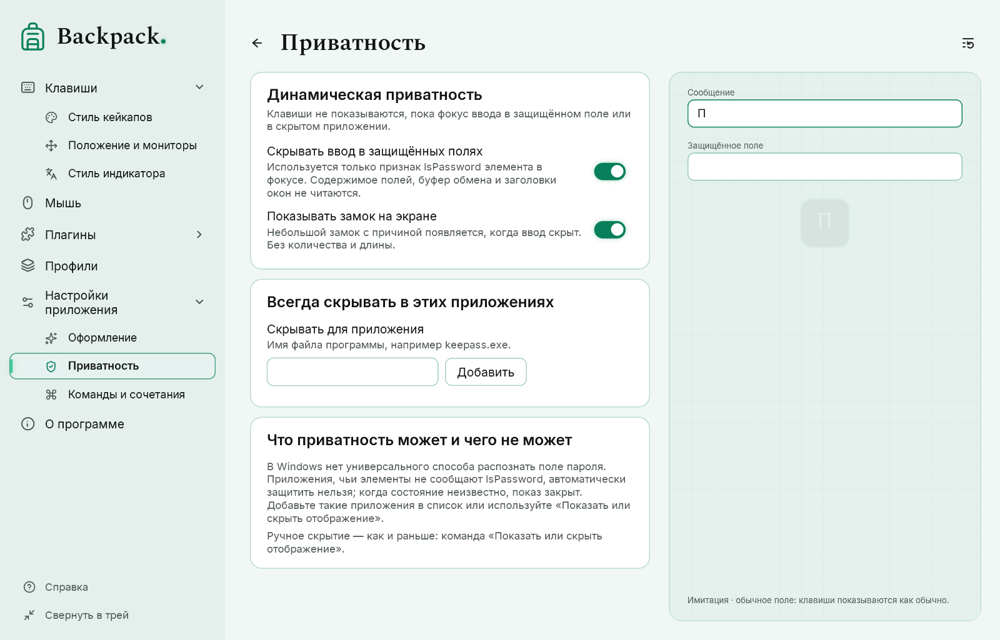

# Приватность, мониторы и команды

## Динамическая приватность

«Настройки приложения» → «Приватность». Когда фокус ввода переходит, Backpack спрашивает Windows UI Automation, является ли элемент в фокусе полем пароля (только свойство `IsPassword` — никогда текст, буфер обмена или заголовок окна).

| Состояние | Отображение |
|---|---|
| Обычное поле | показывается так же, как без приватности: Tab, сочетания с Win и все остальные клавиши |
| Защищённое поле | всё скрыто, включая сочетания; кейкапы на экране очищаются |
| Скрыто для этой программы | программа в вашем списке: скрыто |
| Проверка | новые нажатия ждут ответа об этом поле; они появляются, только если именно это поле подтверждено обычным |
| Нет данных | нет ответа, ошибка, тайм-аут или нет свойства: новые нажатия скрыты; уже показанные клавиши отпускаются обычно |

- Клавиша принадлежит полю, где её **нажали**. Tab, нажатый в обычном поле, показывается, хотя переводит фокус; Win+E и подобные сочетания показываются, хотя открывают системное окно.
- Ждавшие нажатия окончательно отбрасываются, если поле оказалось защищённым, ответа не было вовремя или фокус ушёл дальше. Скрытый ввод никогда не появляется позже.
- Пока поле проверяется после смены фокуса, ничего ещё не показывается; снятия защиты, пока состояние неясно, нет.
- Клавиши, удерживаемые, пока поле было защищено, не появляются, когда оно открывается; показ продолжается со следующего нового нажатия. Кнопки мыши по-прежнему показываются.
- Плагины и подписи второй раскладки получают только то, что показано.
- По желанию на экране появляется небольшой замок с причиной; он не показывает количество, длину или название поля.
- Backpack никогда не блокирует и не меняет клавиши: его хук клавиатуры только наблюдает за вводом и всегда передаёт его программе. UI Automation он спрашивает только когда фокус переходит на другой элемент — один раз и не больше трёх перепроверок — и никогда не опрашивает программу, в которой вы работаете. Элемент, который не сообщает `IsPassword` (например, 3D-вид CAD), считается «нет данных»: Backpack не показывает его клавиши, но программа их получает.
- Сразу после запуска, пока подписка UI Automation не готова, обычное поле не подтверждается: ввод ждёт, а затем при необходимости скрывается.
- **Рабочий стол Windows.** Список значков рабочего стола (список Проводника на рабочем столе) вообще не сообщает `IsPassword`; раньше это означало «нет данных», и нажатия на рабочем столе скрывались до перехода в другое окно. Теперь только этот список — его проверяют по классам окон, процессу Проводника, типу элемента и фреймворку — считается обычным элементом: сочетания на рабочем столе показываются согласно настройкам. Переименование значка — отдельное поле со своей проверкой. Остальной Проводник, панель задач и другие системные окна безопасными не считаются. Когда элемент не даёт данных, Backpack переспрашивает каждые 1,5 с, поэтому состояние восстанавливается без перехода в другое окно; скрытые за это время нажатия позже не появляются.

**Ограничения.** В Windows нет универсального способа распознать поля паролей. Многие программы сообщают `IsPassword` (элементы Windows, WPF, браузеры), но некоторые — нет или сообщают неверно; такую программу распознать нельзя. Остаётся и редкая гонка: если Windows сообщит о смене фокуса позже, чем вы уже печатаете в новом поле, эти клавиши относятся к предыдущему полю. Добавьте рискованные программы в список (например, `keepass.exe`) или используйте «Показать или скрыть отображение».

## Мониторы

«Клавиши» → «Положение и мониторы» (кейкапы) и «Стиль индикатора» (индикатор):

| Выбор | Значение |
|---|---|
| Основной | основной монитор |
| Выбранный | один выбранный монитор |
| Несколько | все выбранные мониторы одновременно |
| Под курсором | монитор, где сейчас указатель мыши (не монитор активного окна) |

Один источник ввода обслуживает все окна. Положение и отступы считаются от рабочей области каждого монитора в его масштабе, в том числе для мониторов с отрицательными координатами. Когда указатель переходит на другой монитор, кейкапы переносятся без дублей, без перезапуска анимации и без сброса удержаний. Если сохранённого монитора нет (например, профиль с другого компьютера), используется основной, и страница об этом сообщает.

## Команды и сочетания

«Настройки приложения» → «Команды и сочетания» содержит все действия; кнопка, трей, радиальное меню и сочетание выполняют одну и ту же команду. Правила и сочетания по умолчанию — в разделе [Команды, сочетания и рисование](12-hotkeys-lens-drawing.md).

