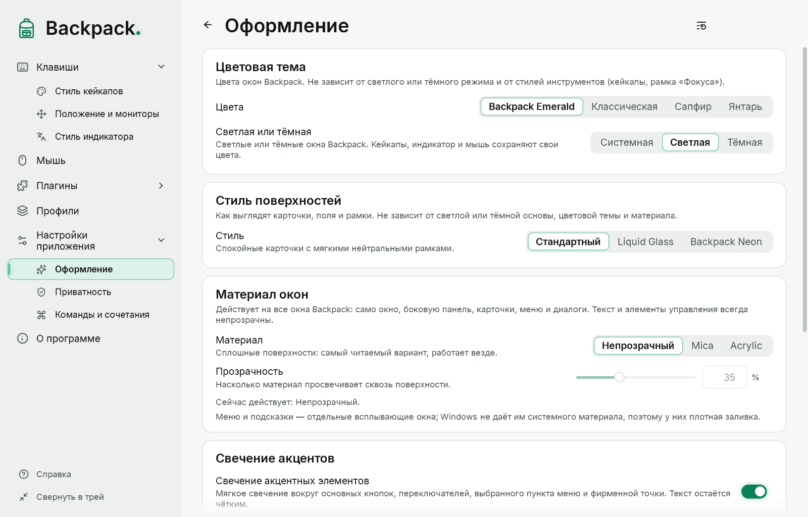
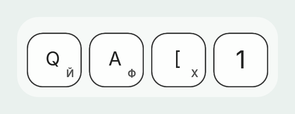

# Внешний вид, навигация и шрифты

## Навигация и кнопка «Назад»

Меню слева содержит все страницы; «Главную» открывает логотип Backpack над меню (подсказка и доступное имя — «Главная»). У групп есть стрелка: **Клавиши** (Стиль кейкапов, Положение и мониторы), **Плагины** (установленные плагины), **Настройки приложения** (Оформление, Приватность, Команды и сочетания). Открытие группы или одной из её страниц разворачивает её; текущая страница подсвечена и всегда прокручивается в видимую часть меню. Полосы прокрутки у меню нет — прокручивайте колесом, тачпадом или клавиатурой; края списка мягко затухают, последний пункт при прокрутке до конца виден целиком. Кнопки на страницах, F1, ссылки справки, избранные плагины и меню трея открывают те же страницы и держат меню синхронным.

Стрелка **«Назад»** рядом с заголовком страницы возвращает на предыдущую страницу этого окна; Alt+← и боковая кнопка мыши «назад» делают то же. На «Главной» её не видно. Переход на страницу, которая уже есть в истории, не создаёт цикла, а значение, которое вы вводили, применяется до смены страницы.

У страницы две компоновки. В широком окне живое превью — колонка фиксированной ширины справа на всю высоту области страницы; когда места не хватает, страница переходит к вертикальной компоновке, и превью становится полосой над параметрами. Элементы никогда не сжимаются: длинные подписи переносятся, элемент, не помещающийся рядом с подписью, переходит под неё, группы кнопок переносятся. Превью никогда не прокручивается вместе со страницей. В узком окне меню слева показывает только значки одним столбцом с квадратным выделением; кнопка меню открывает полное меню поверх страницы. Наименьший размер окна — 560 × 440 DIP. Движущийся предпросмотр обрезается точно по скруглённой рамке при любом размере окна и масштабе.

## Заголовок окна

У главного окна нет отдельной полосы заголовка: крупный знак «Backpack.» над меню, заголовок страницы и кнопки «свернуть», «развернуть» и «закрыть» образуют одну верхнюю строку; кнопки остаются справа, а заголовок страницы оставляет им место. Имя окна для Alt+Tab, панели задач и специальных возможностей остаётся «Backpack». Поведение Windows сохраняется: перетаскивание за свободную часть верхней строки, двойной щелчок — развернуть, щелчок правой кнопкой или Alt+Space — меню окна, Alt+F4 — закрыть, края — изменить размер. В Windows 11 наведение на кнопку «развернуть» показывает макеты привязки. У диалогов и окна справки — компактная полоса заголовка.

Изумрудная точка после «Backpack» — часть знака (меню, «Главная», «О программе»); в Neon и темах-самоцветах она мягко светится.

## Цвета, светлая или тёмная

«Настройки приложения» → «Оформление»: **Цвета** — Backpack Emerald, Классическая, Сапфир или Янтарь; **Светлая или тёмная** — Системная, Светлая или Тёмная. Предпросмотры и иллюстрации следуют теме: светлая сцена в светлой теме, тёмная — в тёмной. Цвета ваших стилей кейкапов, мыши и плагинов от темы не меняются.

Логотип — только контур рюкзака: зелёный в Backpack Emerald, цвет акцента в «Сапфире» и «Янтаре», чёрный на светлом и белый на тёмном в «Классической». Значок в трее тёмный на светлой панели задач и белый на тёмной.

## Стиль поверхностей

«Оформление» разделяет четыре независимых выбора: **светлая или тёмная** основа, **цветовая тема**, **стиль поверхностей** и **материал с прозрачностью**. Любое сочетание работает; это не отдельные темы.

| Стиль | Что это |
|---|---|
| Стандартный | спокойные карточки с мягкими нейтральными рамками |
| Liquid Glass | стеклянные карточки с бликом и светлыми градиентными рамками (оформление Backpack, а не эффект Windows) |
| Backpack Neon | самая тёмная основа, тонкие рамки цвета свечения темы (изумрудные в Backpack Emerald), мягкое свечение активных элементов |

В Neon рамки сохраняют иерархию: карточки спокойные, поля заметнее, выбранное и клавиатурный фокус — ярче всего; текст никогда не светится. Светлый Neon имеет собственные цвета, а не инверсию тёмного. Свечение можно выключить или ослабить («Свечение акцентов»). При высокой контрастности действует стандартный стиль.

## Материал окна

| Материал | Что это |
|---|---|
| Непрозрачный | Сплошные поверхности: самый читаемый вариант, работает везде |
| Mica | Системный материал Windows (Windows 11 22H2 или новее) |
| Acrylic | Системный материал Windows с размытым видом того, что за окном |

**Прозрачность** задаёт, насколько материал просвечивает. Меняются только поверхности: текст и элементы управления всегда непрозрачны. Строка под выбором говорит, какой материал действует сейчас. Если эффекты прозрачности в Windows выключены, включена высокая контрастность или Windows старее, действует непрозрачный вид. Меню и подсказки — отдельные всплывающие окна без системного материала: у них плотная заливка. Профиль предыдущей версии с материалом Liquid Glass открывается как Acrylic со стилем Liquid Glass.

## Свечение акцентов

В темах-самоцветах (Emerald, Сапфир, Янтарь) и в стиле Neon с любой темой основные кнопки, переключатели, выбранный пункт меню и фирменная точка мягко светятся. По умолчанию свечение включено; силу можно изменить. Свечение рисуется под элементом, поэтому текст остаётся чётким. В «Классической» со стилями «Стандартный» или Liquid Glass и при высокой контрастности свечения нет.

## Шрифты

В каждом из двух выборов только два варианта: **Стандартный** (встроенный Inter) и **Spectral** (встроен в Backpack, в Windows не устанавливается).

- **Шрифт заголовков** («Оформление») — заголовок страницы, крупные заголовки справки и название «Backpack». Остальной текст — параметры, подсказки, кнопки, заголовки карточек, меню — всегда стандартным шрифтом для лучшей читаемости.
- **Шрифт кейкапов** («Стиль кейкапов») — надписи на кейкапах и индикаторе раскладки.

Оба независимы, сохраняются в профиле и применяются сразу. Иконки и символы клавиш — рисунки и от шрифта не зависят. Spectral содержит украинские, английские и русские буквы и цифры; символы, которых в нём нет (стрелки, ⌘ ⌥ ⇧, греческие), берутся из Inter или Segoe UI, так что ничего не пропадает. Профили прежних версий с другим установленным шрифтом переходят на «Стандартный».

## Вторая раскладка на кейкапах

«Стиль кейкапов» → «Вторая раскладка на кейкапах». Крупная подпись остаётся английской; маленький символ другой раскладки появляется в выбранном углу — по умолчанию справа снизу — с заметным промежутком и безопасным отступом от края.

- **Активная раскладка** — раскладка программы, в которой вы печатаете (а не Backpack). Когда она английская, ничего не добавляется.
- **Выбранная раскладка** — всегда выбранная из установленных в Windows.
- **Размер основной подписи** и **размер малой подписи** задаются долей лицевой поверхности кейкапа, поэтому работают и после изменения размера кейкапов; с двумя подписями основная буква по умолчанию чуть меньше.
- **Угол** и **горизонтальный и вертикальный сдвиг** (от −15 % до +35 % грани от безопасной точки у угла; положительный — к центру) размещают малую подпись. Обе подписи всегда остаются внутри грани и не закрывают отметки R/num, символы модификаторов и счётчик нажатий.
- Символ — то, что напечатано на клавише, без Shift, Caps Lock и AltGr; мёртвая клавиша показывает свой диакритический знак. Клавиши без одного понятного символа (IME, служебные, цифровой блок) подписи не получают. Чтение символа никогда не меняет состояние клавиатуры ни одной программы.
- Настройки — часть стиля кейкапа и профиля. Сдвиги из предыдущей версии при открытии профиля сбрасываются, чтобы новое размещение не вытолкнуло буквы за грань.
- Приватность действует первой: скрытые клавиши подписей не получают вовсе.
