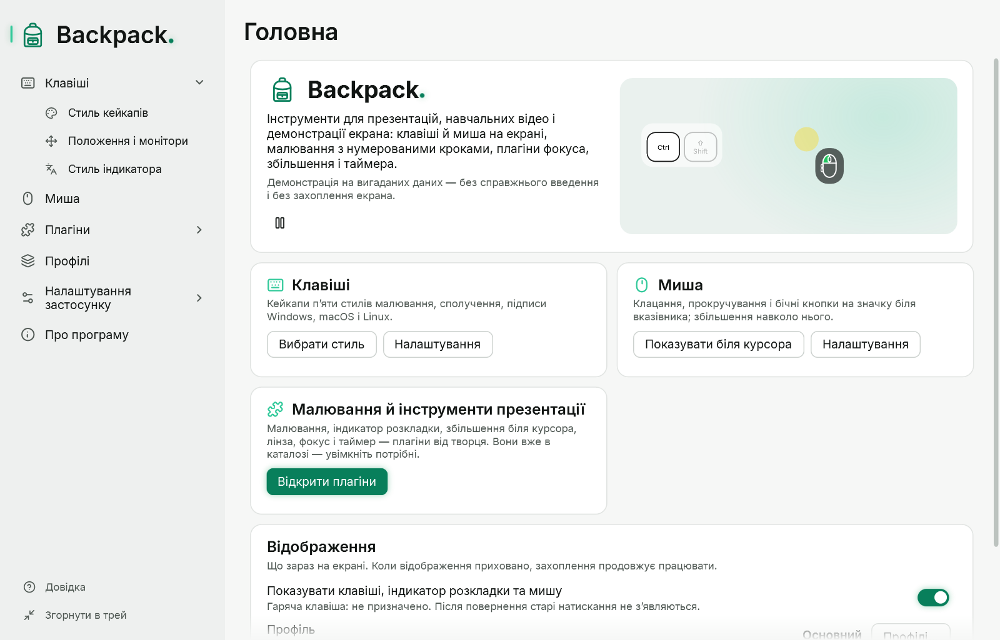

# Почати за хвилину

Потрібні Windows 10 або 11 (x64). Права адміністратора не потрібні. Розпакуйте папку Backpack будь-куди й запустіть `Backpack.exe`; нічого додатково встановлювати не треба.

## Що з’являється

- **Головне вікно** — сторінка «Головна» з перемикачем відображення, активним профілем, швидкими перемикачами й інструментами презентації.
- **Оверлей** — прозора смуга внизу основного монітора. Він ніколи не забирає фокус, пропускає клацання до вікон під ним і не показується на панелі завдань та в Alt+Tab.
- **Значок в області сповіщень** панелі завдань. Windows може сховати його серед прихованих значків (стрілка ^).

## П’ять кроків

1. Швидко надрукуйте слово в будь-якій програмі: літери заміняють одна одну на тому самому місці.
2. Натисніть Ctrl+Shift+K: з’являться три кейкапи — сполучення.
3. Відкрийте «Клавіші» → «Стиль кейкапів» і клацніть інший стиль у каталозі: превью й оверлей зміняться відразу. Налаштування зберігаються автоматично.
4. Натисніть Ctrl+Alt+Shift+O: відображення сховається; натисніть ще раз — повернеться. Захоплення продовжує працювати.
5. Закрийте головне вікно хрестиком: Backpack залишиться в треї. Клацніть значок, щоб знову відкрити головне вікно. Щоб вийти повністю, виберіть «Вийти з Backpack» у меню значка.

Докладніше про вікна й значок: [Головне вікно, трей, тема й мова](02-interface.md). Щоб зберегти весь набір налаштувань: [Профілі](07-profiles.md).

## Приватність коротко

Backpack показує натискання на екрані й нікуди їх не записує. Якщо оверлей видно на трансляції, глядачі бачать і те, що ви друкуєте, зокрема паролі. Перед уведенням пароля приховайте відображення гарячою клавішею або ввімкніть «Лише сполучення». Докладніше: [Діагностика й приватність](09-diagnostics-and-privacy.md).
