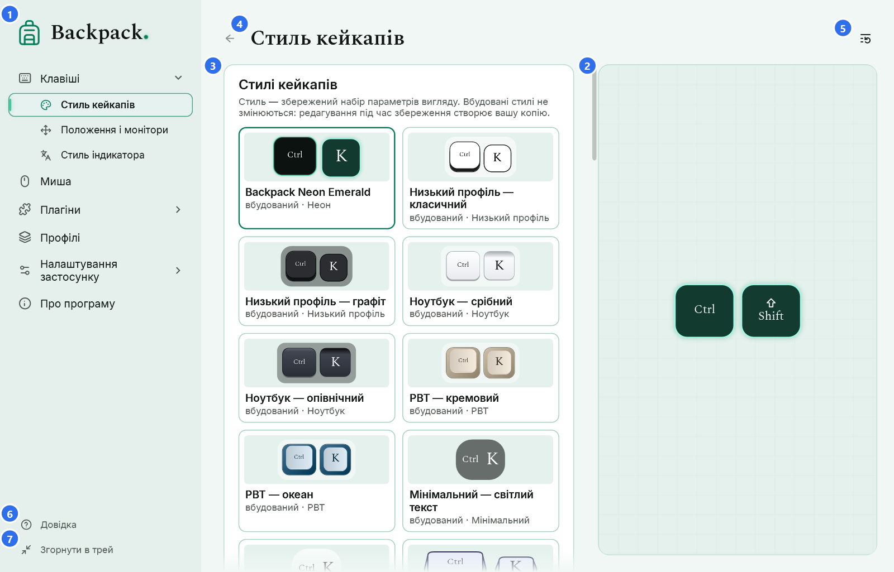
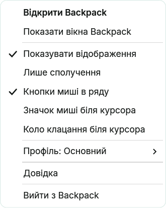
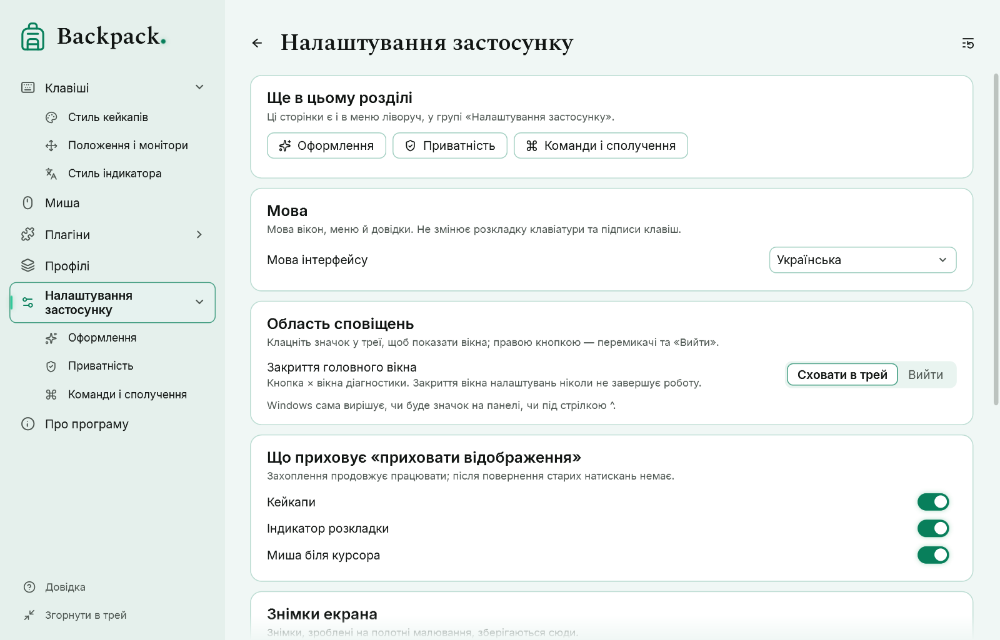

# Головне вікно, трей, тема й мова

## Головне вікно

Навігація ліворуч: **Головна**, **Клавіші** ▸ (Стиль кейкапів, Положення і монітори), **Миша** ▸ (Збільшення біля курсора), **Розкладка**, **Фокус**, **Малювання**, улюблені плагіни, **Плагіни** ▸, **Профілі**, **Налаштування застосунку** ▸ (Оформлення, Приватність, Команди і сполучення), **Про програму**. **Довідка** — унизу меню. Стрілка розгортає групу; стрілка ліворуч від заголовка сторінки повертає назад. У вузькому вікні меню показує лише значки (назва — у підказці; кнопка меню вгорі відкриває повне меню поверх сторінки). Див. [Вигляд, навігація і шрифти](17-appearance-navigation-fonts.md).

1. **Сторінки.** Відкриття групи чи однієї з її сторінок розгортає її; поточну сторінку підсвічено.
2. **Превью.** Приклад вибраної сторінки, намальований тим самим рендером, що й оверлей, на вигаданих даних. У широкому вікні це колонка фіксованої ширини праворуч на всю висоту області сторінки, у вузькому — смуга над параметрами. В обох випадках превью стоїть на місці: прокручуються лише параметри.
3. **Параметри.** Кожна зміна відразу застосовується до превью й оверлея; захоплення введення не перезапускається.
4. **Заголовок сторінки.** Назва відкритої сторінки. Зміни автоматично зберігаються в поточному профілі; профілями керують на сторінці «Профілі».
5. **Скинути розділ.** Повертає типові значення лише відкритої сторінки.
6. **Довідка.** Єдиний вхід до довідки з меню: відкриває тему про поточну сторінку (те саме робить F1). Усередині довідки — пошук і всі розділи.
7. **Згорнути в трей.** Ховає вікна Backpack; оверлей продовжує працювати.

Числові параметри мають повзунок і поле: введіть число й натисніть Enter. Дробові числа можна вводити з комою або крапкою. Кольори вводяться як `#RRGGBB` або `#RRGGBBAA` (остання пара — непрозорість) або вибираються в палітрі.

Налаштування зберігаються автоматично через пів секунди після зміни та під час виходу.

## Головна

«Головна» відкривається клацанням по логотипу Backpack над меню (з клавіатури — Enter або пробіл, коли логотип у фокусі) і показує, що зараз на екрані: перемикач відображення (кейкапи, індикатор розкладки й миша біля курсора), активний профіль, швидкі перемикачі, кнопку малювання, перехід до плагінів-інструментів і найуживаніші сторінки. Технічні лічильники й перевірки — на сторінці «Налаштування застосунку».

## Три різні дії: згорнути, закрити, вийти

| Дія | Що відбувається |
|---|---|
| Згорнути в трей | вікна Backpack ховаються; оверлей, миша біля курсора, індикатор розкладки й сполучення працюють; значок залишається |
| × головного вікна | типово те саме, що «Згорнути в трей»; на сторінці «Налаштування застосунку» можна вибрати «Вийти» |
| Вийти | програма завершується повністю: оверлей, значок, вікна, сполучення й захоплення введення зупиняються |

Під час першого згортання в трей Backpack пояснює, де значок і як вийти. Там же можна вибрати «Краще вийти».

## Значок у треї

- **Клацання лівою кнопкою** — відкрити головне вікно.
- **Клацання правою кнопкою** — швидке меню.

| Пункт | Що робить |
|---|---|
| Відкрити Backpack | повертає приховані вікна й відкриває головне вікно |
| Показати або сховати відображення | ховає або показує відображення (що саме — сторінка «Налаштування застосунку»); натискання й відпускання й далі відстежуються, тож після повернення клавіші не «залипають» |
| Лише сполучення | той самий перемикач, що в «Клавішах» |
| Кнопки миші в ряду | кнопки миші серед кейкапів |
| Значок миші, коло клацання й підсвічування курсора | частини режиму «Миша біля курсора» |
| Індикатор розкладки | вмикає й вимикає індикатор |
| Плагіни | команди ввімкнених плагінів (збільшення, лінза, фокус, таймер) |
| Малювання | та сама команда, що на сторінці й у сполученнях |
| Профіль: … | перемикання профілів; зміни поточного профілю вже збережено |
| Довідка | ця довідка |
| Вийти з Backpack | повне завершення |

Позначки в меню завжди показують поточний стан. Якщо головне вікно відкрите, воно відразу показує зміну з меню, і навпаки.

Windows вирішує, чи буде значок на панелі завдань, чи серед прихованих. Його можна перетягнути на панель або вибрати в параметрах панелі завдань. Щоб Backpack запускався під час входу в Windows, увімкніть «Налаштування застосунку» → «Запускати разом із Windows»: тоді він запускається в області сповіщень, без головного вікна. Права адміністратора не потрібні, portable-версія теж підтримується (запис указує, де `Backpack.exe` лежить зараз). Перемикач показує справжній стан: якщо запис належить іншій копії або вимкнений у списку автозавантаження Windows, під ним є пояснення. Повторний запуск під час роботи Backpack відкриває вікно запущеної копії, а не другу копію.

## Тема інтерфейсу

«Налаштування застосунку» → «Оформлення»: кольори (Backpack Emerald, Класична, Сапфір, Бурштин), **Системна**, **Світла** або **Темна**, матеріал вікон і світіння акцентів. Тема відразу застосовується до всіх відкритих вікон Backpack: головного вікна, діагностики, довідки, діалогів і меню трею.

- Тема інтерфейсу **не змінює** оверлей: кольори кейкапів, індикатора розкладки й миші біля курсора задають їхні стилі.
- «Системна» відповідає параметру Windows «режим застосунків» і змінюється разом із ним.
- Вікна вибору файлу (імпорт і експорт) малює Windows: вони відповідають темі й мові Windows, а не налаштуванням Backpack.

## Мова

«Налаштування застосунку» → «Мова інтерфейсу»: **Системна** або одна з 19 мов — English, Українська, Deutsch, Français, Español, Italiano, Português, Nederlands, Polski, Čeština, Magyar, Română, Svenska, Dansk, Norsk bokmål, Suomi, Lietuvių, Ελληνικά і Русский. «Системна» бере мову Windows; якщо Backpack її не має, використовується англійська.

- Довідка написана англійською, українською й російською. Іншими мовами вікно довідки показує англійський текст і повідомляє про це вгорі.

- Мова змінюється відразу в усіх вікнах, меню й довідці, без перезапуску й без зупинки захоплення.
- Мова інтерфейсу не змінює розкладку клавіатури, підписи на кейкапах і вміст профілів.

Мова, тема, поведінка трею й сполучення — налаштування цього комп’ютера: до профілів вони не входять.

## Клавіші у вікнах Backpack

| Клавіші | Де | Дія |
|---|---|---|
| F1 | будь-яке вікно Backpack | довідка про поточне місце |
| Tab / Shift+Tab | головне вікно | перехід між елементами; фокус показано рамкою |
| стрілки | головне вікно | вибір варіанта, рух повзунка або маркера палітри |
| Enter | числове поле | застосувати значення |
| Esc | палітра, довідка, діалоги | закрити |
| Alt+← / Alt+→ | довідка | назад / вперед |
| Alt+← | головне вікно | назад на попередню сторінку |
| Ctrl+F | довідка | пошук |

Ці клавіші діють, лише поки активне вікно Backpack. Глобальні сполучення (показ/приховування, «Фокус», малювання, радіальне меню) описано в розділі [Команди, сполучення і малювання](12-hotkeys-lens-drawing.md).
