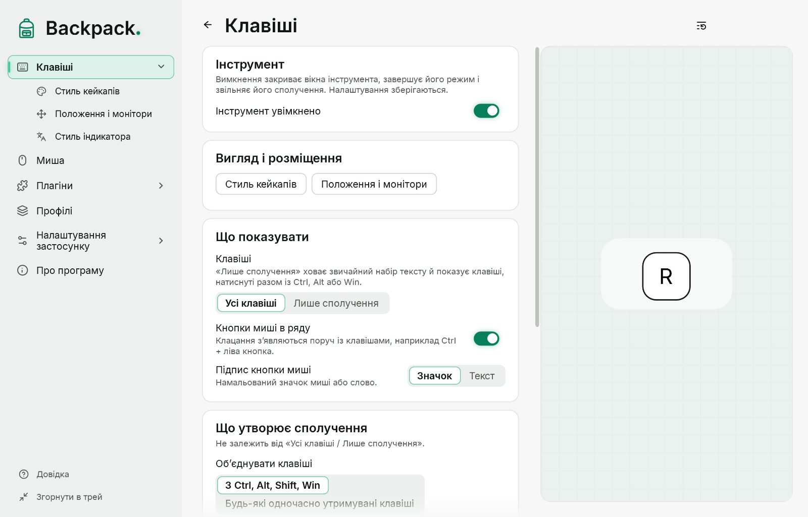
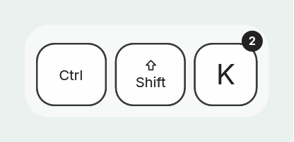
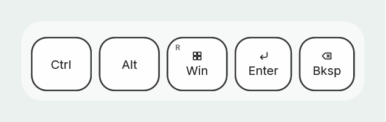
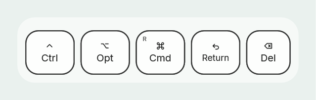
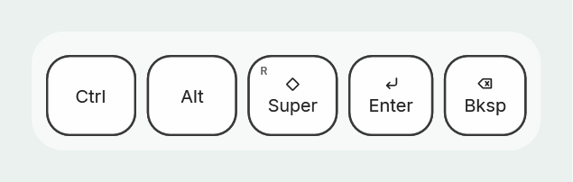

# Клавіші, сполучення й підписи

Сторінки налаштувань «Клавіші» і «Стиль кейкапів».

## Що видно на оверлеї

| Вигляд | Значення |
|---|---|
| верхня грань опущена | клавішу натиснуто |
| видно темну смугу знизу | клавішу відпущено; зникне після затримки (типово 5 с) |
| приглушений підпис і «?» | стан клавіші невідомий, наприклад після блокування комп’ютера |
| маленька позначка «R» або «num» | правий модифікатор або клавіша цифрового блоку |
| кружок із числом | клавішу натиснули кілька разів, не відпускаючи сполучення |

## Спокійний набір або слід

Параметр «Слід» на сторінці «Клавіші».

- **Спокійно** (типово): кожна нова літера стає на місце попередньої, ряд не росте й не тремтить. Ширина групи, поки вона на екрані, не зменшується.
- **Слід, що згасає**: відпущені літери ненадовго лишаються поруч із новими й згасають на місці.

[Показати приклад: спокійно](demo:trail-none) · [Показати приклад: слід](demo:trail-fade)

**Затримка після відпускання** (типово 5000 мс, від 0 до 20 000) — скільки останні клавіші лишаються на екрані. Параметр запуску `--linger-ms` замінює її на один запуск.

## Лише сполучення

Параметр «Клавіші»: **Усі клавіші** або **Лише сполучення**. У режимі «Лише сполучення» звичайний набір і поодинокі модифікатори не показуються, а сполучення з Ctrl, Alt, Win або Shift — показуються.

[Показати приклад: лише сполучення](demo:combos)

- Утримуваний модифікатор враховується: натисніть Ctrl, потім S — з’явиться «Ctrl S».
- Ctrl разом із кнопкою миші — теж сполучення, якщо кнопки миші показуються в ряду.
- Фільтр змінює лише показ: натискання й відпускання й далі відстежуються.
- Клавіша приєднується до сполучення, лише якщо в момент натискання утримується модифікатор; швидке перекриття літер сполученням не вважається.

## Підписи клавіш

«Стиль кейкапів» → «Підписи клавіш».

| Параметр | Варіанти |
|---|---|
| Набір підписів | Windows, macOS, Linux — назви як на клавіатурах цих систем |
| Вигляд підписів | Змішано (символ і назва), Символи, Текст |
| Позначки лівої/правої | позначки «R» і «num» у куті |
| Лічильник натискань | число в куті під час повтору всередині сполучення |

[Показати приклад: підписи й лічильник](demo:labels)

Набір підписів змінює лише написи на кейкапах. Розкладка клавіатури й те, що отримує програма, лишаються незмінними. Підписи відповідають англійській розкладці (US) і не залежать від мови інтерфейсу. Символи клавіш намальовано всередині програми; ⊞ — нейтральна сітка, а не логотип.

## Кейкап, кольори й анімація

| Параметр | Типово |
|---|---|
| Розмір | 32 (від 8 до 128); висота кейкапа — 2,5 × розмір |
| Заокруглення | 0,5 (від 0 до 1) |
| Кольори | верх білий, бік #1A1A1A, підпис чорний, обведення 2 #1A1A1A, тло ряду біле 60 % |
| Поява і зникнення | плавно, 250 мс; або без анімації |
| Анімація натискання | увімкнена: верх опускається за 100 мс |

Кнопки миші в ряду: параметри «Кнопки миші в ряду» і «Підпис кнопки миші» (значок або текст). Миша біля курсора — окремий режим, див. [Миша](04-mouse.md).

## Будь-які одночасно утримувані клавіші

«Клавіші» → «Що утворює сполучення»: **З Ctrl, Alt, Shift, Win** (за замовчуванням) або **Будь-які одночасно утримувані клавіші**. Працює разом із «Усі клавіші / Лише сполучення».

- З «Будь-якими одночасно утримуваними клавішами» A+B та інші сполучення без модифікаторів показуються однією групою.
- Одночасними вважаються лише клавіші, які справді утримуються разом. Відпущена клавіша, що ще видна, не приєднується; клавіша в стані «?» теж.
- Утримання клавіші (автоповтор) не додає другого кейкапа.
- **Поріг одночасності** (типово 150 мс) відрізняє сполучення від швидкого набору. Клавіші об’єднуються, лише якщо перша утримується не менше за поріг або обидві ще утримуються після нього. Під час швидкого набору перша клавіша відпускається раніше — групи немає. 0 — без порогу (старий спосіб: будь-яке перекриття утворює групу).
- Перемикання параметра не повертає старих натискань.

Backpack показує лише те, що клавіатура й Windows повідомляють програмам. Деякі сполучення Windows або інші програми обробляють раніше, ніж їх побачить Backpack, а деякі клавіатури взагалі не можуть повідомити певні сполучення. Див. [Що робити, якщо…](08-troubleshooting.md).
