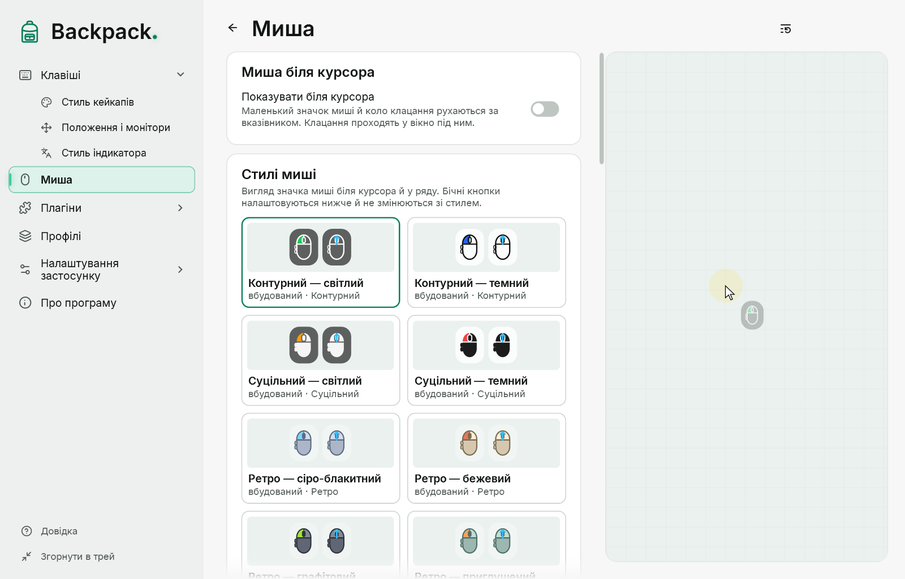
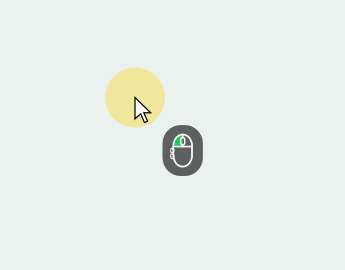
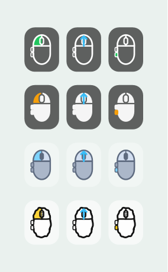

# Миша

Мишу показано двома незалежними способами:

- **у ряду кейкапів** — кнопки як кейкапи, поруч із клавішами; вмикається на сторінці «Клавіші»;
- **біля курсора** — значок миші й коло клацання рухаються за вказівником; розділ «Миша».

## Миша біля курсора

[Показати приклад](demo:mouse-cursor)

| Параметр | Типово |
|---|---|
| Показувати біля курсора | вимкнено |
| Значок | увімкнений; розмір 30; зсув 22 праворуч і 22 вниз від кінчика вказівника |
| Кольори значка | контур білий, заливка чорна 60 %, натиснута кнопка зелена |
| Коло клацання | увімкнене, з’являється, поки кнопку натиснуто; діаметр 48; жовте, 35 % |
| Підсвічування курсора | вимкнене; м’яке сяйво, що завжди йде за вказівником, 72 DIP |

- Натиснута кнопка підсвічується на значку. Ліва, права й середня — на корпусі; «назад» і «вперед» — виступи збоку.
- Невідомий стан кнопки (наприклад, після блокування) показано пунктиром.
- Вікно біля курсора не отримує фокус і пропускає клацання та перетягування. Воно рухається за вказівником на будь-якому моніторі.
- Положення вказівника й натискання ніде не зберігаються.

У меню значка в треї є швидкі перемикачі для значка, кола клацання й підсвічування курсора. Якщо вимкнути всі частини, режим «Миша біля курсора» вимикається повністю.

До версії 0.4.0-preview.2 коло клацання було видно постійно. Тепер воно з’являється під час натискання; увімкнене постійне коло перенесено в підсвічування курсора з тим самим кольором і розміром, тож вигляд не змінюється непомітно.

## Стилі миші

Чотири способи малювання значка, у кожного — готові палітри: **контурний**, **суцільний**, **ретро** (сіро-блакитний, бежевий, графітовий, приглушений шавлієвий) і **скетч**. Виберіть плитку в каталозі «Стилі миші»; власний стиль зберігається так само, як стиль кейкапів ([Стилі](11-styles.md)).

Натискання змінює лише свою частину значка: ліву чи праву кнопку, коліщатко або бічну кнопку — а не весь корпус.

## Бічні кнопки

«Бічні кнопки»: **Приховати**, **Одна** або **Дві**, **ліворуч** або **праворуч**. Налаштуйте відповідно до вашої миші: кількість кнопок автоматично не визначається. Backpack розрізняє ліву, праву й середню кнопки та X1 (назад) і X2 (уперед). Додаткові кнопки часто перепризначає драйвер миші, і вони не надходять як окремі кнопки.

## Прокручування

Поки коліщатко обертається, коротка стрілка в області коліщатка показує фактичний напрямок: угору, униз, а ліворуч/праворуч — якщо миша повідомляє горизонтальне прокручування. Колір стрілки й час показу задаються в «Прокручуванні».

- Прокручування й натискання середньої кнопки — різні події: підсвічене коліщатко означає натискання, стрілка — прокручування.
- Дрібні кроки плавних коліщаток теж показуються.
- Стрілка показується на значку біля курсора; ряд кейкапів прокручування не показує.
