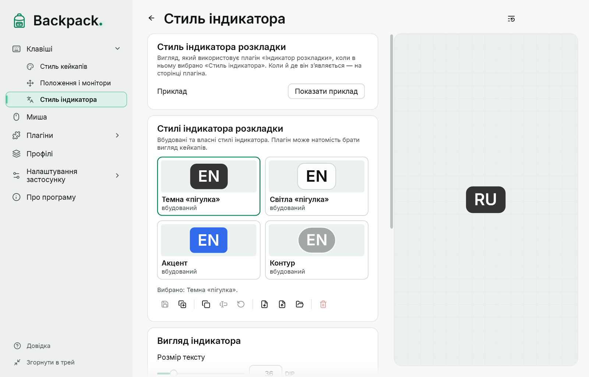

# Індикатор розкладки

Коли мова введення активного вікна іншої програми змінюється, на мить з’являється її код: «EN», «UK», «RU» тощо. Починаючи з Backpack 0.4.0-preview.5 індикатор — **плагін від творця**: він уже є в каталозі («Плагіни»), вимкнений; увімкніть його там (першого разу Backpack попросить підтвердити довіру). Після оновлення з попередньої версії ваші налаштування й сполучення переходять у плагін, а сам він лишається вимкненим, доки ви його не ввімкнете.

[Показати приклад](demo:layout-indicator)

## Як це працює

- Backpack сам стежить за мовою вікна у фокусі (кожні 100 мс і лише поки ввімкнено плагін, якому потрібні зміни розкладки) і повідомляє плагіну код, назву й причину: перемикання в тому самому вікні або інше вікно з іншою мовою. Плагін вирішує, чи показувати, і просить Backpack намалювати індикатор. Натискань клавіш він не отримує.
- Не має значення, як ви перемкнули мову: сполученням, мишею на панелі завдань чи переходом до іншого вікна. Backpack не здогадується з натискань.
- Зміна приймається, коли нове значення побачено двічі поспіль, тому індикатор з’являється приблизно через 0,1–0,3 с.
- Одна зміна — один показ. Під час запуску, після розблокування і виходу зі сну мова лише запам’ятовується.
- Власні вікна Backpack не враховуються.

## Налаштування

На сторінці плагіна («Плагіни» → «Індикатор розкладки» або його пункт із зірочкою в боковому меню):

| Параметр | За замовчуванням |
|---|---|
| Показується | 1,2 с (від 0,2 до 10 с), відлік від моменту появи |
| Під час переходу до вікна з іншою розкладкою | показувати |
| Назва розкладки під кодом | так |
| Поява й зникнення | як кейкапи; плавно; миттєво |
| Вигляд | як кейкапи; або стиль індикатора |
| Місце | над клавішами; або точка екрана (9 варіантів) зі зсувом |

**Стиль індикатора** (розмір і колір тексту, тло, рамка, заокруглення, каталог стилів) — це стиль Backpack: «Клавіші» → «Стиль індикатора» ([Стилі](11-styles.md)). Монітори вибираються в «Положення і монітори». Команди: «Індикатор розкладки: призупинити / продовжити» і «Індикатор розкладки: показати приклад». Індикатор ніколи не забирає фокус і пропускає клацання.

## Якщо індикатор не з’являється

1. Перевірте, що плагін «Індикатор розкладки» увімкнений у «Плагінах» і не призупинений.
2. Натисніть «Показати приклад» (сторінка «Стиль індикатора»): якщо приклад видно, показ працює.
3. Під час перемикання подивіться рядок стану індикатора в «Налаштуваннях програми» → «Перевірки» або рядки «Розкладка» у вікні діагностики: там останнє рішення — наприклад, «немає активного вікна», «розкладка недоступна» або «вимкнено» (жодному плагіну не потрібні зміни розкладки).
4. Якщо індикатор мовчить в одній програмі, а в інших працює, це відоме обмеження: визначення мови в деяких програмах ще не підтверджене ручною перевіркою.

## Обмеження

- Режим IME (наприклад, кана чи латиниця в японській) не показується — лише мова.
- Якщо у Windows увімкнено «Дозволити різний спосіб введення для кожного вікна програми», мова змінюється під час перемикання вікон, і індикатор це показує.
- Визначення мови не підтверджене ручною перевіркою в кожній програмі. Не перевірено: Термінал і консоль, програми Microsoft Store, браузери, Провідник, вікна з правами адміністратора.
- Backpack не перехоплює текст і не втручається у введення чи IME. Права адміністратора не потрібні.
