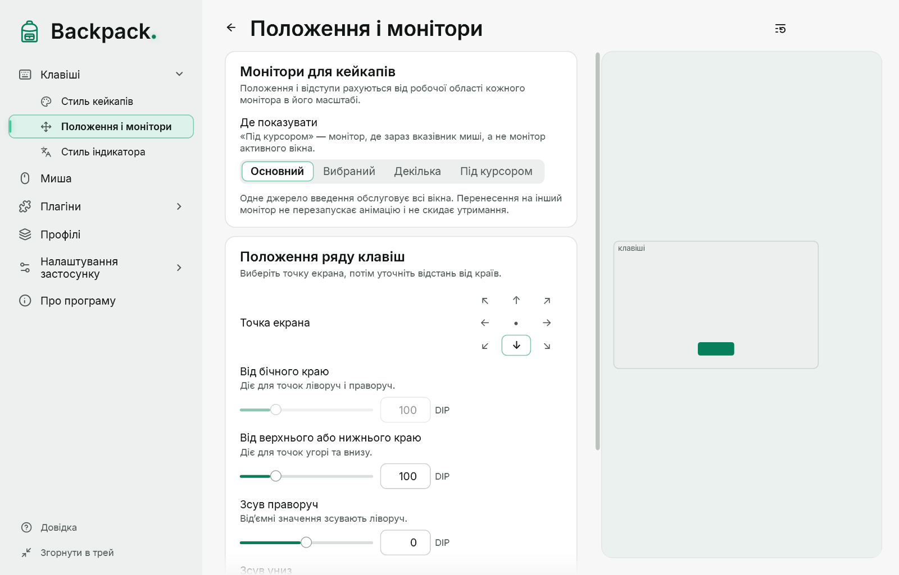

# Положення на екрані

Сторінка «Клавіші» → «Положення і монітори».

[Показати приклад](demo:position)

| Параметр | Типово | Що означає |
|---|---|---|
| Точка екрана | унизу по центру | до якої частини екрана притиснуто ряд; 9 варіантів |
| Від бічного краю | 100 | відступ для точок ліворуч і праворуч |
| Від верхнього або нижнього краю | 100 | відступ для точок угорі та внизу |
| Зсув праворуч / униз | 0 / 0 | зсув від точки; від’ємний — ліворуч / угору |

- Схема в прев’ю показує, де опиниться ряд на основному моніторі.
- Кнопка «Унизу по центру» повертає типове положення.
- Ряд не виходить за робочу область екрана над панеллю завдань, навіть за великого розміру й великих зсувів.
- Використовується основний монітор.

Якщо завантажити профіль, збережений на іншому комп’ютері з іншим екраном, завеликі відступи й зсуви зменшуються, щоб ряд лишився на екрані. Файл профілю при цьому не змінюється.
