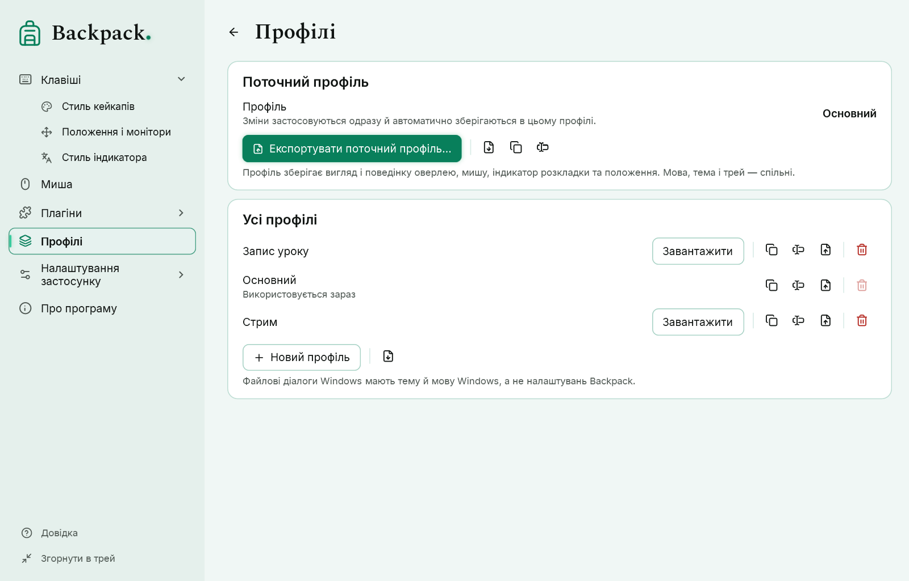

# Профілі

Профіль — повністю збережене налаштування оверлея під завдання: наприклад, «Запис уроку» з великими кейкапами й мишею біля курсора та «Стрим» із режимом «Лише сполучення».

## Що входить до профілю

Усе, що змінює оверлей: вигляд кейкапів і підписів, фільтр, затримка, слід, анімації, лічильник, миша в ряду й біля курсора, індикатор розкладки та положення.

**Не входять:** мова інтерфейсу, тема інтерфейсу, поведінка трею й глобальні гарячі клавіші — це налаштування цього комп’ютера. Джерело захоплення й параметри лабораторного запуску теж не входять. У профілі немає коду, розмітки вікон та історії натискань.

## Поточний профіль і автоматичне збереження

Назву поточного профілю показано на сторінці «Профілі» та в меню значка в треї. Кожна зміна налаштування застосовується одразу й **автоматично зберігається в поточному профілі** — кнопки «Зберегти» і позначки «не збережено» немає. Швидкі серії змін (наприклад, рух повзунка) записуються разом, не частіше двох разів на секунду; під час перемикання профілю, експорту й виходу зміни, що чекають, записуються негайно.

- Число чи колір, які ще вводяться, не зберігаються: значення приймається по Enter або коли ви виходите з поля, а неповний колір, як-от `#FF0`, до профілю не потрапляє.
- Якщо файл профілю не вдалося записати (диск заповнено, папка лише для читання), у вікні налаштувань з’являється «Не вдалося зберегти зміни» з причиною і кнопкою **Повторити**. Зміни лишаються застосованими й не зникають.
- Файл профілю лише для читання (еталонний профіль) ніколи не перезаписується: за першої зміни Backpack створює робочу копію «… — моя копія» і продовжує в ній.

Під час першого запуску Backpack 0.4.0-preview.3 профілі, збережені попередніми версіями, переносяться в нову модель без втрат: якщо застосовані налаштування відрізнялися від збереженого профілю, застосовані стають профілем, а попередня збережена версія лишається окремим профілем (її назву вказано в повідомленні під час запуску).

## Створити й перемкнути профіль

1. Налаштуйте відображення — зміни потрапляють у поточний профіль.
2. Щоб почати інше налаштування, натисніть «Новий профіль» (типові значення) або «Дублювати» (копія поточного), потім «Завантажити» в його рядку.
3. Щоб перемкнутися, натисніть «Завантажити» в рядку профілю або виберіть його в меню значка: «Профіль: …». Спершу записуються зміни поточного профілю, що чекають; якщо це не вдалося, перемикання не відбувається, і причину показано.

## Інші дії

| Кнопка | Дія |
|---|---|
| Новий профіль | профіль із типовими значеннями |
| Дублювати | копія профілю з назвою «… — копія» |
| Перейменувати | нова назва; файл та ідентифікатор не змінюються |
| Видалити | після підтвердження; поточний профіль видалити не можна |
| Експортувати поточний профіль… | актуальний стан усіх налаштувань профілю, разом зі щойно зробленими змінами |
| Експорт… | зберегти профіль зі списку у файл `.backpack-profile.json` |
| Імпорт… | додати профіль із файлу |

## Імпорт і експорт

- Файл для імпорту спершу перевіряється повністю: формат, версія, кожне поле й діапазон. Якщо знайдено хоча б одну проблему, нічого не додається й не змінюється, а Backpack показує список проблем.
- Імпортований профіль отримує новий ідентифікатор, тому не замінює ваші профілі. Після імпорту Backpack запропонує завантажити його.
- Завеликі відступи й зсуви положення зменшуються під час завантаження, щоб ряд було видно на цьому екрані.
- Профілі записуються через тимчасовий файл: збій під час запису не псує попередній файл.
- Вікна вибору файлу — системні вікна Windows: вони мають тему й мову Windows.

Профілі зберігаються в теці `profiles` поруч із файлом налаштувань (`%APPDATA%\Backpack\profiles\`). Формат описано схемою `docs/settings/backpack-profile.schema.json`.

## Профілі й стилі

Стиль — лише вигляд одного елемента; профіль зберігає повну копію всіх параметрів вигляду, поведінку й положення ([Стилі](11-styles.md)).

- Експорт профілю записує й ваші власні стилі, які він використовує. Під час імпорту вони додаються до каталогу; якщо стиль із тим самим ідентифікатором, але іншими параметрами вже є, імпортований отримує новий ідентифікатор.
- Навіть якщо стилю немає на іншому комп’ютері, профіль зберігає вигляд: параметри записано в профілі.
