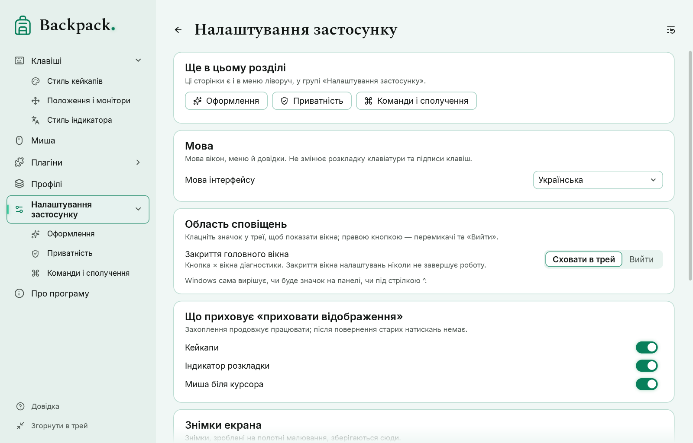

# Діагностика й приватність

## Вікно діагностики

Відкривається з «Налаштування застосунку» → «Перевірки» → «Вікно діагностики» → «Відкрити» (у лабораторному режимі `--lab` — під час запуску). Показує:

- режим захоплення (Raw Input, LL-хук або порівняння) і стан кожного джерела;
- лічильники подій, повторів, втрат і ресинхронізацій; затримки обробки;
- знахідки — підозри й підтверджені відмови;
- стан оверлея (чи видимий, чи поверх інших вікон);
- повідомлення про завантаження налаштувань;
- рядки «Розкладка» і «Миша біля курсора».

| Кнопка | Дія |
|---|---|
| Налаштування… | вікно налаштувань |
| Довідка (F1) | ця довідка |
| Сховати оверлей / Показати оверлей | навмисно ховає оверлей; захоплення триває |
| Експорт агрегованого JSON… | файл лише з лічильниками й затримками |
| Заморозити UI на 3 с | перевірка перевантаження; захоплення працює далі |
| Скинути стан | вважає всі клавіші відпущеними |
| Згорнути в трей | ховає вікна Backpack |
| Вийти | повний вихід |

Унизу — список ручної перевірки; кнопка над ним згортає його.

## Що зберігається на диску

| Файл | Вміст |
|---|---|
| `settings.json` | поточні параметри оверлея |
| `app.json` | мова, тема інтерфейсу, поведінка трею, поточний профіль, гарячі клавіші, параметри лінзи, малювання й оновлень |
| `profiles\*.json` | збережені профілі |
| `styles\*.json` | ваші стилі |
| експорт діагностики | лише числа, прапорці, коди знахідок і визначення метрик |

Ніде не зберігаються коди клавіш, надрукований текст, послідовності натискань, положення вказівника, вікна, заголовки й програми. Журналів, дампів пам’яті й мережевих звернень немає.

## Приватність на трансляції

Backpack показує натискання всім, хто бачить екран. Перед введенням пароля:

- приховайте відображення гарячою клавішею або «Показувати відображення» в меню значка; або
- увімкніть «Лише сполучення».

Поки оверлей сховано, натискання й відпускання й далі відстежуються, тому після показу на екрані не буде «залиплих» клавіш.

## Відомі обмеження

- Натискання на екрані блокування, у вікні UAC і Ctrl+Alt+Del не бачить жодна програма.
- Чи бачить Backpack введення в програмах, запущених від імені адміністратора, ще перевіряється.
- Повноекранні ігри в ексклюзивному режимі можуть перекривати оверлей.
- Оверлей показується на основному моніторі.
- Визначення розкладки підтверджено ручною перевіркою не в усіх програмах.

## Де лежать файли

Папка — `%APPDATA%\Backpack`. У режимі portable (файл `Backpack.portable` поруч із `Backpack.exe`) — папка `Data` поруч із програмою. Лінза й малювання нічого не зберігають на диску.
