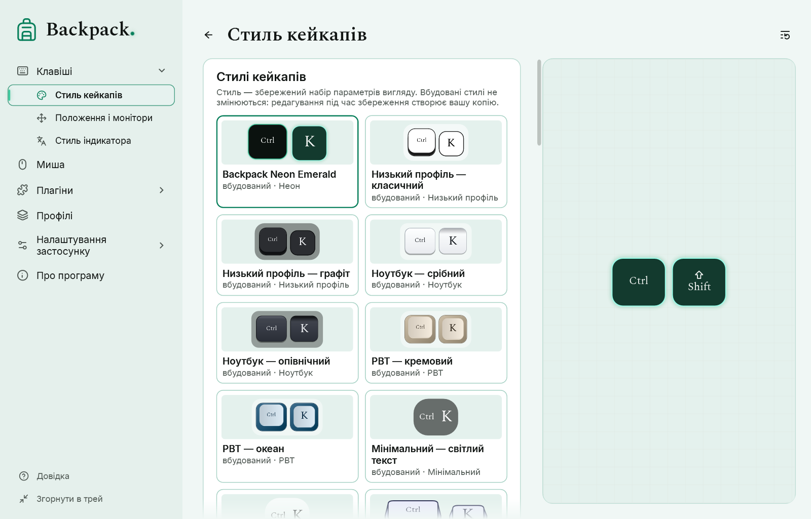
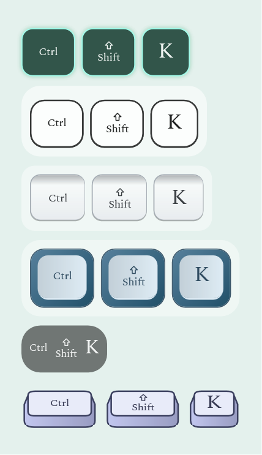

# Стилі: кейкапи, індикатор, миша

## Стиль, пресет, рендер і профіль

| Слово | Що це |
|---|---|
| Рендер | геометрія й спосіб малювання, вбудовані в програму: низький профіль, ноутбук, PBT, мінімальний, об’ємний, неон для кейкапів; контурний, суцільний, ретро, скетч, неон для миші |
| Пресет | вбудований стиль: рендер із готовими кольорами й параметрами. Вбудовані стилі ніколи не змінюються |
| Ваш стиль | збережений вами набір параметрів вигляду; лежить у папці стилів |
| Профіль | усе разом: вигляд (повна копія параметрів), поведінка й положення. Див. [Профілі](07-profiles.md) |

Стиль — це лише вигляд одного елемента. Розмір, підписи, анімація, фільтри й положення залишаються в профілі.

## Вибрати стиль

1. Відкрийте «Клавіші» → «Стиль кейкапів» (кейкапи), «Миша» або «Клавіші» → «Стиль індикатора» (індикатор).
2. Клацніть плитку в каталозі. Превью й оверлей зміняться відразу.
3. Вибрана плитка має акцентну рамку. Рядок під каталогом каже, який стиль вибрано.

**Backpack Neon Emerald** — стиль нового встановлення: темні кейкапи й значок миші з тонкою смарагдовою лінією та м’яким світінням, яке посилюється, поки клавішу чи кнопку натиснуто. «Світіння» на сторінці стилю задає його силу; 0 вимикає. Якщо ви вже користувалися Backpack, ваші стилі лишаються як були. «Скинути розділ» повертає цей фірмовий стиль.

Об’ємний рендер показує клавішу спереду й трохи згори: підпис стоїть прямо на верхній грані, видно передню грань і скошені боковини, а натискання опускає верхню грань разом із підписом. Більшість клавіш квадратні; службові клавіші й пробіл — компактні видовжені; Enter може бути Г-подібним («Г-подібний Enter» на тій самій сторінці).

## Змінити й зберегти

Дії зі стилями — один компактний ряд значків: **зберегти**, **зберегти як новий** | **дублювати**, **перейменувати**, **відновити** | **імпорт**, **експорт**, **відкрити папку стилів** | **видалити** (окремо). Кожен значок має підказку з назвою (і причиною, коли дія недоступна); у вузькому вікні імпорт, експорт і папка переходять до меню «…», де мають назви.

- Змініть будь-який колір чи параметр: рядок стану покаже «змінено».
- «Зберегти стиль» зберігає у ваш стиль. Для вбудованого стилю просить назву й створює вашу копію — вбудований не змінюється.
- «Зберегти як новий…» завжди створює новий стиль. «Дублювати» копіює вибраний.
- «Відновити» повертає параметри вибраного стилю.
- «Перейменувати» і «Видалити» працюють лише для ваших стилів. Профіль, що використовував видалений стиль, зберігає свій вигляд: параметри зберігаються в профілі.
- «Спосіб малювання» змінює лише геометрію і зберігає кольори.

## Імпорт, експорт і папка стилів

- «Експорт» записує вибраний вигляд у файл `.backpack-style.json`. «Імпорт» спершу перевіряє файл цілком; пошкоджений або чужий файл відхиляється, і нічого не змінюється.
- Якщо стиль із тим самим ідентифікатором, але іншими параметрами вже є, імпортований отримує новий ідентифікатор і «(імпортовано)» в назві; нічого не перезаписується. Той самий стиль удруге не додається.
- Файл стилю містить лише дані: кольори, числа й назви. Backpack ніколи не завантажує з нього код, XAML чи програми.
- «Відкрити папку стилів» показує папку з вашими стилями поруч із налаштуваннями (див. [Діагностика й приватність](09-diagnostics-and-privacy.md)).

## Індикатор розкладки: як у кейкапів або власний стиль

«Вигляд» на сторінці плагіна «Індикатор розкладки»: **Як кейкапи** бере кольори кейкапів; **Стиль індикатора** використовує стиль, вибраний у «Клавіші» → «Стиль індикатора» (каталог, розмір і колір тексту, тло, рамка, заокруглення). Коли й де з’являється індикатор — налаштовується в плагіні.

## Матеріал підкладки

Підкладка під групою кейкапів («Стиль кейкапів» → «Матеріал підкладки») і під значком миші («Миша» → «Матеріал підкладки значка») може бути **заливкою** — колір підкладки, прозорість — альфа кольору — або **прозорою** — без заливки, те, що позаду, видно повністю, а форму тримає тонкий контур кольору підкладки. Розмір, заокруглення і згасання не змінюються; підписи й індикатори кнопок не зачіпаються. Обидва перегляди показують результат на світлому і темному тлі. Вибір зберігається в стилі кейкапів чи миші та в профілі.

Acrylic і Mica для підкладки не пропонуються: на прозорих для клацань вікнах оверлея Windows застосовує їх до всього прямокутника вікна, без заокруглення і без згасання разом із клавішами. Профіль чи стиль, що їх просить, використовує заливку, і сторінка про це каже.
