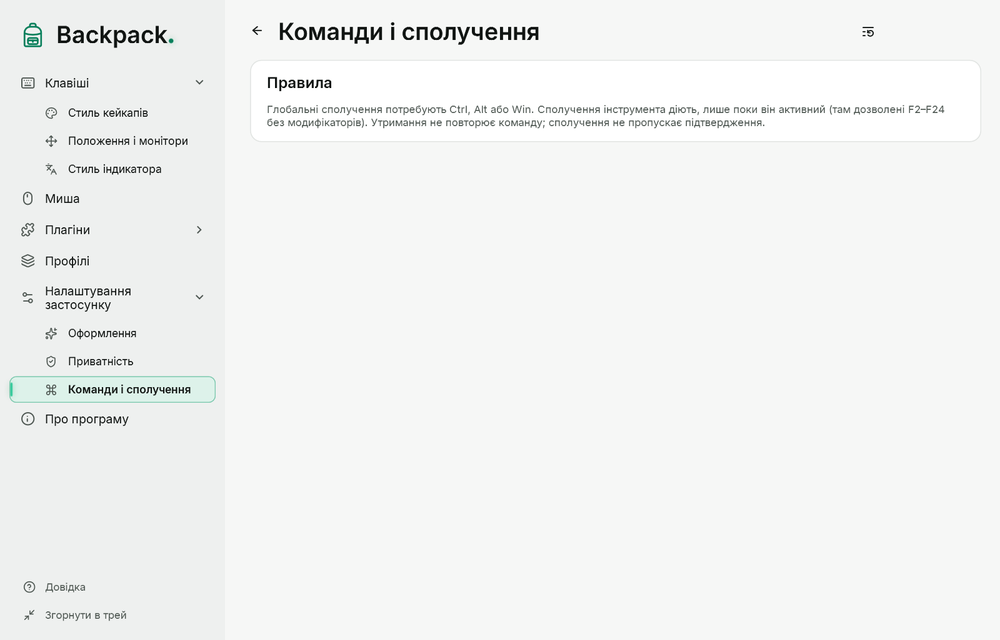
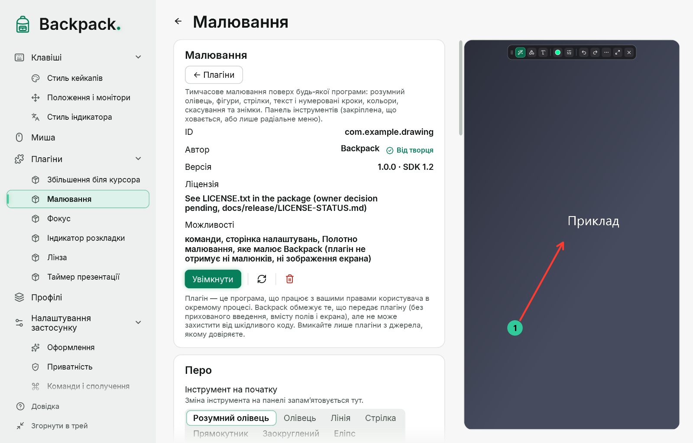
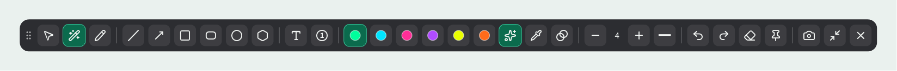
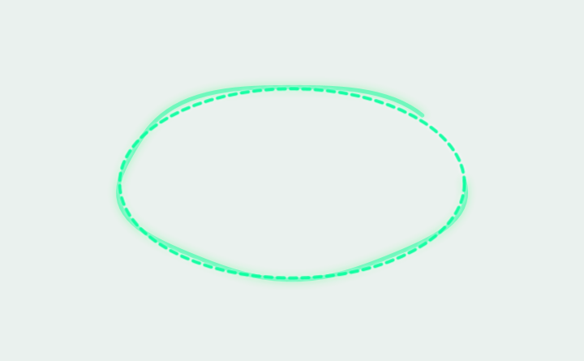
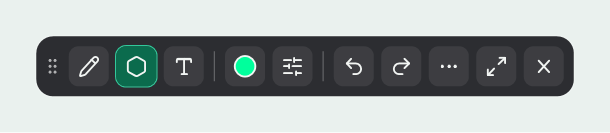
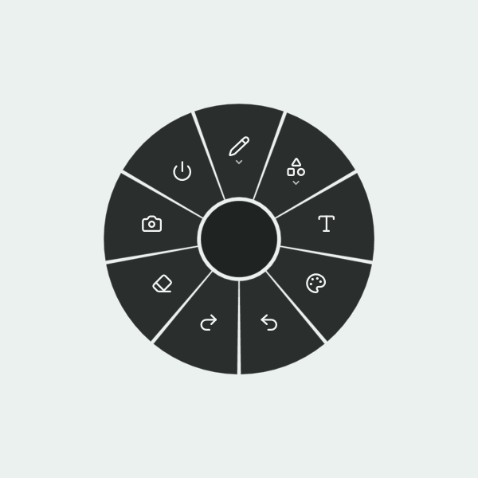
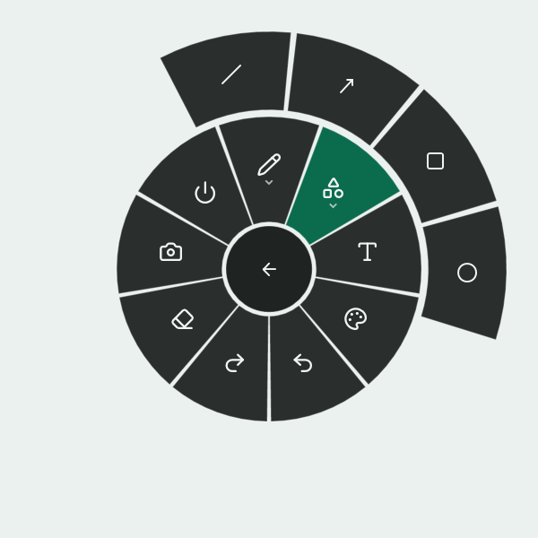

# Команди, сполучення і малювання

## Команди і сполучення

«Налаштування програми» → «Команди і сполучення». Кожна дія Backpack — одна команда: кнопка, пункт меню трею, сектор радіального меню і сполучення виконують ту саму реалізацію. Клацніть поле й натисніть сполучення; Esc скасовує, Backspace видаляє.

| Команда | За замовчуванням |
|---|---|
| Показати або сховати відображення | Ctrl+Alt+Shift+O |
| Малювання: почати / завершити (плагін) | Ctrl+Alt+Shift+D |
| Малювання: радіальне меню (плагін) | Ctrl+Alt+Shift+R |
| Малювання: знімок екрана (плагін, лише під час малювання) | F2 |

Команди плагіна з’являються лише тоді, коли плагін увімкнений. Інші команди (збільшення, лінза, фокус, таймер, індикатор розкладки, підсвічування курсора, кожен інструмент малювання, відкриття сторінок налаштувань) не мають сполучення, доки ви його не призначите.

- Глобальне сполучення потребує Ctrl, Alt або Win і ще однієї клавіші. Сполучення, які використовує Windows (Win+Space, Alt+Tab, Win+L та інші), призначити не можна.
- Якщо сполучення вже зайняте іншою програмою, у стані написано «зайнято іншою програмою».
- Одне сполучення не може обслуговувати дві команди.
- Команди інструмента діють лише поки інструмент відкритий (для плагіна — поки відкритий один із його інструментів), тому для них можна взяти одну клавішу F2–F24. Поза інструментом клавіша лишається іншим програмам.
- Сполучення перехоплює лише своє поєднання. Утримання клавіш не повторює команду.
- Сполучення — налаштування цього комп’ютера: імпорт профілю їх не змінює. F1 лишається локальною у вікнах Backpack.

**Перенесено з попередніх версій.** Окремі сполучення KeyOverlay і ранніх версій Backpack — звичайні команди з тими самими клавішами. Сполучення колишніх вбудованих малювання, індикатора розкладки, збільшення, лінзи і «Фокуса» під час оновлення Backpack переходять до команд плагінів; зняте вами сполучення лишається знятим.

## Показати і сховати відображення

За замовчуванням команда ховає кейкапи, індикатор розкладки і мишу біля курсора; перемикачі на сторінці «Налаштування застосунку» вибирають частини. Захоплення вводу триває, тож після показу немає старих натискань і «залиплих» клавіш. Приховування також закриває інструменти плагінів і малювання.

## Малювання

Малювання — **плагін від творця** («Плагіни» → «Малювання»); увімкніть його там. Потім натисніть його сполучення або виконайте «Малювання: почати / завершити» з трею, радіального меню чи сторінки плагіна. Поки режим увімкнений, миша малює поверх живого робочого столу; після виходу робочий стіл працює як завжди. Полотно, панель і радіальне меню малює Backpack; плагін зберігає налаштування і не отримує ні малюнків, ні зображення екрана.

| Група | Інструменти |
|---|---|
| Малювати | Вибір і переміщення, **Розумний олівець** (за замовчуванням), Олівець |
| Фігури | Лінія, Стрілка, Прямокутник, Заокруглений прямокутник, Еліпс, Правильний багатокутник |
| Текст і позначки | Текст, Нумерована позначка |

- Кольори: шість готових, **будь-який колір** (палітра, `#RRGGBB` або `#RRGGBBAA` із прозорістю) і швидкий перемикач прозорості 60 %.
- Товщина −/+, суцільна, пунктирна або точкова лінія.
- Скасувати (Ctrl+Z), повторити (Ctrl+Y), очистити все; малюнки зникають через кілька секунд або лишаються до виходу.
- Камера — знімок, × — вихід (також Esc або сполучення малювання). Малюнки не зберігаються.
- Останні інструмент, колір, товщина й лінія запам’ятовуються в налаштуваннях плагіна; папка знімків — у «Налаштуваннях програми».

### Розумний олівець

Розумний олівець перетворює намальовану лінію, дугу, кут, еліпс, прямокутник або багатокутник (3–8 кутів, зокрема повернутий квадрат чи трикутник) на рівну фігуру, яку можна змінювати.

- **Під час малювання** розпізнана фігура показується пунктиром поверх штриха; ваш штрих лишається видимим, трохи приглушеним. Пропозиція не перескакує між фігурами на кожен рух: нова фігура з’являється лише після кількох розпізнавань поспіль.
- Якщо розпізнавання не впевнене, пропозиції немає і штрих лишається штрихом.
- **Коли відпускаєте кнопку**, результат фіксується. Скасування повертає ваш початковий штрих, друге скасування прибирає і його. Сама пропозиція нічого не додає в історію.
- Розпізнавання відбувається на цьому комп’ютері; штрихи нікуди не надсилаються.
- **Дуга**: плавна крива стає дугою через три точки — початок, кінець і точку посередині. Вибрана дуга має три ручки, по одній на кожну точку. Три точки на одній прямій дають пряму лінію, а не зламану дугу.
- **Кут**: два прямі штрихи, що сходяться в куті («V» або «L»), стають кутом. Поки кнопку затиснуто, біля вершини показано його величину в градусах (менший із двох кутів, 0–180°). Підпис відходить від вказівника й лишається в межах екрана. Кнопка кута на панелі залишає підпис і після того, як ви відпустите кнопку.

### Shift і Alt під час малювання фігур

| Клавіша | Прямокутник, заокруглений прямокутник, еліпс | Лінія, стрілка | Правильний багатокутник |
|---|---|---|---|
| **Shift** | квадрат або коло | напрямок кроками по 15° | поворот кроками по 15° |
| **Alt** | від центру | — | — |
| **Shift+Alt** | квадрат або коло від центру | — | — |

Клавіші діють під час протягування: натисніть або відпустіть їх будь-коли — фігура зміниться одразу. Коротка підказка про них з’являється внизу екрана, коли ви вперше вибираєте кожен інструмент.

### Заокруглений прямокутник і правильний багатокутник

- **Заокруглений прямокутник**: радіус кутів задається −/+ поруч з інструментом (0–120 DIP). Радіус ніколи не більший за половину коротшої сторони.
- **Правильний багатокутник**: натисніть у центрі й тягніть до вершини — відстань задає розмір, напрямок повертає фігуру. Кількість вершин (3–12) задається −/+ поруч з інструментом. Фігуру видно під час побудови; клацання без протягування нічого не створює.
- Розпізнавання намальованого багатокутника (розумний олівець) і побудова правильного багатокутника — різні інструменти: розумний олівець зберігає кути, які ви намалювали.

### Вибір і переміщення

Виберіть «Вибір і переміщення», клацніть фігуру, текст чи позначку й перетягніть. Delete видаляє вибране, Esc знімає вибір. Переміщення і видалення — кроки історії, як і малювання.

Вибрана фігура має **ручки**: кути й сторони змінюють розмір, кругла ручка над рамкою повертає фігуру. Вказівник показує, що робить ручка.

- **Shift** зберігає пропорції під час зміни розміру й повертає кроками по 15°; **Alt** змінює розмір від центру.
- **Esc** під час перетягування скасовує його й повертає фігуру як була.
- Одне перетягування — один крок історії.
- Товщина лінії під час зміни розміру не змінюється. Текст масштабується цілком, як картинка; нумеровані позначки лише переміщуються.

### Компактна панель

Кнопка з двома стрілками перемикає повну і компактну панель (зберігається в профілі).

Компактна панель лишає три кнопки груп (кожна показує поточний інструмент своєї групи), поточний колір і кнопку лінії; інструменти, кольори й параметри відкриваються в невеликих спливних групах. Поточні інструмент і колір завжди видно.

### Вигляд панелі

| Варіант | Як працює |
|---|---|
| Завжди видима | Панель лишається на екрані. Перетягуйте за ручку — місце запам’ятовується; «Повернути вгору по центру» скидає його. |
| Автоприховування біля краю | Панель ховається біля вибраного краю. Затримайте вказівник біля краю — панель виїжджає; коли вказівник далеко, ховається. |
| Лише радіальне меню | Панелі немає. Правий клік або сполучення радіального меню відкриває всі інструменти; Esc — вихід. |

### Текст

1. Виберіть «Текст» і клацніть там, де має бути текст.
2. Друкуйте; Enter починає новий рядок. Перетягніть поле за ручку, щоб пересунути його до підтвердження.
3. Ctrl+Enter або клацання поза полем підтверджує; Esc скасовує лише цей текст.

### Знімок

F2 (змінюється на сторінці «Команди і сполучення») або кнопка камери. Знімається монітор, де увімкнено малювання, з вашими малюнками, але без панелі, підказок і меню, у справжніх пікселях монітора. «Зберегти у файл», «Копіювати» чи «Зберегти й копіювати» і що робити з малюнками після знімка — на сторінці плагіна «Малювання»; папка — у «Налаштуваннях програми». Якщо зберегти не вдалося, малюнки ніколи не видаляються.

## Радіальне меню

Натисніть сполучення радіального меню або правою кнопкою в режимі малювання: навколо вказівника з’являється кільце (малювання вмикається, якщо було вимкнене).

- **Внутрішнє кільце** — категорії й основні дії: Малювання, Фігури, Текст і позначки, Колір, Правка, Фокус, Показ на екрані, Плагіни (коли увімкнені плагіни мають команди), Знімок, Вихід.
- **Категорія відкриває зовнішнє кільце** з її діями; вибрана категорія лишається підсвіченою. Кнопка в центрі стає «Назад».
- **Esc закриває по одному рівню**: спершу зовнішнє кільце, потім меню. Клацання в центрі робить те саме.
- Сектор спрацьовує, лише якщо натиснути й відпустити кнопку миші на тому самому секторі, тож сусідній не вибереться випадково. Недоступні команди (вимкнений інструмент, нічого скасовувати) приглушені й не вибираються.
- Клавіатура: стрілки — по колу активного кільця, Enter або Пробіл — вибрати, Backspace — назад.
- Біля краю екрана меню зсувається всередину, щоб обидва кільця було видно повністю; на дуже малому екрані воно зменшується.

## Які режими працюють разом

| Разом | Правило |
|---|---|
| Фокус і малювання | запуск «Фокуса» закриває малювання |
| Радіальне меню | у режимі малювання (сполучення вмикає малювання) |

Esc закриває по одному шару: спливну групу панелі, вибір, введення тексту, кільця меню, потім малювання. Після виходу не лишається жодного вікна, що перехоплює мишу. Блокування комп’ютера, зміна робочого столу чи сон закривають усе.
