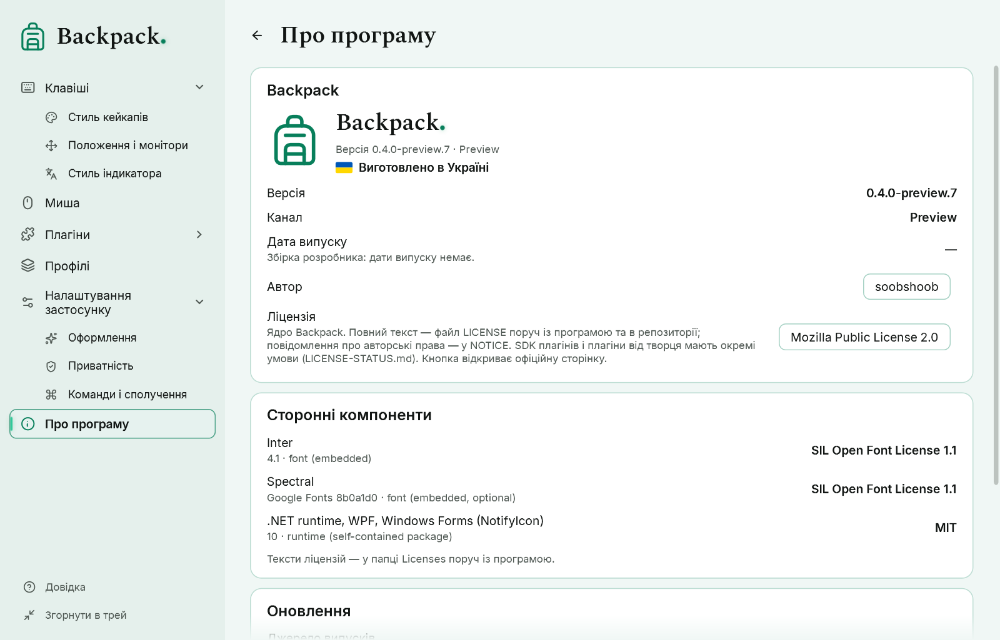

# Про Backpack та оновлення

## Сторінка «Про програму»

- Назва, логотип, версія й канал (Stable або Preview).
- Дата випуску — береться із самого випуску. Збірка розробника не має дати випуску й так і пише.
- Автор: soobshoob (посилання на профіль GitHub; відкривається в браузері після підтвердження).
- Ліцензія ядра Backpack — Mozilla Public License 2.0 (кнопка відкриває офіційну сторінку). Повний текст — `LICENSE.txt` поруч із програмою, повідомлення про авторські права — `NOTICE.txt`. Коротко: програму можна використовувати, змінювати й поширювати; якщо ви поширюєте змінені файли ядра, їхній вихідний код має лишатися доступним за тією самою ліцензією. Діє саме текст ліцензії.
- SDK для плагінів і плагіни від автора не підпадають під MPL: у них власні умови, перелічені в `LICENSE-STATUS.md` і в кожному пакеті плагіна.
- «Виготовлено в Україні».
- Сторонні компоненти з їхніми ліцензіями. Їхні тексти — у папці `Licenses` поруч із програмою.

## Перевірка оновлень

- «Перевірити» запитує GitHub Releases репозиторію Backpack про найновішу версію вибраного каналу.
- **Stable** ніколи не пропонує попередні версії; **Preview** пропонує обидва види.
- Якщо є новіша версія, ви побачите її номер, дату й опис та кнопку, що відкриває офіційну сторінку завантаження в браузері.
- «Перевіряти автоматично» (типово вимкнено) повторює перевірку раз на добу, поки працює Backpack, і показує коротке сповіщення біля значка в треї.
- Backpack ніколи не завантажує й не запускає оновлення сама. Щоб оновитися, завантажте новий пакет зі сторінки й замініть папку (налаштування зберігаються, див. нижче).

До GitHub іде лише запит списку випусків. Налаштування, профілі та введення ніколи не надсилаються.

## Коли перевірка не може завершитися

| Повідомлення | Що це означає |
|---|---|
| Джерело випусків не налаштовано | ця збірка не знає репозиторію з випусками; перевірити неможливо |
| Немає з’єднання з GitHub | немає мережі або GitHub недоступний |
| GitHub не відповів вчасно | запит тривав понад 10 секунд |
| GitHub обмежив кількість запитів | спробуйте пізніше |
| GitHub повернув неочікувану відповідь | відповідь не вдалося прочитати |
| Версія … є, але пакета для Windows x64 ще немає | дочекайтеся пакета |

## Оновлення й видалення

- **Оновлення:** вийдіть із Backpack («Вийти з Backpack» у меню трею), замініть папку програми новою й запустіть `Backpack.exe`. Налаштування, профілі й стилі лежать у `%APPDATA%\Backpack` і залишаються.
- **Режим portable:** якщо поруч із `Backpack.exe` лежить файл `Backpack.portable`, налаштування зберігаються в папці `Data` поруч із програмою (коли в неї можна писати). Під час оновлення скопіюйте `Data` в нову папку.
- **Видалення:** вийдіть із Backpack й видаліть папку програми. Щоб видалити й налаштування, видаліть `%APPDATA%\Backpack` (або `Data` у режимі portable). Backpack пише до реєстру лише тоді, коли ввімкнено «Запускати разом із Windows» (одне значення в `HKCU\Software\Microsoft\Windows\CurrentVersion\Run`); вимкніть його перед видаленням теки.
