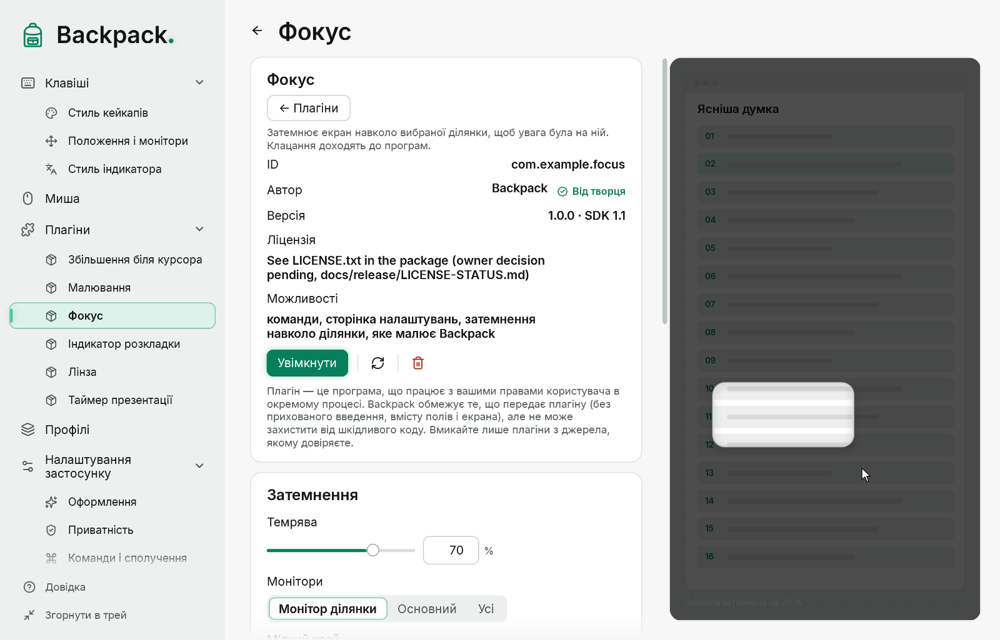
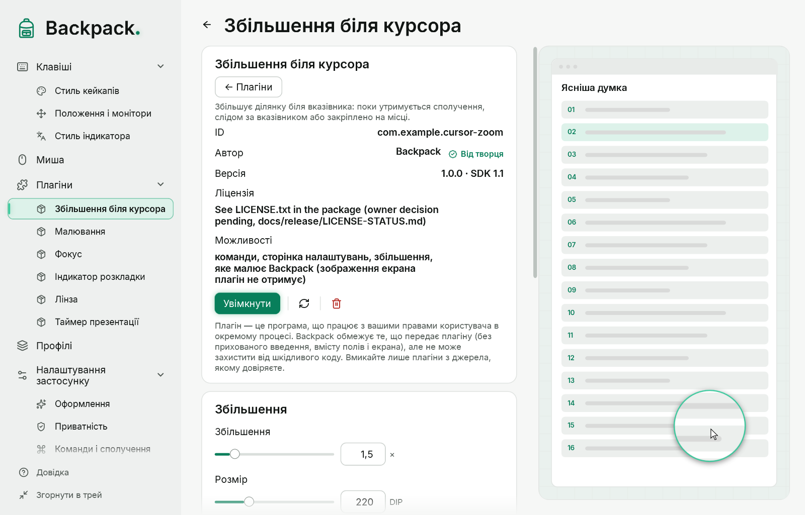

# Збільшення, лінза, фокус і таймер

Ці інструменти — **плагіни**: у кожного свій ідентифікатор, версія, налаштування, команди, сторінка і демонстрація. Вони постачаються разом із Backpack у папці `Plugins` поруч із програмою, але не ввімкнені: імпортуйте їх на сторінці «Плагіни» й увімкніть потрібні (Backpack попросить підтвердити довіру). Як улаштовані плагіни — у розділі [Плагіни](15-plugins.md).

## Збільшення біля курсора

Три незалежні команди — у кожної своє сполучення, режим вибирати не треба:

| Команда | Поведінка |
|---|---|
| «Збільшення: поки утримується» | збільшення видно, поки сполучення натиснуте; відпускання закриває |
| «Збільшення: слідом за вказівником увімк. / вимк.» | збільшення йде за вказівником до повторного натискання |
| «Збільшення: закріпити тут / прибрати» | живе збільшення лишається там, де був вказівник |

- На екрані завжди не більше одного збільшення: «слідом» і «закріпити» заміняють одне одного; утримання під час уже відкритого збільшення нічого не додає.
- Повторне натискання тієї ж команди закриває збільшення. Esc, блокування Windows, вимкнення або видалення плагіна закривають його одразу.
- У збільшення немає кнопок і ручок: вказівник завжди всередині нього, тому керування лише командами та Esc.
- Windows не повідомляє про відпускання сполучення: Backpack перевіряє його кожні 30 мс і закриває утримання не пізніше ніж за 5 хвилин.
- Клацання проходять крізь збільшення. Системний вказівник і власні вікна Backpack до зображення не потрапляють.

## Лінза

«Лінза: відкрити / закрити» — виділіть ділянку мишею (Esc — скасування, клацання без перетягування — ділянка розміру з налаштувань). З’являється переміщуване вікно з живою збільшеною копією ділянки-джерела; джерело позначене пунктирною рамкою, якщо ввімкнено «Показувати джерело». Лінза і джерело переміщуються незалежно.

## Фокус

«Фокус: затемнити навколо ділянки / вимк.» — виділіть ділянку; решта монітора (або всі монітори, за налаштуванням) затемнюється. Сама ділянка не змінюється: це не збільшення і не знімок.

## Керування при наведенні

Кнопки, підписи та ручки переміщення й розміру в лінзи, фокуса і таймера типово приховані — видно лише вміст (збільшене зображення, рамку, цифри).

- Наведіть вказівник на інструмент або його компактну ділянку керування — панель плавно з’явиться; відведіть — сховається з невеликою затримкою, без мерехтіння.
- Перехід з інструмента на панель її не закриває. Під час перетягування, зміни розміру й відкритого меню панель лишається.
- Приховані елементи не перехоплюють клацання, наведення не забирає фокус у програми під інструментом. Клацання по лінзі й ділянці фокуса проходять до програми.
- Команди «Лінза: показати керування» і «Фокус: показати керування» показують панель без наведення.
- Коли анімації Windows вимкнені, панель з’являється одразу. Панель тримається в межах поточного монітора.

## Таймер

Плагін «Таймер презентації» показує зворотний відлік поверх інших вікон.

| Команда | Дія |
|---|---|
| «Таймер: старт / пауза» | запуск, пауза і продовження |
| «Таймер: скинути» | повернення до заданого часу |
| «Таймер: показати / сховати панель» | панель без зміни відліку |

- Панель переміщується й розтягується за ручки, які видно при наведенні; розмір цифр, прозорість і колір акценту — в налаштуваннях плагіна. Налаштування зберігаються в профілі.
- Відлік іде за годинником, а не за спрацюваннями таймера інтерфейсу: навантаження й затримки малювання не розтягують секунди.
- **Сон комп’ютера:** час під час сну теж іде. Якщо відлік закінчився уві сні, після пробудження панель показує 00:00 і стан «закінчено».
- Після закінчення лишається 00:00 і ненав’язлива рамка акценту. Звук — окреме налаштування, типово вимкнене.
- Після перезапуску Backpack таймер не запускається сам і панель не з’являється до першої команди.

## Перенесення з вбудованих інструментів

У попередніх версіях лупа, лінза і фокус були вбудовані. Під час імпорту поставлених плагінів Backpack переносить їхні налаштування, сполучення і пункти меню: колишня спільна команда «Фокус» переходить у команду того режиму, який було вибрано. Перенесення не вмикає плагін і не підтверджує довіру — це робите ви.
