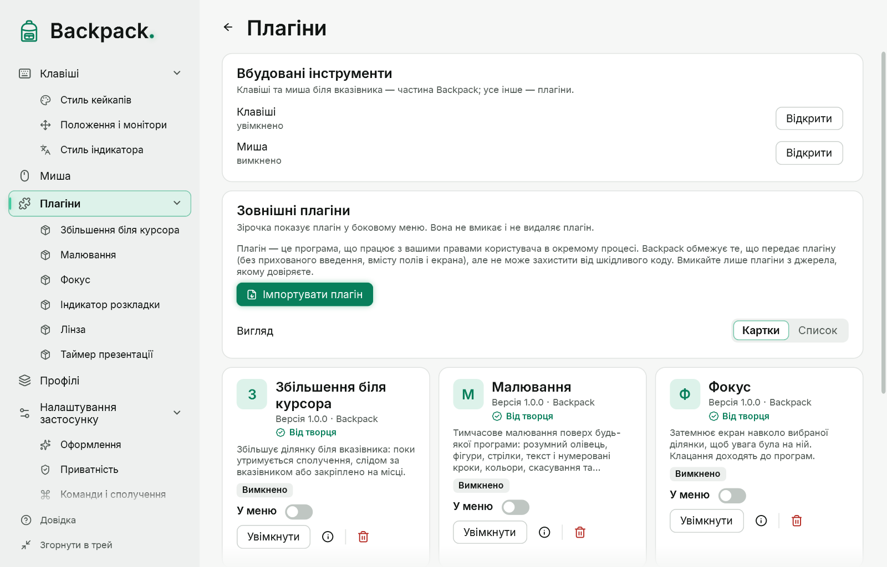

# Плагіни

## Встановлення

«Плагіни» → «Імпортувати плагін» → виберіть файл `.bppkg`. Backpack перевіряє пакет (шляхи, розміри, дублікати, `manifest.json`, вхідну збірку, сумісність SDK) і розпаковує його. **Імпорт не запускає жодного коду і не надає довіри.** Новий або оновлений плагін встановлюється вимкненим.

| Дія | Де |
|---|---|
| Докладно, налаштування, команди | значок «Докладно» або пункт плагіна із зірочкою в боковому меню |
| Увімкнути / вимкнути | «Увімкнути» (текстова кнопка: веде до підтвердження довіри) / значок живлення |
| Оновити | імпортувати новішу версію того самого плагіна (стара або та сама версія відхиляється) |
| Видалити | значок кошика, відокремлений від інших (просить підтвердження; налаштування теж видаляються) |
| Показувати в боковому меню | зірочка «У меню» — вона не вмикає і не видаляє плагін |

Клавіші й миша біля вказівника — частина Backpack. Усе інше — плагіни: **Малювання, Індикатор розкладки, Збільшення біля курсора, Лінза, Фокус і Таймер** постачаються з Backpack як **плагіни від творця**. Під час запуску Backpack додає їх до каталогу вимкненими, не запускаючи їхній код; шукати пакети не потрібно. Вони мають позначку **Від творця**: встановлений пакет збігається з індексом постачання цієї версії Backpack за контрольною сумою SHA-256. Позначка не залежить від імені автора в manifest і не є криптографічним підписом видавця; пакет, який ви імпортуєте самі, позначки не має.

Після оновлення з попередньої версії налаштування, сполучення і пункти меню колишніх вбудованих інструментів переходять до цих плагінів, про це з’являється повідомлення, а плагіни лишаються вимкненими, доки ви їх не ввімкнете. Плагін, який ви ввімкнули, лишається ввімкненим після оновлення, що постачається з Backpack. Видалений вами плагін від творця сам не повертається: у картці «Плагіни від творця, які не встановлено» є «Додати знову».

### Картки або список



Встановлені плагіни типово показано **картками**: іконка (або перша літера назви на плитці, якщо в пакеті немає іконки), назва, версія й автор, короткий опис, стан — увімкнено, вимкнено або помилка (наприклад, «вимкнено після повторних збоїв») — перемикач «У меню», «Докладніше», «Увімкнути / Вимкнути» і «Видалити». У сітці стільки стовпців, скільки вміщується; довгі назви й описи переносяться або скорочуються з підказкою. **Список** показує те саме рядками. Вибір запам’ятовується.

### Значок плагіна

Кожен плагін показує значок у боковому меню, на картці й у шапці своєї сторінки. Автор вибирає його в `manifest.json` (`"symbol"`, назва одного зі значків, вбудованих у Backpack). Щоб вибрати свій: відкрийте сторінку плагіна → «Відображення» → «Вибрати значок», знайдіть потрібний за словом (pen, timer, search…) і клацніть. Ваш вибір зберігається під час оновлення плагіна; «Повернути значок автора» повертає авторський. Значки малює Backpack: плагін не може завантажувати для них картинки з інтернету. Зірочки серед значків немає — у меню вона означає «У меню».

Перегляд карток читає лише `manifest.json` і картинку іконки: код плагіна не запускається. Перше вмикання плагіна, як і раніше, просить підтвердити довіру; картка цього не оминає й можливостей не надає.

## Довіра

Плагін — це програма. Перед першим запуском Backpack просить підтвердити, що ви йому довіряєте. Плагін працює в **окремому процесі** з вашими правами користувача; якщо він збоїть або зависає, Backpack працює далі. Три збої за 10 хвилин вимикають плагін. Щоб запустити Backpack без плагінів, виконайте `Backpack.exe --no-plugins`.

Чого Backpack **не передає** плагіну: введення, прихованого динамічною приватністю, сирих хуків клавіатури, вмісту полів, текстів і заголовків вікон, історії вказівника, екрана. Плагін із можливістю «видимі клавіші» отримує лише назви клавіш, що пройшли фільтр приватності.

Чого Backpack **не може**: захистити від шкідливого коду. Окремий процес — не пісочниця: плагін може те саме, що будь-яка запущена вами програма. Вмикайте лише плагіни з джерела, якому довіряєте.

Імпорт профілю ніколи не встановлює, не довіряє і не запускає плагін.

## Створення плагіна

Потрібен .NET 10 SDK. Приклади — шість плагінів від творця: вихідний код у `lab/samples` (папка `Samples` у пакеті Backpack), готові пакети в `Plugins`:

| Приклад | Що показує |
|---|---|
| `Drawing` | `overlay.draw` — полотно малювання хоста, команди `whileTool` (F2 лише під час малювання), `UpdateSettings` |
| `LayoutIndicator` | `input.layout` і `overlay.indicator` — зміни розкладки та індикатор, який малює хост |
| `CursorZoom` | `overlay.magnifier`, команда утримання (`hold`) і два перемикачі |
| `Lens` | `overlay.magnifier` з окремою ділянкою-джерелом |
| `Focus` | `overlay.dim` — затемнення навколо ділянки |
| `PresentationTimer` | `overlay.panel` з кнопками, станом і панеллю, яку можна переміщувати |

```powershell
dotnet build lab/samples/Drawing/Drawing.csproj -c Release
powershell -ExecutionPolicy Bypass -File tools/pack-plugin.ps1 -Project lab/samples/Drawing/Drawing.csproj -Out artifacts/plugins
```

Результат — `artifacts/plugins/<id>-<version>.bppkg`.

Плагін — бібліотека класів .NET, що посилається на `Backpack.Sdk` (до пакета не копіюється: її надає Backpack) і має клас, похідний від `BackpackPlugin`:

| Метод | Коли |
|---|---|
| `OnStart()` | плагін увімкнено |
| `OnCommand(id)` | користувач виконав команду з manifest |
| `OnSettingsChanged()` | користувач змінив налаштування; значення — у `Context.Settings` |
| `OnVisibleKey(key, down)` | лише з `input.visible`: клавіша, що пройшла фільтр приватності |
| `OnCommandReleased(id)` | відпущено сполучення команди з `"hold": true` |
| `OnToolClosed(tool, reason)` | інструмент хоста закрито (Esc, блокування, вимкнення, `busy` — полотно зайняте іншим плагіном) |
| `OnPanelButton(id)` | натиснуто кнопку панелі |
| `OnLayoutChanged(e)` | SDK 1.2, лише з `input.layout`: код, назва розкладки та причина (`switch` або `window`) |
| `OnToolState(tool, values)` | SDK 1.2: користувач змінив відкритий інструмент на ньому самому (для малювання: інструмент, колір, товщина, місце панелі) |
| `OnStop()` | плагін вимкнено або Backpack завершується |

`Context.ShowPanel(title, text, progress)` показує панель поверх екрана (потрібна `overlay.panel`); малює її Backpack. `Context.UpdateSettings(values)` (SDK 1.2) записує власні значення налаштувань плагіна, перевірені за manifest. Методи мають швидко повертати керування.

### Інструменти хоста (SDK 1.1 і 1.2)

`Context.OpenMagnifier(id, request)` відкриває збільшення, яке малює Backpack: біля вказівника, закріплене або з ділянкою-джерелом (`overlay.magnifier`); `Context.OpenDim(id, request)` затемнює навколо ділянки (`overlay.dim`). SDK 1.2 додає `Context.OpenDrawing(id, request)` і `Context.DrawAction(id, action)` — полотно малювання з панеллю, радіальним меню, фігурами, розумним олівцем, текстом, номерами, кольорами, скасуванням і знімками (`overlay.draw`, одне полотно водночас) — та `Context.ShowIndicator(request)` — короткий код із другим рядком у вигляді кейкапів або стилі індикатора (`overlay.indicator`). `Context.EditTool(id)` показує керування інструментом, `Context.CloseTool(id)` закриває його. **Плагін не отримує ні зображення екрана, ні малюнків, ні координат вказівника** — лише повідомлення, коли інструмент закрито або користувач змінив його параметри. Панель (`overlay.panel`) може мати кнопки, стан (`normal`, `warning`, `finished`), акцент і переміщуватися; кнопки й ручки з’являються під час наведення через спільний механізм хоста.

### manifest.json

| Поле | Значення |
|---|---|
| `format`, `formatVersion` | `backpack-plugin`, `1` |
| `id` | у стилі зворотного домену, малими літерами: `com.example.timer`; `backpack.*` зарезервовано |
| `name`, `description` | текст або `{ "en", "uk", "ru" }` |
| `author`, `version` | версія — `1.2.3` або `1.2.3-beta` |
| `sdk` | потрібна версія SDK, наприклад `1.2` |
| `entry`, `type` | шлях до збірки в пакеті та ім’я класу |
| `capabilities` | `commands`, `settings`, `overlay.panel`, `overlay.magnifier`, `overlay.dim`, `overlay.draw`, `overlay.indicator`, `input.layout`, `input.visible`, `screen` |
| `dependencies`, `resources`, `locales`, `license` | інші збірки, файли в пакеті, мови, текст ліцензії |
| `icon` | необов’язково: `.png` у пакеті (зазначений у `resources`, до 256 КБ) для картки плагіна |
| `commands` | `{ "id", "title" }` — у «Командах і сполученнях» як `plugin.<id>.<команда>`; необов’язково `hold`, а в SDK 1.2 — `whileTool` (сполучення діє лише поки відкритий інструмент плагіна), `hotkey` (за замовчуванням) і `icon` |
| `settings` | поля `toggle`, `number` (`min`, `max`), `text`, `choice` (`choices`), `color` з `default`; `group`, `hint`, `showWhen`, а в SDK 1.2 — `hidden` (зберігається, не показується) — сторінку малює Backpack |
| `preview` | демонстрація, яку малює хост: `magnifier.follow`, `magnifier.region`, `dim`, `panel`, а в SDK 1.2 — `drawing` і `indicator` |

Можливості Backpack перевіряє в кожному повідомленні: панель від плагіна без `overlay.panel` відхиляється; повторні порушення зупиняють плагін. `screen` у цій версії не надається.

### Сумісність

Хост приймає плагін, якщо старший номер SDK збігається, а молодший не новіший за версію Backpack (зараз SDK 1.2): плагіни для 1.0 і 1.1 працюють далі. Пакети: до 64 МБ, 500 файлів, без шляхів із `..`, літер дисків і посилань.

**Обмеження щодо прикладів.** Сам Backpack поширюється за MPL 2.0, а SDK і приклади — ні: для них запропоновано окремі умови, які чекають рішення власника (див. `docs/release/LICENSE-STATUS.md`). До того для них діє PolyForm Strict 1.0.0: приклади можна вивчати й використовувати в некомерційних цілях, але ця ліцензія не дозволяє змінювати їх чи передавати змінені копії. Плагін, написаний вами з нуля, — ваш код під вашою ліцензією.
