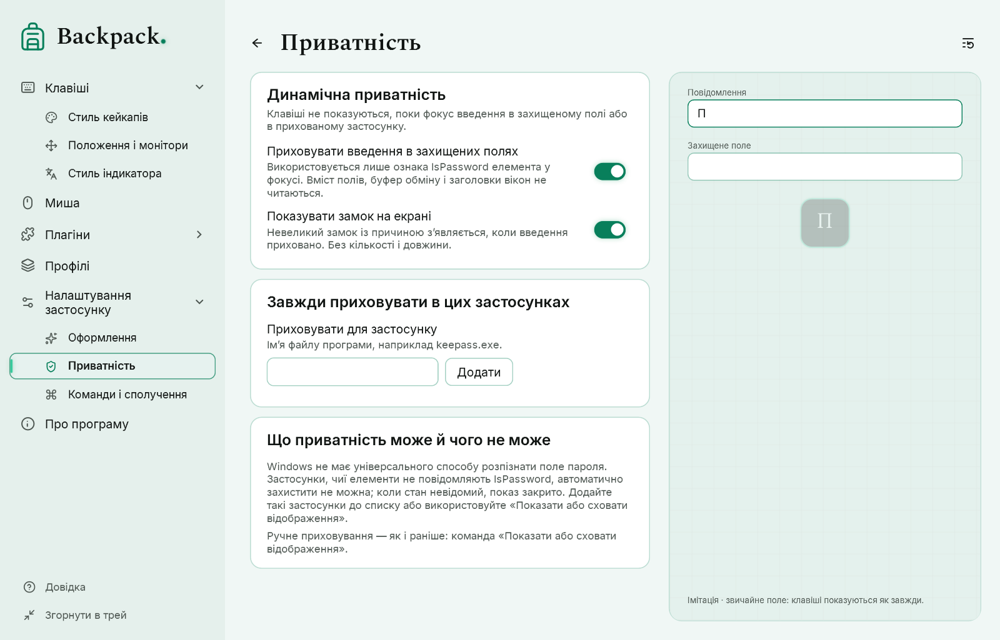

# Приватність, монітори і команди

## Динамічна приватність

«Налаштування застосунку» → «Приватність». Коли фокус введення переходить, Backpack питає Windows UI Automation, чи є елемент у фокусі полем пароля (лише властивість `IsPassword` — ніколи текст, буфер обміну чи заголовок вікна).

| Стан | Відображення |
|---|---|
| Звичайне поле | показується так само, як без приватності: Tab, сполучення з Win і всі інші клавіші |
| Захищене поле | усе приховано, зокрема сполучення; кейкапи на екрані очищуються |
| Приховано для цієї програми | програма у вашому списку: приховано |
| Перевірка | нові натискання чекають відповіді про це поле; вони з’являються, лише якщо саме це поле підтверджено звичайним |
| Немає даних | немає відповіді, помилка, тайм-аут або немає властивості: нові натискання приховано; уже показані клавіші відпускаються звичайно |

- Клавіша належить полю, де її **натиснули**. Tab, натиснутий у звичайному полі, показується, хоча переводить фокус; Win+E та подібні сполучення показуються, хоча відкривають системне вікно.
- Натискання, що чекали, остаточно відкидаються, якщо поле виявилося захищеним, відповіді не було вчасно або фокус пішов далі. Прихований ввід ніколи не з’являється пізніше.
- Поки поле перевіряється після зміни фокусу, нічого ще не показується; вимкнення захисту, поки стан неясний, немає.
- Клавіші, утримувані, поки поле було захищене, не з’являються, коли воно відкривається; показ продовжується з наступного нового натискання. Кнопки миші й далі показуються.
- Плагіни й підписи другої розкладки отримують лише те, що показано.
- За бажанням на екрані з’являється невеликий замок із причиною; він не показує кількість, довжину чи назву поля.
- Backpack ніколи не блокує і не змінює клавіші: його хук клавіатури лише спостерігає за вводом і завжди передає його програмі. UI Automation він питає лише тоді, коли фокус переходить на інший елемент, — один раз і щонайбільше три перевірки потому — і ніколи не опитує програму, в якій ви працюєте. Елемент, що не повідомляє `IsPassword` (наприклад, 3D-вид CAD), вважається «немає даних»: Backpack не показує його клавіші, але програма їх отримує.
- Одразу після запуску, доки підписка UI Automation не готова, звичайне поле не підтверджується: ввід чекає, а потім за потреби приховується.
- **Робочий стіл Windows.** Список значків робочого столу (список Провідника на робочому столі) взагалі не повідомляє `IsPassword`; раніше це означало «немає даних», і натискання на робочому столі приховувалися до переходу в інше вікно. Тепер лише цей список — його перевіряють за класами вікон, процесом Провідника, типом елемента й фреймворком — вважається звичайним елементом: сполучення на робочому столі показуються згідно з налаштуваннями. Перейменування значка — окреме поле з власною перевіркою. Решту Провідника, панель завдань та інші системні вікна безпечними не вважають. Коли елемент не дає даних, Backpack перепитує кожні 1,5 с, тож стан відновлюється без переходу в інше вікно; приховані тим часом натискання пізніше не з’являються.

**Обмеження.** У Windows немає універсального способу розпізнати поля паролів. Багато програм повідомляють `IsPassword` (елементи Windows, WPF, браузери), але деякі — ні або повідомляють неправильно; таку програму розпізнати не можна. Лишається й рідкісна гонка: якщо Windows повідомить про зміну фокусу пізніше, ніж ви вже друкуєте в новому полі, ці клавіші належать попередньому полю. Додайте ризиковані програми до списку (наприклад, `keepass.exe`) або використовуйте «Показати або сховати відображення».

## Монітори

«Клавіші» → «Положення і монітори» (кейкапи) і «Стиль індикатора» (індикатор):

| Вибір | Значення |
|---|---|
| Основний | основний монітор |
| Вибраний | один вибраний монітор |
| Декілька | усі вибрані монітори одночасно |
| Під курсором | монітор, де зараз вказівник миші (не монітор активного вікна) |

Одне джерело введення обслуговує всі вікна. Положення і відступи рахуються від робочої області кожного монітора в його масштабі, зокрема для моніторів із від’ємними координатами. Коли вказівник переходить на інший монітор, кейкапи переносяться без дублів, без перезапуску анімації і без скидання утримань. Якщо збереженого монітора немає (наприклад, профіль з іншого комп’ютера), використовується основний, і сторінка про це повідомляє.

## Команди і сполучення

«Налаштування застосунку» → «Команди і сполучення» містить усі дії; кнопка, трей, радіальне меню і сполучення виконують ту саму команду. Правила й типові сполучення — у розділі [Команди, сполучення і малювання](12-hotkeys-lens-drawing.md).

