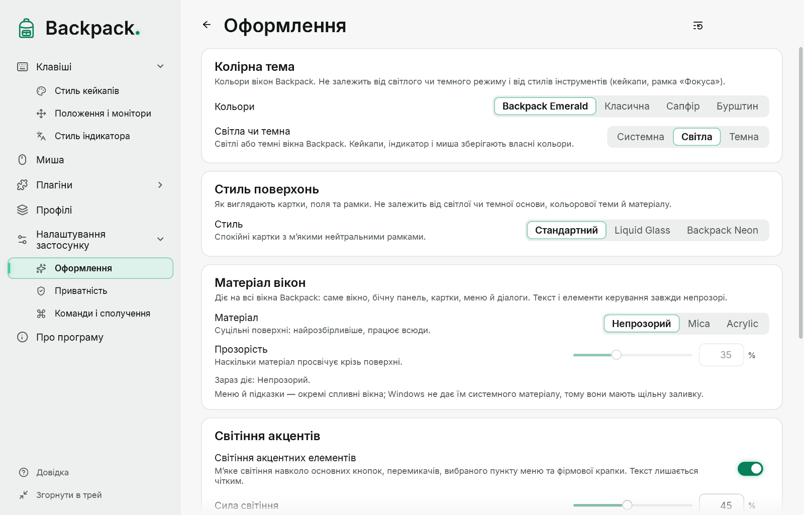
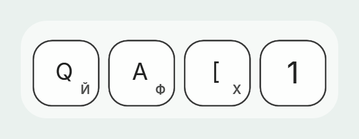

# Вигляд, навігація і шрифти

## Навігація і кнопка «Назад»

Меню ліворуч містить усі сторінки; «Головну» відкриває логотип Backpack над меню (підказка й доступне ім’я — «Головна»). У груп є стрілка: **Клавіші** (Стиль кейкапів, Положення і монітори), **Плагіни** (встановлені плагіни), **Налаштування застосунку** (Оформлення, Приватність, Команди і сполучення). Відкриття групи або однієї з її сторінок розгортає її; поточна сторінка підсвічена й завжди прокручується у видиму частину меню. Смуги прокручування в меню немає — прокручуйте коліщатком, тачпадом або клавіатурою; краї списку м’яко згасають, останній пункт під час прокручування до кінця видно повністю. Кнопки на сторінках, F1, посилання довідки, обрані плагіни й меню трею відкривають ті самі сторінки й тримають меню синхронним.

Стрілка **«Назад»** поруч із заголовком сторінки повертає на попередню сторінку цього вікна; Alt+← і бокова кнопка миші «назад» роблять те саме. На «Головній» її не видно. Перехід на сторінку, яка вже є в історії, не створює циклу, а значення, яке ви вводили, застосовується до зміни сторінки.

Сторінка має дві компоновки. У широкому вікні живе превью — колонка фіксованої ширини праворуч на всю висоту області сторінки; коли місця бракує, сторінка переходить у вертикальну компоновку, і превью стає смугою над параметрами. Елементи ніколи не стискаються: довгі підписи переносяться, елемент, що не вміщується поруч із підписом, переходить під нього, групи кнопок переносяться. Превью ніколи не прокручується разом зі сторінкою. У вузькому вікні меню ліворуч показує лише значки одним стовпчиком із квадратним виділенням; кнопка меню відкриває повне меню поверх сторінки. Найменший розмір вікна — 560 × 440 DIP. Рухомий перегляд обрізається точно по заокругленій рамці за будь-якого розміру вікна й масштабу.

## Заголовок вікна

Головне вікно не має окремої смуги заголовка: великий знак «Backpack.» над меню, заголовок сторінки та кнопки «згорнути», «розгорнути» і «закрити» утворюють один верхній рядок; кнопки лишаються праворуч, а заголовок сторінки залишає їм місце. Ім’я вікна для Alt+Tab, панелі завдань і доступності лишається «Backpack». Поведінка Windows зберігається: перетягування за вільну частину верхнього рядка, подвійне клацання — розгорнути, клацання правою кнопкою або Alt+Space — меню вікна, Alt+F4 — закрити, краї — змінити розмір. У Windows 11 наведення на кнопку «розгорнути» показує макети прив’язки. Діалоги й вікно довідки мають компактну смугу заголовка.

Смарагдова крапка після «Backpack» — частина знака (меню, «Головна», «Про програму»); у Neon і темах-самоцвітах вона м’яко світиться.

## Кольори, світла чи темна

«Налаштування застосунку» → «Оформлення»: **Кольори** — Backpack Emerald, Класична, Сапфір або Бурштин; **Світла чи темна** — Системна, Світла або Темна. Перегляди й ілюстрації йдуть за темою: світла сцена у світлій темі, темна — у темній. Кольори ваших стилів кейкапів, миші й плагінів від теми не змінюються.

Логотип — лише контур рюкзака: зелений у Backpack Emerald, колір акценту в «Сапфірі» й «Бурштині», чорний на світлому й білий на темному в «Класичній». Значок у треї темний на світлій панелі завдань і білий на темній.

## Стиль поверхонь

«Вигляд» розділяє чотири незалежні вибори: **світла чи темна** основа, **кольорова тема**, **стиль поверхонь** і **матеріал із прозорістю**. Будь-яке поєднання працює; це не окремі теми.

| Стиль | Що це |
|---|---|
| Стандартний | спокійні картки з м’якими нейтральними рамками |
| Liquid Glass | скляні картки з відблиском і світлими градієнтними рамками (оформлення Backpack, а не ефект Windows) |
| Backpack Neon | найтемніша основа, тонкі рамки кольору світіння теми (смарагдові в Backpack Emerald), м’яке світіння активних елементів |

У Neon рамки зберігають ієрархію: картки спокійні, поля помітніші, вибране й клавіатурний фокус — найяскравіші; текст ніколи не світиться. Світлий Neon має власні кольори, а не інверсію темного. Світіння можна вимкнути або послабити («Світіння акцентів»). У режимі високої контрастності діє стандартний стиль.

## Матеріал вікна

| Матеріал | Що це |
|---|---|
| Непрозорий | Суцільні поверхні: найчитабельніший варіант, працює всюди |
| Mica | Системний матеріал Windows (Windows 11 22H2 або новіша) |
| Acrylic | Системний матеріал Windows із розмитим виглядом того, що за вікном |

**Прозорість** задає, наскільки матеріал просвічує. Змінюються лише поверхні: текст і елементи керування завжди непрозорі. Рядок під вибором каже, який матеріал діє зараз. Якщо ефекти прозорості у Windows вимкнені, увімкнена висока контрастність або Windows старіша, діє непрозорий вигляд. Меню й підказки — окремі спливні вікна без системного матеріалу: у них щільна заливка. Профіль попередньої версії з матеріалом Liquid Glass відкривається як Acrylic зі стилем Liquid Glass.

## Світіння акцентів

У темах-самоцвітах (Emerald, Сапфір, Бурштин) і в стилі Neon з будь-якою темою основні кнопки, перемикачі, вибраний пункт меню та фірмова крапка м’яко світяться. За замовчуванням світіння увімкнене; силу можна змінити. Світіння малюється під елементом, тому текст лишається чітким. У «Класичній» зі стилями «Стандартний» чи Liquid Glass і в режимі високої контрастності світіння немає.

## Шрифти

У кожному з двох виборів лише два варіанти: **Стандартний** (вбудований Inter) і **Spectral** (вбудований у Backpack, у Windows не встановлюється).

- **Шрифт заголовків** («Оформлення») — заголовок сторінки, великі заголовки довідки й назва «Backpack». Решта тексту — параметри, підказки, кнопки, заголовки карток, меню — завжди стандартним шрифтом для кращої читабельності.
- **Шрифт кейкапів** («Стиль кейкапів») — написи на кейкапах та індикаторі розкладки.

Обидва незалежні, зберігаються в профілі й застосовуються одразу. Іконки й символи клавіш — малюнки й від шрифту не залежать. Spectral містить українські, англійські й російські літери та цифри; символи, яких у ньому немає (стрілки, ⌘ ⌥ ⇧, грецькі), беруться з Inter або Segoe UI, тож нічого не зникає. Профілі попередніх версій з іншим установленим шрифтом переходять на «Стандартний».

## Друга розкладка на кейкапах

«Стиль кейкапів» → «Друга розкладка на кейкапах». Великий підпис лишається англійським; маленький символ іншої розкладки з’являється у вибраному куті — за замовчуванням праворуч унизу — з помітним проміжком і безпечним відступом від краю.

- **Активна розкладка** — розкладка програми, в якій ви друкуєте (а не Backpack). Коли вона англійська, нічого не додається.
- **Вибрана розкладка** — завжди вибрана з установлених у Windows.
- **Розмір основного підпису** і **розмір малого підпису** задаються часткою лицьової поверхні кейкапа, тож працюють і після зміни розміру кейкапів; із двома підписами основна літера за замовчуванням трохи менша.
- **Кут** і **горизонтальний та вертикальний зсув** (від −15 % до +35 % грані від безпечної точки біля кута; додатний — до центру) розміщують малий підпис. Обидва підписи завжди лишаються всередині грані й не закривають позначки R/num, символи модифікаторів і лічильник натискань.
- Символ — те, що надруковано на клавіші, без Shift, Caps Lock і AltGr; мертва клавіша показує свій діакритичний знак. Клавіші без одного зрозумілого символу (IME, службові, цифровий блок) підпису не отримують. Читання символу ніколи не змінює стан клавіатури жодної програми.
- Налаштування — частина стилю кейкапа і профілю. Зсуви з попередньої версії під час відкриття профілю скидаються, щоб нове розміщення не виштовхнуло літери за грань.
- Приватність діє першою: приховані клавіші підписів не отримують зовсім.
